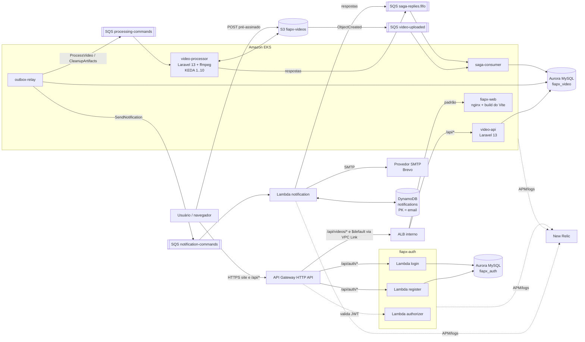
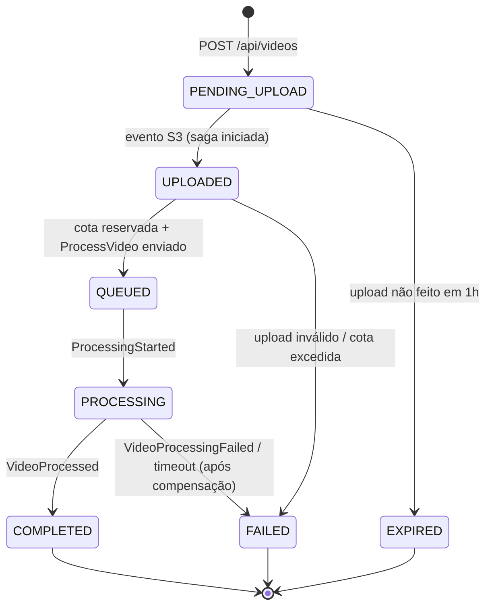
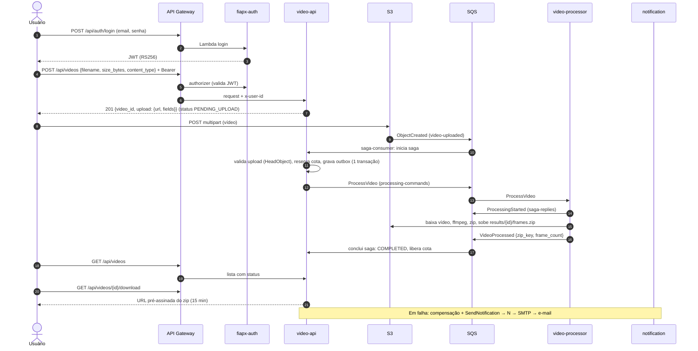
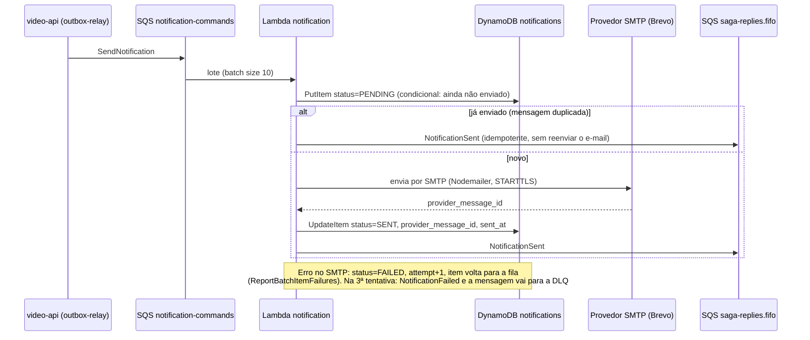
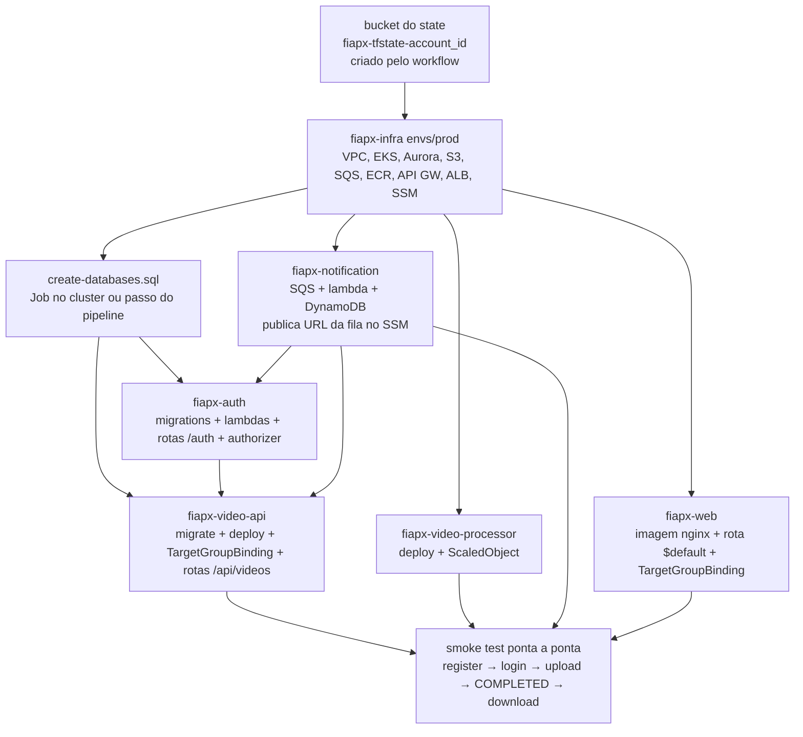

# Projeto Hackathon FIAP X — Especificação para o Agente Executor

> **Para quem é este documento:** um agente de IA (ou dev) que vai **criar do zero** todos os repositórios,
> a documentação, a infraestrutura e o código do Hackathon da Fase 5 (POSTECH SOAT).
> Leia o documento inteiro antes de começar. Siga a ordem das etapas (§12) e **pare nos pontos de aprovação**.
>
> Fontes: `POSTECH - SOAT - Fase 5 - Hacka.pdf` (enunciado, na raiz deste workspace e em `/Applications/XAMPP/xamppfiles/htdocs/pos/tech-challenge-application/docs/Fase5/`),
> `FASE5.md` (análise inicial) e as entregas das Fases 1–4 em `/Applications/XAMPP/xamppfiles/htdocs/pos/tech-challenge-application/docs/Fase1` … `Fase4`
> (repositório `tech-challenge-application`, padrões já adotados pelo time).

---

## Sumário

1. [Contexto e objetivo](#1-contexto-e-objetivo)
2. [Requisitos (enunciado)](#2-requisitos-enunciado)
3. [Stack obrigatória e decisões fechadas](#3-stack-obrigatória-e-decisões-fechadas)
4. [Repositórios](#4-repositórios)
5. [Arquitetura](#5-arquitetura)
6. [SAGA orquestrada do processamento](#6-saga-orquestrada-do-processamento)
7. [Mensageria e contratos](#7-mensageria-e-contratos)
8. [Especificação por repositório](#8-especificação-por-repositório)
9. [Banco de dados](#9-banco-de-dados)
10. [Observabilidade](#10-observabilidade)
11. [CI/CD e fluxo de deploy](#11-cicd-e-fluxo-de-deploy)
12. [Plano de execução para o agente](#12-plano-de-execução-para-o-agente)
13. [Regras para o agente](#13-regras-para-o-agente)
14. [Entregáveis finais e checklist](#14-entregáveis-finais-e-checklist)

---

## 1. Contexto e objetivo

A empresa fictícia **FIAP X** tem um protótipo que recebe um vídeo, extrai um frame por segundo com
`ffmpeg` e devolve as imagens em um `.zip`. O protótipo (projeto base) é um único `main.go` (Go + Gin)
que:

- processa o vídeo **de forma síncrona** dentro do `POST /upload`;
- grava tudo em **disco local** (`uploads/`, `outputs/`, `temp/`);
- não tem **autenticação**, **banco de dados**, **fila**, **testes** nem **tratamento de falhas**;
- tem um Dockerfile marcado como "exemplo de como NÃO fazer".

Lógica a preservar do projeto base (é o "core" do negócio):

```bash
ffmpeg -i <video> -vf fps=1 -y <tempDir>/frame_%04d.png   # extrai 1 frame/s
# zipa todos os frame_*.png em frames_<id>.zip
# formatos aceitos: mp4, avi, mov, mkv, wmv, flv, webm (os mesmos do projeto base)
```

**Objetivo:** reconstruir o sistema como uma solução distribuída, escalável e resiliente na AWS, aplicando
DDD + Clean Architecture, microsserviços, mensageria, SAGA, testes, CI/CD e observabilidade.

---

## 2. Requisitos (enunciado)

### Funcionais

| ID | Requisito | Como atendemos |
|---|---|---|
| RF1 | Processar **mais de um vídeo ao mesmo tempo** | Workers no EKS escalados pelo tamanho da fila (KEDA). Cada pod processa 1 vídeo e N pods rodam em paralelo |
| RF2 | Em picos, **não perder nenhuma requisição** | Upload direto ao S3 + evento S3 → SQS (durável) + outbox transacional + DLQ + consumidores idempotentes |
| RF3 | Sistema protegido por **usuário e senha** | API Gateway + Lambda Node.js (register/login, bcrypt, JWT RS256) + Lambda Authorizer |
| RF4 | **Listagem de status** dos vídeos do usuário | `GET /api/videos` paginado e filtrado pelo usuário do token |
| RF5 | Em caso de erro, **notificar o usuário** | A SAGA envia o comando `SendNotification` → Lambda de notificação → e-mail por SMTP num provedor externo (Brevo) |

### Técnicos

| ID | Requisito | Como atendemos |
|---|---|---|
| RT1 | Persistir os dados | Aurora MySQL (dados) + S3 (arquivos) |
| RT2 | Arquitetura escalável | EKS + HPA (API) + KEDA (worker) + serviços gerenciados (SQS, S3, Aurora, Lambda) |
| RT3 | Versionado no GitHub | Um repositório por serviço (§4) |
| RT4 | Testes que garantam a qualidade | Cobertura ≥ 80% por repositório, BDD da SAGA, SonarCloud com Quality Gate no CI |
| RT5 | CI/CD | GitHub Actions por repositório, autenticação na AWS com as credenciais do lab em GitHub Secrets, deploy automático na `main` |

### Entregáveis do enunciado

- Documentação da arquitetura proposta.
- Script de criação do banco de dados e dos demais recursos.
- Link do GitHub do(s) projeto(s).
- Vídeo de **até 10 minutos** mostrando a documentação, a arquitetura escolhida e o projeto funcionando.

---

## 3. Stack obrigatória e decisões fechadas

| Tema | Decisão (fechada pelo time) |
|---|---|
| Cloud | **AWS**, numa conta da **AWS Academy Learner Lab** (região `us-east-1`), com as restrições do ADR-019: sem roles próprias (tudo usa a `LabRole`), sem OIDC, SES, CloudFront, spot nem CloudWatch Metric Streams |
| IaC | **Terraform** (≥ 1.10), backend remoto S3 com lock nativo (`use_lockfile = true`); o bucket `fiapx-tfstate-<account_id>` é criado pelo próprio workflow, sem bootstrap manual |
| Autenticação | **API Gateway (HTTP API) + Lambda em Node.js** (runtime Node.js 24). Usuários em banco próprio no Aurora, senha com bcrypt, **JWT RS256** |
| Aplicação principal | **PHP 8.4.27 + Laravel 13**, em **Docker** no **EKS** (Kubernetes) |
| Worker de processamento | **PHP 8.4.27 + Laravel 13** em repositório próprio, no EKS, com `ffmpeg` na imagem, escalado por **KEDA** pela fila |
| Banco | **Aurora MySQL** (v3, compatível com MySQL 8.0), provisionado `db.t3.medium`, uma instância (o lab nega `db.serverless`, ADR-019). **Um database por serviço** no mesmo cluster |
| Arquivos | **Amazon S3** (vídeos e zips) |
| Fila | **Amazon SQS** (todo o processamento passa pela fila) + DLQ |
| Arquitetura de código | **DDD + Clean Architecture** |
| Processamento | **SAGA orquestrada pela aplicação principal** (Laravel), com estado da saga no Aurora e comandos e respostas via SQS |
| Observabilidade | **New Relic** (APM PHP, Kubernetes, Lambda, logs e alertas) + **CloudWatch** para os serviços gerenciados (SQS, DLQs, Aurora, API Gateway), com alarmes num tópico SNS com e-mail do time |
| Notificação | **SQS → Lambda Node.js → SMTP externo** (Nodemailer; provedor **Brevo** por padrão, Mailpit no local), com registro de cada envio em **DynamoDB** (partition key = `email`), em repositório próprio |
| Front-end | SPA mínima **React + Vite + TypeScript + Tailwind**, servida por um pod **nginx** no EKS, em repositório próprio, na **mesma origem** da API: a URL (HTTPS) do API Gateway, cuja rota `$default` leva ao site (ADR-019) |
| Repositórios | Organização GitHub **[hackathon-fiap-soat](https://github.com/hackathon-fiap-soat)** |
| CI/CD | **GitHub Actions** com as credenciais temporárias da sessão do lab em **GitHub Secrets** (`AWS_ACCESS_KEY_ID`, `AWS_SECRET_ACCESS_KEY`, `AWS_SESSION_TOKEN`), atualizadas a cada sessão. `terraform apply` **só via GitHub Actions**, sem exceção; apply local só no LocalStack (§11.5) |
| Documentação | **Primeiro**: Domain Storytelling, ADRs, RFCs, fluxo de deploy, C4, sequência, contratos |

### Decisões técnicas derivadas (o agente deve segui-las e registrá-las em ADR)

1. **Upload direto ao S3 com POST pré-assinado** (`content-length-range` limita o tamanho). O vídeo **não passa
   pelo API Gateway**, que tem limite de payload de 10 MB e timeout de 30 s.
2. **A SAGA começa pelo evento do S3** (`s3:ObjectCreated` → SQS), não por uma chamada do cliente. Se o
   cliente cair depois do upload, o vídeo continua sendo processado.
3. **Contratos de mensagens em JSON puro, com versão** (não usar jobs serializados do Laravel entre
   serviços), porque o worker e as Lambdas precisam ler as mesmas mensagens.
4. **Saídas da infra publicadas no SSM Parameter Store** (`/fiapx/<env>/...`). Os outros repositórios leem dali,
   sem `terraform_remote_state`, o que diminui o acoplamento entre repositórios.
5. **API Gateway → VPC Link → ALB interno.** O ALB e o Target Group são criados pelo Terraform, e o
   `video-api` se registra nele com `TargetGroupBinding` (AWS Load Balancer Controller). Isso evita o
   problema de "ovo e galinha" entre Terraform e Kubernetes.
6. **Uma imagem/pod processa um vídeo por vez.** A concorrência vem do número de pods (KEDA). Durante o
   `ffmpeg`, o worker estende o visibility timeout da mensagem (heartbeat).
7. **UUID v7** gerado no domínio (`ramsey/uuid`, que é biblioteca e não framework) para todas as entidades.
8. **Site e API na mesma origem, pelo API Gateway** (ADR-019, o lab nega o CloudFront e o Block Public Access
   da conta impede bucket público): o front-end é uma imagem nginx (`nginxinc/nginx-unprivileged`) com o
   build do Vite, no ECR `fiapx-web`, com Deployment, Service e `TargetGroupBinding` no namespace `fiapx`. O
   ALB interno tem um 2º target group, `fiapx-<env>-web`: a regra `/api/*` vai para o video-api e o padrão do
   listener vai para o site. O `fiapx-web` cria a rota `$default` do HTTP API (sem authorizer), integrada ao
   ALB pelo VPC Link; as rotas específicas têm prioridade. O usuário acessa tudo pela URL do API Gateway
   (`https://<api_id>.execute-api.us-east-1.amazonaws.com`), com HTTPS, e o front usa
   `VITE_API_BASE_URL=/api`: **sem CORS na API**. O bucket de vídeos tem CORS para o `POST` de upload com
   essa origem. **Todas as rotas públicas ficam sob o prefixo `/api`**: `/api/auth/register`,
   `/api/auth/login`, `/api/videos`... No Laravel, isso é o prefixo padrão de `routes/api.php`.
   **Neste documento, toda rota pública é escrita com o prefixo `/api`.**
9. **`LabRole` para toda identidade** (ADR-019): cluster EKS, nós, pods (credenciais dos nós pelo IMDS, sem
   Pod Identity), KEDA (`identityOwner: keda`), AWS Load Balancer Controller e Lambdas. O Terraform lê a role
   com `data "aws_iam_role"` e não cria nenhuma. As políticas de menor privilégio por serviço ficam
   documentadas em `03-arquitetura/seguranca.md` como desenho para uma conta própria, não aplicado no lab.

---

## 4. Repositórios

Prefixo `fiapx-`. Todos na organização **<https://github.com/hackathon-fiap-soat>**. Todos com `main` protegida, PR
obrigatório (aprovação opcional), checks obrigatórios (testes + Sonar) e acesso ao usuário `soat-architecture`.

| # | Repositório | Responsabilidade | Stack |
|---|---|---|---|
| 1 | `fiapx-docs` | Toda a documentação: Domain Storytelling, C4, sequência, ADRs, RFCs, fluxo de deploy, contratos de mensagens (JSON Schema), OpenAPI consolidado, documento de entrega | Markdown + Mermaid + JSON Schema |
| 2 | `fiapx-infra` | VPC, EKS (com add-ons), Aurora, S3 (vídeos), SQS/DLQ, ECR (inclui o do site), API Gateway + VPC Link + ALB interno, Secrets, SSM outputs, orquestrador de deploy, ambiente local (docker-compose + LocalStack) | Terraform + Helm |
| 3 | `fiapx-auth` | Lambdas de **register**, **login**, **password** (recuperação e troca de senha) e **authorizer**, rotas `/api/auth/*` no API Gateway, schema `fiapx_auth` | Node.js 24 + Terraform |
| 4 | `fiapx-video-api` | Aplicação principal: gestão de vídeos, URLs pré-assinadas, listagem de status, download, **orquestrador da SAGA**, outbox, consumidores de eventos/respostas, schema `fiapx_video`, rotas `/api/videos*` (`infra/`) | PHP 8.4.27 + Laravel 13 + Docker + manifests K8s + Terraform |
| 5 | `fiapx-video-processor` | Worker: consome `ProcessVideo`/`CleanupArtifacts`, baixa o vídeo, `ffmpeg` → frames → zip → S3, responde à SAGA | PHP 8.4.27 + Laravel 13 + ffmpeg + Docker + manifests K8s + KEDA |
| 6 | `fiapx-notification` | Fila SQS própria → Lambda que envia e-mail por SMTP (Brevo) e registra cada envio no DynamoDB (chave = e-mail); responde à SAGA | Node.js 24 + Nodemailer + DynamoDB + Terraform |
| 7 | `fiapx-web` | Front-end mínimo: cadastro, login, upload (múltiplos vídeos), lista de status e download. Prompt de layout em [`Prompt-layout-web.md`](Prompt-layout-web.md) | React + Vite + TypeScript + Tailwind, nginx no EKS + Terraform (rota `$default`) |

> Os manifests Kubernetes ficam **no repositório de cada serviço** (`k8s/`). O `fiapx-infra` cria só o cluster e
> os add-ons compartilhados.

---

## 5. Arquitetura

### 5.1 Visão de containers (C4 nível 2)



Cada fila tem DLQ própria (`*-dlq`), com `maxReceiveCount = 3` (`5` na `video-uploaded`).

### 5.2 Bounded contexts

| Contexto | Serviço | Linguagem ubíqua |
|---|---|---|
| **Identidade** | `fiapx-auth` | Usuário, Credencial, Token de acesso |
| **Gestão de Vídeos** | `fiapx-video-api` | Vídeo, Status do vídeo, Cota de processamento, Saga de processamento, Link de download |
| **Processamento** | `fiapx-video-processor` | Tarefa de processamento, Frame, Pacote de frames (zip), Artefato |
| **Notificação** | `fiapx-notification` | Notificação, Destinatário, Modelo de mensagem |

### 5.3 Ciclo de vida do vídeo



### 5.4 Fluxo principal (sequência)



### 5.5 Rede e segurança

- VPC em 2 AZs: subnets públicas (NAT único para reduzir custo, ALB não), privadas (EKS, Lambdas, Aurora).
- Aurora e ALB **somente** em subnets privadas. O ALB interno só é alcançável pelo VPC Link.
- Lambdas de auth/notification **dentro da VPC** (acesso ao Aurora); VPC endpoints para S3, DynamoDB, SQS,
  Secrets Manager e SSM (o provedor SMTP é acessado pelo NAT, porta 587 com STARTTLS).
- IAM: no lab, toda identidade usa a **`LabRole`** (pods pelas credenciais dos nós via IMDS, com
  `http_put_response_hop_limit = 2`; KEDA com `identityOwner: keda`). Risco aceito e desenho de menor
  privilégio para conta própria (Pod Identity por serviço) em `03-arquitetura/seguranca.md`.
- Chave privada do JWT no **Secrets Manager** (só a Lambda de login lê). A chave pública fica no SSM (o
  authorizer e o `video-api` leem para validar o token também na aplicação, como defesa em profundidade).
- Bucket S3: Block Public Access, SSE-S3, CORS só para `POST` de upload, lifecycle (`uploads/` expira em
  7 dias; `results/` em 30 dias).

---

## 6. SAGA orquestrada do processamento

O **orquestrador vive no `fiapx-video-api`**: o agregado `ProcessingSaga` guarda o estado no
`fiapx_video.processing_sagas`. Ele reage a mensagens (upload, respostas) e emite comandos pela **outbox**.

### 6.1 Passos

| # | Passo | Participante | Ação | Sucesso | Falha | Compensação |
|---|---|---|---|---|---|---|
| 1 | `ValidateUpload` | video-api (local) | `HeadObject`: existe, tamanho ≤ 500 MB, extensão/MIME permitidos (mp4, avi, mov, mkv, wmv, flv, webm) | segue | `FAILED` (motivo `INVALID_UPLOAD`) | `DeleteUploadedObject` |
| 2 | `ReserveQuota` | video-api (local) | reserva 1 vaga na cota de processamentos simultâneos do usuário (padrão 5) | segue | `FAILED` (motivo `QUOTA_EXCEEDED`) | `ReleaseQuota` |
| 3 | `ProcessVideo` | video-processor | comando via `processing-commands` | `VideoProcessed` | `VideoProcessingFailed` ou **timeout** (padrão 30 min) | `CleanupArtifacts` (apaga `results/{id}/` parcial) |
| 4 | `CompleteVideo` | video-api (local) | `COMPLETED`, grava `zip_key`/`frame_count`, libera cota | — | — | — (**ponto sem retorno**: daqui em diante só há retry) |
| 5 | `NotifyUser` | notification | `SendNotification` (`VIDEO_COMPLETED` opcional, `VIDEO_FAILED` obrigatório) | `NotificationSent` | `NotificationFailed` → retry e DLQ | não compensa (passo após o ponto sem retorno) |

### 6.2 Caminho de falha

```text
Falha no passo N → compensações dos passos < N em ordem inversa
                → vídeo FAILED com failure_reason
                → SendNotification(VIDEO_FAILED)   ← atende RF5
```

Exemplo: o `ffmpeg` falha 3 vezes → o worker responde `VideoProcessingFailed` → a saga envia
`CleanupArtifacts` → recebe `ArtifactsCleaned` → executa `ReleaseQuota` → marca `FAILED` → envia
`SendNotification`.

### 6.3 Estados da saga

`STARTED → UPLOAD_VALIDATED → QUOTA_RESERVED → PROCESSING_REQUESTED → PROCESSING → COMPLETED → NOTIFIED`
e, na falha: `COMPENSATING → COMPENSATED (FAILED) → NOTIFIED`.

### 6.4 Regras de robustez

- **Transactional outbox:** a mudança de estado da saga e o comando a enviar são gravados na **mesma
  transação**. O `outbox-relay` publica e marca `published_at`.
- **Idempotência:** toda mensagem tem `message_id`. O consumidor grava em `processed_messages` na mesma
  transação do efeito. Mensagem repetida vira no-op.
- **Guardas de transição:** o agregado rejeita transições inválidas (por exemplo, `VideoProcessed` em
  saga `COMPENSATING`). A mensagem é descartada com log de warning e não vai para a DLQ.
- **Timeout:** o comando agendado `saga:check-timeouts` (a cada minuto) dispara a compensação das
  sagas `PROCESSING_REQUESTED` ou `PROCESSING` que passaram de `deadline_at` (preenchido em `PROCESSING_REQUESTED` com agora + 30 min e renovado no `ProcessingStarted`).
- **Correlação:** `processing_sagas.correlation_id` (id do evento do S3) é copiado para todos os comandos,
  inclusive os disparados pelo timeout.
- **Limpeza:** `messaging:prune` (diário) apaga mensagens da outbox já publicadas e `processed_messages` com
  mais de 7 dias.
- **Motivo da falha:** banco e mensagens guardam o código (`failure_code`); a API e os e-mails mostram o texto.
- **Contratos:** produtor estrito (schemas com `additionalProperties: false` nos testes do produtor),
  consumidor tolerante (ignora campos desconhecidos). Campo opcional novo é compatível; só mudança
  incompatível gera nova `version`.
- **Worker idempotente:** se `results/{video_id}/frames.zip` já existe, responde `VideoProcessed` sem
  reprocessar.
- **Testes BDD obrigatórios da SAGA:** sucesso; falha no ffmpeg com compensação; timeout; cota excedida;
  upload inválido; mensagem duplicada; resposta fora de ordem.

---

## 7. Mensageria e contratos

### 7.1 Filas (SQS)

| Fila | Tipo | Produtor | Consumidor | Visibility | DLQ |
|---|---|---|---|---|---|
| `fiapx-<env>-video-uploaded` | Standard | S3 (evento) | video-api `saga-consumer` | 60 s | sim (5) |
| `fiapx-<env>-processing-commands` | Standard | video-api `outbox-relay` | video-processor | 300 s + heartbeat | sim (3) |
| `fiapx-<env>-saga-replies.fifo` | FIFO (`MessageGroupId = saga_id`) | processor, notification | video-api `saga-consumer` | 60 s | sim (3) |
| `fiapx-<env>-notification-commands` | Standard (**criada pelo repositório `fiapx-notification`**) | video-api `outbox-relay` | Lambda notification | 60 s | sim (3) |

Alarmes no CloudWatch, integrados ao New Relic: `ApproximateNumberOfMessagesVisible > 0` em qualquer DLQ.

### 7.2 Envelope padrão (todas as mensagens)

```json
{
  "message_id": "0192f1c4-...-uuidv7",
  "type": "ProcessVideo",
  "version": 1,
  "saga_id": "0192f1c4-...",
  "video_id": "0192f1c4-...",
  "correlation_id": "0192f1c4-...",
  "occurred_at": "2026-11-16T12:00:00Z",
  "payload": {}
}
```

### 7.3 Mensagens

| Tipo | Direção | Payload |
|---|---|---|
| `ProcessVideo` | api → processor | `bucket`, `video_key`, `fps` (1), `output_prefix` |
| `CleanupArtifacts` | api → processor | `bucket`, `prefix` |
| `ProcessingStarted` | processor → api | `started_at`, `worker_id` |
| `VideoProcessed` | processor → api | `zip_key`, `frame_count`, `zip_size_bytes`, `duration_ms` |
| `VideoProcessingFailed` | processor → api | `error_code` (`FFMPEG_ERROR`, `NO_FRAMES`, `DOWNLOAD_ERROR`, `UPLOAD_ERROR`), `error_message`, `attempt` |
| `ArtifactsCleaned` | processor → api | `deleted_objects` |
| `SendNotification` | api → notification (vídeo) e auth → notification (senha) | `template` (`VIDEO_FAILED` / `VIDEO_COMPLETED` / `PASSWORD_RESET` / `PASSWORD_CHANGED`), `recipient_email`, `recipient_name`, `video_name` (só templates de vídeo), `reason?`, `action_url` (só `PASSWORD_RESET`). Nos templates de senha, `saga_id` e `video_id` são `null` e não há resposta na `saga-replies.fifo` (ADR-017) |
| `NotificationSent` / `NotificationFailed` | notification → api | `channel`, `provider_message_id?`, `error?` |

O agente deve escrever um **JSON Schema por mensagem** em `fiapx-docs/contracts/` e validar as mensagens
contra esses schemas nos testes de cada serviço (*contract tests*).

---

## 8. Especificação por repositório

### 8.1 `fiapx-docs` (criar PRIMEIRO)

```text
fiapx-docs/
├── README.md                          # índice de toda a documentação
├── 01-contexto/
│   ├── visao-geral.md                 # problema, objetivos, requisitos RF/RT, diagnóstico do projeto base
│   └── linguagem-ubiqua.md            # glossário por bounded context
├── 02-domain-storytelling/
│   ├── README.md                      # notação usada e como abrir no Egon.io
│   ├── ds-01-cadastro-e-login.md
│   ├── ds-02-envio-de-video.md
│   ├── ds-03-processamento-com-sucesso.md
│   ├── ds-04-falha-e-notificacao.md
│   ├── ds-05-consulta-status-e-download.md
│   └── *.egn / *.svg                  # opcional: exportados do Egon.io (o time desenha manualmente)
├── 03-arquitetura/
│   ├── c4-contexto.md                 # Mermaid
│   ├── c4-containers.md
│   ├── c4-componentes-video-api.md
│   ├── sequencias.md                  # login, upload+processamento, falha+compensação, download
│   ├── saga.md                        # passos, estados, compensações, timeouts
│   ├── modelo-de-dados.md             # ER (Mermaid erDiagram) dos dois databases
│   ├── seguranca.md
│   └── escalabilidade-e-resiliencia.md
├── 04-adrs/                           # formato MADR: Contexto, Decisão, Alternativas, Consequências
├── 05-rfcs/                           # formato: Resumo, Motivação, Proposta, Alternativas, Riscos, Decisão
├── 06-deploy/
│   ├── fluxo-de-deploy.md             # pipelines, ordem entre repos, rollback
│   └── ambientes.md                   # local (compose + LocalStack) e prod (AWS), custos e destroy
├── 07-observabilidade/
│   ├── observabilidade.md
│   └── newrelic-dashboard.json
├── contracts/                         # JSON Schema de cada mensagem (§7.3)
├── api/openapi.yaml                   # OpenAPI consolidado (auth + video-api)
└── entrega/
    ├── entrega-fase5.md               # participantes, links, vídeo (→ exportar PDF)
    └── roteiro-video.md               # roteiro de até 10 min
```

**Domain Storytelling** (notação textual, uma história por arquivo, com diagrama Mermaid):
`<nº> <Ator> --<atividade>--> <Objeto de trabalho> --para/com--> <Ator>`. Exemplo para `ds-02`:

```text
1. Usuário  --informa-->  dados do vídeo (nome, tamanho, formato)  --para-->  Plataforma FIAP X
2. Plataforma FIAP X  --cria-->  Vídeo (aguardando envio) e autorização de envio  --para-->  Usuário
3. Usuário  --envia-->  arquivo de vídeo  --para-->  Armazenamento
4. Armazenamento  --avisa-->  chegada do vídeo  --para-->  Plataforma FIAP X
5. Plataforma FIAP X  --valida-->  Vídeo  e  --reserva-->  Cota de processamento
6. Plataforma FIAP X  --coloca-->  pedido de processamento  --na-->  Fila
```

Atores: Usuário, Plataforma FIAP X, Serviço de Identidade, Armazenamento, Fila, Processador,
Serviço de Notificação. Objetos de trabalho: Credencial, Token, Vídeo, Cota, Pedido de processamento,
Frames, Pacote zip, Link de download, E-mail.

**ADRs obrigatórios** (`04-adrs/ADR-NNN-titulo.md`, status `Aceito`; os que o ADR-019 alterou ficam como
"Substituído" ou "Aceito, parcialmente substituído", sem reescrever o registro):

| ADR | Título |
|---|---|
| 001 | Um repositório por serviço (polyrepo) e comunicação entre repositórios via SSM Parameter Store |
| 002 | AWS como cloud e Terraform como IaC, com backend S3 e lock nativo |
| 003 | DDD + Clean Architecture nos serviços Laravel |
| 004 | Autenticação com API Gateway + Lambda Node.js + Lambda Authorizer e JWT RS256 |
| 005 | Aurora MySQL Serverless v2 com um database por serviço no mesmo cluster |
| 006 | Upload direto ao S3 via POST pré-assinado e início da SAGA pelo evento do S3 |
| 007 | Amazon SQS como mensageria (Standard para comandos, FIFO para respostas, DLQ em todas) |
| 008 | SAGA orquestrada no video-api com transactional outbox e consumidores idempotentes |
| 009 | Worker Laravel no EKS escalado por KEDA (1 vídeo por pod, heartbeat de visibility) |
| 010 | Exposição da API: API Gateway → VPC Link → ALB interno + TargetGroupBinding |
| 011 | Observabilidade com New Relic |
| 012 | CI/CD com GitHub Actions + OIDC e ordem de deploy entre repositórios |
| 013 | Notificação: SQS → Lambda Node.js → SES, com histórico e idempotência no DynamoDB (PK `email`, SK `message_id`) |
| 014 | Front-end React + Vite em S3 + CloudFront, com `/api/*` na mesma origem |
| 015 | Remetente de e-mail: domínio próprio no Route 53 com DKIM/SPF/DMARC e uso do sandbox do SES (substituído pelo ADR-019) |
| 016 | `terraform apply` somente via GitHub Actions; apply local apenas para testes (§11.5) |
| 017 | Recuperação e troca de senha no `fiapx-auth`, com e-mail pelo `fiapx-notification` |
| 018 | Orquestração do deploy no GitHub Actions: `deploy-all.yml` e `destroy-all.yml` no `fiapx-infra`, chamando o `deploy.yml` reutilizável de cada repositório |
| 019 | Deploy na AWS Academy Learner Lab: credenciais do lab em GitHub Secrets, `LabRole`, SMTP externo e site no EKS atrás do mesmo API Gateway (substitui o ADR-015 e partes dos ADRs 002, 005, 009–014 e 016) |

**RFCs obrigatórias** (`05-rfcs/RFC-NNN-titulo.md`, cada uma com alternativas comparadas em tabela):

| RFC | Tema | Alternativas a comparar |
|---|---|---|
| 001 | Escolha da cloud e da IaC | AWS+Terraform × GCP × Azure × CloudFormation/CDK |
| 002 | Upload de arquivos grandes | via API × S3 pré-assinado (PUT × POST) × multipart |
| 003 | Estratégia da SAGA | orquestrada no Laravel × Step Functions × coreografia SNS/SQS |
| 004 | Autenticação | Lambda própria + Aurora × Cognito × JWT na aplicação |
| 005 | Escala do processamento | KEDA por fila × HPA por CPU × Lambda container × AWS Batch |
| 006 | Mensageria | SQS × SNS+SQS × RabbitMQ (Amazon MQ) × Kafka (MSK) |
| 007 | Banco de dados e cache | Aurora MySQL × RDS MySQL × Aurora PostgreSQL + Redis (**stack recomendada no enunciado**) × DynamoDB. Justificar a escolha do MySQL e a ausência de Redis |
| 008 | Registro de notificações | DynamoDB × tabela no Aurora × apenas logs |
| 009 | Hospedagem do front-end | S3 + CloudFront × Amplify Hosting × container no EKS |
| 010 | Observabilidade | New Relic × Prometheus + Grafana (**recomendado no enunciado**) × ELK × CloudWatch |

**Fluxo de deploy** (`06-deploy/fluxo-de-deploy.md`): ver §11. Deve ter um diagrama Mermaid da ordem entre
repositórios e um da pipeline de cada tipo de repositório.

### 8.2 `fiapx-infra`

```text
fiapx-infra/
├── modules/
│   ├── network/          # VPC, subnets, NAT, VPC endpoints
│   ├── eks/              # cluster e managed node group on-demand t3.large (2–4) com a LabRole; launch template com hop limit 2 (IMDS)
│   ├── eks-addons/       # Helm: aws-load-balancer-controller, metrics-server, keda, newrelic nri-bundle
│   ├── aurora/           # Aurora MySQL provisionado db.t3.medium, uma instância (aurora_instance_class), subnet group, SG, secret do master, databases
│   ├── storage/          # bucket S3 (módulo s3-bucket, criado pelo AWS CLI), CORS do POST de upload, lifecycle, notificação ObjectCreated → SQS (prefixo uploads/)
│   ├── messaging/        # 3 filas compartilhadas (video-uploaded, processing-commands, saga-replies) + DLQs
│   │                     #   + alarmes do CloudWatch e tópico SNS com e-mail do time
│   │                     #   (a notification-commands é do repositório fiapx-notification, ver §8.6)
│   ├── ecr/              # fiapx-video-api, fiapx-video-processor, fiapx-web (scan on push, lifecycle)
│   ├── edge/             # API Gateway HTTP API, stage, VPC Link, ALB interno, target groups do video-api e do site
│   │                     #   (fiapx-<env>-web, padrão do listener), logs de acesso; o ALB e o ECR atendem o site
│   ├── s3-bucket/        # bucket criado e apagado pelo AWS CLI (a SCP do lab nega s3:GetBucketObjectLockConfiguration)
│   └── ssm-outputs/      # publica tudo em /fiapx/<env>/...
├── envs/prod/            # main.tf, backend.tf (bucket passado no init), variables.tf, terraform.tfvars.example
├── local/
│   ├── docker-compose.yml   # mysql:8.0, localstack 4.14.0 (s3, sqs, ssm, secretsmanager, dynamodb), mailpit
│   └── init/                # scripts que criam bucket/filas/databases no LocalStack/MySQL
├── sql/                     # create-databases.sql (fiapx_auth, fiapx_video, usuários com GRANT mínimo)
└── .github/workflows/       # terraform.yml, deploy-all.yml, destroy-all.yml (o 1º passo cria o bucket do state)
```

Sem `bootstrap/` e sem módulo `ses/` (ADR-019): o bucket do state `fiapx-tfstate-<account_id>` é garantido
pelo primeiro passo de todo job Terraform, nenhuma role é criada (tudo usa a `LabRole`) e o e-mail sai por
SMTP externo, configurado pelo `fiapx-notification`. Não há bucket do site: o site é um pod nginx no EKS,
atrás do ALB e do API Gateway. A SCP do lab nega `s3:GetBucketObjectLockConfiguration`; os buckets são criados
e apagados pelo AWS CLI dentro do Terraform (módulo `s3-bucket`) e as configurações seguem em recursos
`aws_s3_bucket_*`.

Parâmetros SSM publicados (exemplos): `/fiapx/prod/vpc/private_subnet_ids`, `/eks/cluster_name`,
`/aurora/endpoint`, `/aurora/secret_arn`, `/s3/videos_bucket`, `/sqs/<fila>/url`, `/sqs/<fila>/arn`,
`/apigw/api_id`, `/apigw/vpc_link_id`, `/apigw/url`, `/alb/target_group_arn`, `/alb/web_target_group_arn`,
`/ecr/<repo>/url` (inclui `/ecr/fiapx-web/url`), `/web/url` (URL do API Gateway, que também serve o site).
Publicados pelo `fiapx-notification`: `/fiapx/prod/sqs/notification-commands/url` (lido pelo `video-api` e
pelo `fiapx-auth`) e `/fiapx/prod/notification/smtp_host`, `/smtp_port` e `/smtp_secret_arn`.
Catálogo completo (chaves, segredos, quem publica e quem lê): `fiapx-docs/06-deploy/parametros-ssm.md`.

### 8.3 `fiapx-auth` (Node.js 24)

```text
fiapx-auth/
├── src/
│   ├── domain/           # User (entidade), Email e Password (VOs), regras de senha
│   ├── application/      # RegisterUser, AuthenticateUser, VerifyToken (use cases) + ports
│   ├── infrastructure/   # MysqlUserRepository (mysql2), BcryptHasher, JwtRs256Signer, SecretsProvider
│   └── handlers/         # register.js, login.js, password.js, authorizer.js e migrate.js (sem rota: o deploy
│                         #   a invoca para aplicar as migrations dentro da VPC, ADR-019)
├── migrations/           # 001_create_users.sql (schema fiapx_auth)
├── tests/                # jest: unit + integração (MySQL do compose)
├── infra/                # Terraform: lambdas (role de execução = LabRole), rotas /api/auth/*, authorizer
└── .github/workflows/
```

- `POST /api/auth/register` `{name, email, password}` → 201. E-mail único, bcrypt custo 12. **Política de senha**
  (cadastro, redefinição e troca): 8 a 72 caracteres, com pelo menos uma letra maiúscula, um número e um símbolo.
- **Recuperação e troca de senha** (Lambda `password`, ADR-017):
  - `POST /api/auth/password/forgot` `{email}` → sempre 202. Gera token aleatório de 256 bits (só o hash SHA-256 vai
    para `password_reset_tokens`), válido por 30 min e de uso único; invalida os anteriores; publica
    `SendNotification` `PASSWORD_RESET` com o link `<web_url>/redefinir-senha?token=...`. No máximo 1 e-mail a cada
    2 min por usuário.
  - `POST /api/auth/password/reset/verify` `{token}` → 200 `{email_masked, expires_at}` ou 422 genérico.
  - `POST /api/auth/password/reset` `{token, password}` → 200 com JWT (troca e já entra) + `PASSWORD_CHANGED`.
  - `PUT /api/auth/password` `{current_password, new_password}` (com authorizer) → 204 + `PASSWORD_CHANGED`.
  - O token vai sempre no corpo (nunca na URL da API). JWTs emitidos antes da troca valem até expirar (≤ 1 h).
- `POST /api/auth/login` `{email, password}` → `{access_token, token_type: "Bearer", expires_in: 3600}`.
  Claims: `sub` (user_id), `email`, `name`, `iss: fiapx-auth`, `aud: fiapx-api`, `exp`.
- **Authorizer** (REQUEST, payload 2.0, respostas simples, cache de 300 s): valida assinatura RS256, `iss`,
  `aud` e `exp`, e repassa `user_id`, `email` e `name` no contexto. O API Gateway injeta esses valores como
  headers `x-user-id`, `x-user-email` e `x-user-name` para o `video-api`.
- Respostas de erro genéricas (não revelar se o e-mail existe): cadastro com e-mail repetido devolve o mesmo
  422 genérico ("Não foi possível concluir o cadastro"). Rate limit no stage do API Gateway.
- O authorizer com respostas simples devolve **403** para token inválido ou expirado e **401** quando falta o
  header; o front trata os dois como sessão expirada.

### 8.4 `fiapx-video-api` (PHP 8.4.27 + Laravel 13) — aplicação principal

Estrutura DDD + Clean Architecture (mesmo padrão do `tech-challenge-application`, com as regras de ouro:
**Domain** sem framework, **Application** só depende de interfaces, **Infrastructure** implementa,
**Presentation** só converte HTTP ↔ DTO; handler global de exceções em `bootstrap/app.php`, sem try/catch
em controller/use case):

```text
app/
├── Domain/
│   ├── Video/
│   │   ├── Entities/Video.php                       # agregado: create(), markUploaded(), markQueued(), markProcessing(), complete(), fail(), expire()
│   │   ├── ValueObjects/{VideoId,VideoStatus,StorageKey,FileName,FileSize,VideoFormat,FailureReason}.php
│   │   ├── Events/{VideoCreated,VideoCompleted,VideoFailed}.php
│   │   └── Interfaces/VideoRepositoryInterface.php
│   ├── Saga/
│   │   ├── Entities/ProcessingSaga.php              # máquina de estados + compensações (puro PHP)
│   │   ├── ValueObjects/{SagaState,SagaStep,Deadline}.php
│   │   └── Interfaces/ProcessingSagaRepositoryInterface.php
│   ├── Quota/
│   │   ├── Entities/ProcessingQuota.php             # reserve(), release()
│   │   └── Interfaces/ProcessingQuotaRepositoryInterface.php
│   └── Shared/Interfaces/{Clock,IdGenerator}.php
├── Application/
│   ├── Video/UseCases/{RequestVideoUpload,ListUserVideos,ShowVideo,GetDownloadLink}UseCase.php
│   ├── Video/DTOs/...
│   ├── Saga/UseCases/{StartProcessingSaga,HandleSagaReply,CheckSagaTimeouts}UseCase.php
│   ├── Saga/Ports/{CommandBus,ObjectStorage,UserDirectory}.php    # saídas (implementadas na Infrastructure)
│   └── Shared/{TransactionManager,MessageDeduplicator}.php
├── Infrastructure/
│   ├── Persistence/Eloquent/{Models,Repositories}/
│   ├── Messaging/{SqsClientFactory,OutboxCommandBus,OutboxRelay,SqsConsumer,MessageEnvelope,Handlers/*}.php
│   ├── Storage/S3ObjectStorage.php                # presigned POST, HeadObject, presigned GET, delete
│   └── Auth/GatewayUserResolver.php               # lê x-user-* e revalida JWT com a chave pública
├── Presentation/
│   ├── Http/Controllers/{VideoController,HealthController}.php
│   ├── Http/Requests/{RequestVideoUpload,ListVideos}Request.php
│   ├── Http/Resources/VideoResource.php
│   └── Console/Commands/{OutboxRelayCommand,SagaConsumeCommand,SagaCheckTimeoutsCommand,ExpirePendingUploadsCommand}.php
└── Providers/RepositoryServiceProvider.php
```

**Endpoints** (todos atrás do authorizer, exceto health):

| Método | Rota | Descrição |
|---|---|---|
| `POST` | `/api/videos` | `{filename, size_bytes, content_type}` → 201 `{id, status: PENDING_UPLOAD, upload: {url, fields, expires_at}}` |
| `GET` | `/api/videos` | lista paginada do usuário (`?status=&page=&per_page=`), ordenada por `created_at desc` |
| `GET` | `/api/videos/{id}` | detalhe com status, `frame_count`, `failure_reason`, timestamps (404 se não for do usuário) |
| `GET` | `/api/videos/{id}/download` | 200 `{url, expires_at}` se `COMPLETED`; 409 caso contrário |
| `GET` | `/api/health/live`, `/api/health/ready` | probes do Kubernetes e smoke test pelo gateway (o ready testa DB e SQS); rota sem authorizer |

**Processos no Kubernetes** (mesma imagem, comandos diferentes):

| Deployment | Comando | Escala |
|---|---|---|
| `video-api-web` | php-fpm + nginx (ou FrankenPHP/Octane) | HPA CPU 70%, 2–6 réplicas |
| `video-api-outbox-relay` | `php artisan outbox:relay` | 1–2 (relay com `SELECT ... FOR UPDATE SKIP LOCKED`) |
| `video-api-saga-consumer` | `php artisan saga:consume` (long polling nas filas `video-uploaded` e `saga-replies`) | KEDA 1–5 |
| CronJob | `php artisan schedule:run` (timeouts, expiração de uploads pendentes, `messaging:prune` diário) | 1/min |
| Job (pré-deploy) | `php artisan migrate --force` | por deploy |

`k8s/`: `namespace`, `serviceaccount`, `configmap`, `externalsecret` ou secret gerado no CI a
partir do Secrets Manager, `deployment-*`, `service`, `targetgroupbinding`, `hpa`, `scaledobject`,
`cronjob`, `job-migrate`, `pdb`. Usar **Kustomize** (`base/` + `overlays/prod`).

Dockerfile multi-stage: `composer install --no-dev` em stage separado → imagem final `php:8.4.27-fpm-alpine`
com extensões `pdo_mysql`, `opcache`, `intl`, agente New Relic PHP, usuário não-root e `HEALTHCHECK`.

### 8.5 `fiapx-video-processor` (PHP 8.4.27 + Laravel 13 + ffmpeg)

```text
app/
├── Domain/Processing/
│   ├── Entities/ProcessingJob.php                 # start(), finish(frames, zip), fail(reason)
│   ├── ValueObjects/{FramesPerSecond,StorageLocation,FrameSet,ProcessingError}.php
│   └── Interfaces/{FrameExtractor,FrameArchiver,ObjectStorage,ReplyPublisher}.php
├── Application/Processing/UseCases/{ProcessVideoUseCase,CleanupArtifactsUseCase}.php
├── Infrastructure/
│   ├── Media/FfmpegFrameExtractor.php             # Symfony Process; timeout; parse de erros
│   ├── Media/ZipFrameArchiver.php                 # ZipArchive, gravação em streaming
│   ├── Storage/S3ObjectStorage.php                # download em stream para /work, multipart upload
│   └── Messaging/{SqsCommandConsumer,SqsReplyPublisher,VisibilityHeartbeat}.php
└── Presentation/Console/Commands/ConsumeCommandsCommand.php   # php artisan processor:consume
```

- Um pod processa **uma mensagem por vez**: `ReceiveMessage` (long polling 20 s) → use case → `DeleteMessage`
  **só depois** de subir o zip e publicar a resposta.
- **Heartbeat:** enquanto o `ffmpeg` roda, chamar `ChangeMessageVisibility` a cada 60 s (+300 s).
- Diretório de trabalho `/work` em `emptyDir` com `sizeLimit` (ex.: 10Gi). Limpar sempre no `finally`.
- **Graceful shutdown:** tratar `SIGTERM` (`pcntl`), terminar o vídeo atual e não pegar novas mensagens;
  `terminationGracePeriodSeconds` maior que o tempo máximo de processamento esperado.
- Falha **definitiva** (vídeo corrompido, sem frames): responde `VideoProcessingFailed` na hora e apaga a
  mensagem. Falha **transitória** (S3 ou rede): não apaga, a mensagem volta para a fila e, depois de 3
  tentativas, vai para a DLQ. Nesse caso o timeout da saga cobre a compensação.
- KEDA `ScaledObject` (`aws-sqs-queue`, `queueLength: 1`, `minReplicaCount: 1`, `maxReplicaCount: 10`,
  `identityOwner: keda`: o operador usa a `LabRole` dos nós, ADR-019).
- Sem banco próprio (stateless). Idempotência pela chave determinística `results/{video_id}/frames.zip`.
- Dockerfile: `php:8.4.27-cli-alpine` + `ffmpeg` + extensões `zip`, `pcntl`; usuário não-root.

### 8.6 `fiapx-notification` (Node.js 24 + SQS + SMTP + DynamoDB)

Serviço autônomo, dono da **própria fila**, da **própria Lambda** e da **própria tabela NoSQL**.

```text
fiapx-notification/
├── src/
│   ├── domain/           # Notification (entidade), Recipient/Email (VO), NotificationStatus, Template
│   ├── application/      # SendNotificationUseCase + ports (EmailSender, NotificationRepository, ReplyPublisher)
│   ├── infrastructure/   # SmtpEmailSender (Nodemailer: Brevo na AWS, Mailpit local), DynamoNotificationRepository, SqsReplyPublisher
│   ├── templates/        # video-failed, video-completed, password-reset, password-changed (.html e .txt, pt-BR)
│   └── handlers/         # sqs-handler.js (entrada)
├── tests/                # jest: unit + integração (DynamoDB/SQS no LocalStack, SMTP no Mailpit)
├── infra/                # Terraform: SQS notification-commands + DLQ, Lambda (LabRole), event source mapping, DynamoDB,
│                         #   secret SMTP, parâmetros notification/smtp_*, alarmes
└── .github/workflows/
```

#### 8.6.1 Fluxo



#### 8.6.2 Tabela DynamoDB `fiapx-<env>-notifications`

A **partition key é o e-mail do destinatário**, como o time pediu. Para guardar **o histórico de todos os
envios** de um mesmo e-mail (e não sobrescrever o último), a tabela tem uma sort key:

| Atributo | Tipo | Papel |
|---|---|---|
| `email` | S | **Partition key**: destinatário (normalizado em minúsculas) |
| `message_id` | S | **Sort key**: id do `SendNotification`. Garante a idempotência com `attribute_not_exists` |
| `created_at` | S (ISO-8601) | Sort key do **LSI `email-created_at-index`**: histórico em ordem cronológica por e-mail |
| `status` | S | `PENDING` · `SENT` · `FAILED` |
| `template` | S | `VIDEO_FAILED` · `VIDEO_COMPLETED` |
| `subject` | S | assunto enviado |
| `video_id`, `saga_id`, `correlation_id` | S | rastreabilidade com a SAGA |
| `provider_message_id` | S | id da mensagem devolvido pelo provedor SMTP |
| `attempts` | N | tentativas de envio |
| `last_error` | S | última mensagem de erro |
| `sent_at`, `updated_at` | S | timestamps |
| `expires_at` | N | **TTL** (epoch; 90 dias) |

Consultas suportadas: "todos os envios para o e-mail X" (`Query email = X` no LSI, mais recentes primeiro)
e "esse comando já foi enviado?" (`GetItem email + message_id`). Billing `PAY_PER_REQUEST`, PITR ligado,
criptografia padrão.

#### 8.6.3 Regras

- Event source mapping com `batch_size = 10`, `function_response_types = ["ReportBatchItemFailures"]`,
  `maxReceiveCount = 3` na fila e DLQ `notification-commands-dlq` com alarme.
- Condição do `PutItem`: `attribute_not_exists(message_id) OR #status = :failed` (só reenvia o que falhou).
- Validar o payload contra o JSON Schema `SendNotification` (`fiapx-docs/contracts`). Payload inválido é
  registrado como `FAILED` e não é reenviado.
- Templates em pt-BR, com nome do vídeo, motivo da falha legível (`FFMPEG_ERROR` → "O arquivo de vídeo
  está corrompido ou em um formato que não conseguimos ler") e link para o front-end (`/web/url`).
- Um só adaptador SMTP: local envia para o **Mailpit**; na AWS, para o provedor externo (Brevo) (§8.6.4).

#### 8.6.4 Envio de e-mail por SMTP externo

**Decisão do time (ADR-019): SMTP autenticado num provedor externo, no lugar do SES** (negado na AWS
Academy Learner Lab). O ADR-015 (domínio `hackfiapf5.click` no Route 53 e sandbox do SES) deixou de valer.

- Provedor padrão: **Brevo** (`smtp-relay.brevo.com:587`, STARTTLS, plano gratuito de 300 e-mails/dia).
  Qualquer provedor SMTP serve: host, porta, usuário, senha e remetente são configuração.
- Envio pelo **Nodemailer** (`SmtpEmailSender`), o mesmo adaptador nos dois ambientes.
- Remetente (`SMTP_FROM`): um e-mail do time verificado no provedor (single sender), com nome de exibição
  "FIAP X". Não há domínio próprio, Route 53, DKIM/SPF/DMARC nem sandbox.
- Credenciais: GitHub Secrets `SMTP_USER`, `SMTP_PASSWORD` e `SMTP_FROM` no `fiapx-notification`. O Terraform
  grava tudo no secret `fiapx/<env>/notification/smtp` do Secrets Manager, lido pela Lambda na inicialização.
  Host e porta ficam no SSM (`/fiapx/<env>/notification/smtp_host` e `/smtp_port`), e o ARN do secret em
  `/fiapx/<env>/notification/smtp_secret_arn`.
- Local: o mesmo adaptador aponta para o **Mailpit** (`mailpit:1025`, sem autenticação).
- Não há eventos de entrega (bounces e reclamações): uma falha de envio vira `FAILED` e, esgotadas as
  tentativas, `NotificationFailed`. Como depende da reputação do provedor, o e-mail pode cair no spam; na
  demonstração, conferir a caixa de spam.

### 8.7 `fiapx-web` (React + Vite + TypeScript + Tailwind)

- Front-end mínimo e funcional. O layout foi gerado pelo time no Google Stitch e está versionado em
  `fiapx-web/stitch_fiap_x_video_processor_front_end/` (HTML + print por tela e `DESIGN.md`). O agente o
  implementa em React e o integra aos contratos reais. O escopo de cada tela (editar perfil fica fora,
  exceto a seção de senha) e os elementos do painel sem suporte na API estão listados no README do
  `fiapx-web`.
- Telas: **Cadastro**, **Login**, **Meus vídeos** (upload múltiplo com barra de progresso + tabela de
  status com atualização automática), **Download** do zip, **Recuperar senha** (`/recuperar-senha`),
  **Criar nova senha** (`/redefinir-senha?token=`) e **Trocar senha** logado (`/conta/senha`) (ADR-017).
- `VITE_API_BASE_URL=/api`: site e API ficam na mesma origem, a URL do API Gateway (ADR-019), sem CORS na
  API. O token fica em memória +
  `sessionStorage` e só trafega para a API (HTTPS); 401 ou 403 → volta para o login.
- Upload: `POST /api/videos` → `POST` multipart no S3 com os `fields` recebidos (o arquivo deve ser o
  **último** campo), com progresso via `XMLHttpRequest` (o `fetch` não informa progresso de upload).
- Modo **mock** (MSW) para desenvolver e demonstrar o layout sem back-end.
- Testes: Vitest + Testing Library (cobertura ≥ 80%) e um teste E2E com Playwright (login → upload → status).
- Hospedagem: imagem nginx (`nginxinc/nginx-unprivileged`) com o build do Vite, no ECR `fiapx-web`
  (`/fiapx/<env>/ecr/fiapx-web/url`), com Deployment, Service e `TargetGroupBinding` (target group
  `/fiapx/<env>/alb/web_target_group_arn`) no namespace `fiapx`; o `infra/` do repositório cria a rota
  `$default` do HTTP API, sem authorizer, integrada ao ALB pelo VPC Link.
- Deploy: build da imagem com `VITE_API_BASE_URL=/api` → push no ECR → `terraform apply` do `infra/` (rota
  `$default`) → `kubectl apply -k` → `rollout status` → smoke com Playwright na URL do API Gateway
  (`/fiapx/<env>/web/url`).

---

## 9. Banco de dados

Um cluster **Aurora MySQL** provisionado (`db.t3.medium`, uma instância, sem Multi-AZ no lab; ADR-019), com **databases e usuários
separados por serviço**. Nenhum serviço acessa o database de outro.

### 9.1 `fiapx_auth` (dono: `fiapx-auth`)

```sql
CREATE TABLE users (
  id             CHAR(36)     NOT NULL PRIMARY KEY,
  name           VARCHAR(120) NOT NULL,
  email          VARCHAR(180) NOT NULL,
  password_hash  VARCHAR(255) NOT NULL,
  created_at     TIMESTAMP    NOT NULL DEFAULT CURRENT_TIMESTAMP,
  updated_at     TIMESTAMP    NOT NULL DEFAULT CURRENT_TIMESTAMP ON UPDATE CURRENT_TIMESTAMP,
  UNIQUE KEY uq_users_email (email)
) ENGINE=InnoDB DEFAULT CHARSET=utf8mb4 COLLATE=utf8mb4_0900_ai_ci;

CREATE TABLE password_reset_tokens (
  id          CHAR(36)  NOT NULL PRIMARY KEY,
  user_id     CHAR(36)  NOT NULL,
  token_hash  CHAR(64)  NOT NULL,                  -- SHA-256 do token; o token em si nunca é gravado
  expires_at  TIMESTAMP NOT NULL,                  -- criação + 30 min
  used_at     TIMESTAMP NULL,
  created_at  TIMESTAMP NOT NULL DEFAULT CURRENT_TIMESTAMP,
  UNIQUE KEY uq_reset_token_hash (token_hash),
  KEY idx_reset_user_created (user_id, created_at),
  CONSTRAINT fk_reset_user FOREIGN KEY (user_id) REFERENCES users(id)
) ENGINE=InnoDB DEFAULT CHARSET=utf8mb4 COLLATE=utf8mb4_0900_ai_ci;
```

### 9.2 `fiapx_video` (dono: `fiapx-video-api`)

```sql
CREATE TABLE videos (
  id              CHAR(36)     NOT NULL PRIMARY KEY,
  user_id         CHAR(36)     NOT NULL,           -- referência lógica (outro serviço), sem FK
  user_email      VARCHAR(180) NOT NULL,           -- snapshot do token, usado na notificação
  user_name       VARCHAR(120) NOT NULL,
  original_name   VARCHAR(255) NOT NULL,
  content_type    VARCHAR(100) NOT NULL,
  size_bytes      BIGINT UNSIGNED NOT NULL,
  video_key       VARCHAR(512) NOT NULL,
  zip_key         VARCHAR(512) NULL,
  frame_count     INT UNSIGNED NULL,
  status          VARCHAR(20)  NOT NULL,           -- PENDING_UPLOAD|UPLOADED|QUEUED|PROCESSING|COMPLETED|FAILED|EXPIRED
  failure_code    VARCHAR(40)  NULL,             -- código (FFMPEG_ERROR...); o texto legível é derivado
  failure_reason  VARCHAR(255) NULL,
  created_at      TIMESTAMP NOT NULL DEFAULT CURRENT_TIMESTAMP,
  updated_at      TIMESTAMP NOT NULL DEFAULT CURRENT_TIMESTAMP ON UPDATE CURRENT_TIMESTAMP,
  KEY idx_videos_user_created (user_id, created_at),
  KEY idx_videos_status (status)
);

CREATE TABLE processing_sagas (
  id            CHAR(36)    NOT NULL PRIMARY KEY,
  video_id      CHAR(36)    NOT NULL,
  correlation_id CHAR(36)   NOT NULL,              -- id do evento S3 que iniciou a saga
  state         VARCHAR(30) NOT NULL,
  current_step  VARCHAR(30) NOT NULL,
  deadline_at   TIMESTAMP   NULL,
  attempts      TINYINT UNSIGNED NOT NULL DEFAULT 0,
  history       JSON        NOT NULL,              -- [{step, state, at, detail}]
  version       INT UNSIGNED NOT NULL DEFAULT 0,   -- lock otimista
  created_at    TIMESTAMP NOT NULL DEFAULT CURRENT_TIMESTAMP,
  updated_at    TIMESTAMP NOT NULL DEFAULT CURRENT_TIMESTAMP ON UPDATE CURRENT_TIMESTAMP,
  UNIQUE KEY uq_sagas_video (video_id),
  KEY idx_sagas_state_deadline (state, deadline_at),
  CONSTRAINT fk_sagas_video FOREIGN KEY (video_id) REFERENCES videos(id)
);

CREATE TABLE processing_quotas (
  user_id        CHAR(36) NOT NULL PRIMARY KEY,
  in_progress    INT UNSIGNED NOT NULL DEFAULT 0,
  max_parallel   INT UNSIGNED NOT NULL DEFAULT 5,
  updated_at     TIMESTAMP NOT NULL DEFAULT CURRENT_TIMESTAMP ON UPDATE CURRENT_TIMESTAMP
);

CREATE TABLE outbox_messages (
  id            CHAR(36)     NOT NULL PRIMARY KEY,   -- = message_id
  destination   VARCHAR(60)  NOT NULL,               -- processing-commands | notification-commands
  type          VARCHAR(60)  NOT NULL,
  payload       JSON         NOT NULL,               -- envelope completo
  attempts      TINYINT UNSIGNED NOT NULL DEFAULT 0,
  published_at  TIMESTAMP    NULL,
  created_at    TIMESTAMP    NOT NULL DEFAULT CURRENT_TIMESTAMP,
  KEY idx_outbox_pending (published_at, created_at)
);

CREATE TABLE processed_messages (
  message_id    CHAR(36)  NOT NULL PRIMARY KEY,
  type          VARCHAR(60) NOT NULL,
  processed_at  TIMESTAMP NOT NULL DEFAULT CURRENT_TIMESTAMP,
  KEY idx_processed_at (processed_at)            -- limpeza diária (messaging:prune)
);
```

### 9.3 NoSQL — DynamoDB `fiapx-<env>-notifications` (dono: `fiapx-notification`)

Modelagem em §8.6.2, criada pelo Terraform do `fiapx-notification/infra`.

**Script de criação** (entregável): `fiapx-infra/sql/create-databases.sql` cria os databases e os usuários
com privilégios mínimos. Cada serviço versiona as próprias migrations: Laravel em `database/migrations` e
Node em `migrations/*.sql`. Também deve exportar um `schema.sql` consolidado para a documentação
(`fiapx-docs/03-arquitetura/modelo-de-dados.md` com `erDiagram`).

---

## 10. Observabilidade

| Camada | Instrumentação |
|---|---|
| EKS | `nri-bundle` (Helm) no `fiapx-infra`: infraestrutura, eventos e logs do cluster |
| video-api / processor | agente **New Relic PHP** na imagem (só há build para Alpine em x86_64: imagens `linux/amd64`). Logs JSON (Monolog `JsonFormatter`) com `correlation_id`, `video_id`, `saga_id` e `user_id` |
| Lambdas | layer com a extensão do New Relic para Node.js (license key, sem integração da conta AWS) + logs JSON |
| SQS / DLQs / Aurora / API Gateway | **CloudWatch** (métricas nativas) com alarmes num tópico SNS com e-mail do time. Sem CloudWatch Metric Streams nem integração da conta AWS no New Relic: o lab não cria as roles (ADR-019) |

**Eventos customizados:** `VideoSagaTransition` (de, para, passo, duração) e `VideoProcessed` (duração,
frames, tamanho).

**Dashboard** (`fiapx-docs/07-observabilidade/newrelic-dashboard.json`): vídeos por status (hoje),
throughput de uploads, tempo de processamento p50/p95, taxa de falha, réplicas do worker ao longo do tempo,
latência e erros do `video-api`, invocações e erros das Lambdas, sagas presas (`PROCESSING` com deadline
vencido). Profundidade das filas e das DLQs, Aurora e API Gateway: console do CloudWatch.

**Alertas:** no New Relic, taxa de falha > 10% em 15 min, erro 5xx no `video-api` > 2% e sagas vencidas > 0;
no CloudWatch (SNS por e-mail), mensagem em DLQ > 0, fila `processing-commands` com mais de 50 mensagens
por 10 min e erro 5xx no API Gateway > 2%.

---

## 11. CI/CD e fluxo de deploy

### 11.1 Princípios

- GitHub Actions com as **credenciais temporárias da sessão da AWS Academy Learner Lab** em GitHub Secrets
  da organização (`AWS_ACCESS_KEY_ID`, `AWS_SECRET_ACCESS_KEY`, `AWS_SESSION_TOKEN`), passadas ao
  `aws-actions/configure-aws-credentials` (região `us-east-1`). O lab não permite OIDC nem roles próprias
  (ADR-019). A cada sessão do lab (~4 h), quem vai fazer o deploy copia as credenciais de *AWS Details* para
  os Secrets; um job com credencial vencida falha com `ExpiredToken` e é só reexecutar depois de atualizar.
- Segredos **sempre em Secrets, nunca em Variables**: os repositórios são públicos e Variables não são
  mascaradas nos logs.
- Sem bootstrap manual: o primeiro passo de todo job Terraform garante, de forma idempotente, o bucket
  `fiapx-tfstate-<account_id>` (versionado, SSE-S3, Block Public Access) e o passa no
  `terraform init -backend-config=bucket=...`.
- `main` protegida: PR obrigatório (aprovação **opcional**: qualquer integrante, inclusive o autor, pode fazer o
  merge — decisão do time), checks obrigatórios (lint, testes, cobertura ≥ 80%, Quality Gate do SonarCloud).
- Imagens com tag = SHA do commit, scan com **Trivy** (falha em CRITICAL).
- Deploy em produção só na `main`, com **GitHub Environment `prod`** (aprovação manual opcional no
  `terraform apply`).

### 11.2 Pipelines por tipo de repositório

| Repositório | PR | Merge na `main` |
|---|---|---|
| `fiapx-docs` | markdownlint, validação dos JSON Schemas, lint do OpenAPI (Spectral) | publica (GitHub Pages opcional) |
| `fiapx-infra` | `fmt -check`, `validate`, `tflint`, `checkov`, `plan` comentado no PR | `apply` (environment `prod`) |
| `fiapx-auth` / `fiapx-notification` | eslint, jest (cov ≥ 80%), Sonar, `terraform plan` | build do zip → `terraform apply` → (auth) invoca a Lambda `migrate` → smoke test (`/api/auth/login`; na notification, um `SendNotification` de teste para um e-mail do time e conferência do item `SENT` no DynamoDB) |
| `fiapx-web` | eslint, vitest (cov ≥ 80%), Sonar, build | build da imagem nginx com `VITE_API_BASE_URL=/api` → push no ECR → `terraform apply` do `infra/` (rota `$default`) → `kubectl apply -k` → `rollout status` → Playwright smoke na URL do API Gateway |
| `fiapx-video-api` | pint, phpstan (nível 6+), phpunit (cov ≥ 80%, com MySQL e LocalStack do `fiapx-infra/local`), behat (SAGA), Sonar, build + Trivy, kustomize + kubeconform, `terraform plan` do `infra/` | push no ECR → `terraform apply` do `infra/` (rotas) → `aws.env` e Secrets → manifests sem os Deployments → Job `migrate` → Deployments → `rollout status` → smoke test (`/api/health/ready` via gateway) |
| `fiapx-video-processor` | pint, phpstan, phpunit (inclui integração com `ffmpeg` real e um vídeo de 3 s em `tests/fixtures`), Sonar, build + Trivy | push no ECR → `kustomize edit set image` → `kubectl apply -k` → `rollout status` |

### 11.3 Ordem de deploy (primeira subida)



Depois da primeira subida, cada repositório faz deploy independente. Mudanças incompatíveis em contratos
devem subir uma nova `version` no envelope, com os consumidores aceitando as duas versões durante a
transição.

**Rollback:** aplicação → `kubectl rollout undo` (ou reverter o PR, que reimplanta a imagem anterior);
Lambdas → reverter o PR (alias/versão anterior); infra → reverter o PR + `apply`.

### 11.4 Custos

Com tudo ligado, o `prod` custa **~US$ 10/dia**, abatido do crédito do lab: EKS ~2,40; 2× `t3.large`
on-demand ~4,00; Aurora ~1,50; NAT ~1,10; ALB ~0,55 (por dia). O e-mail (Brevo gratuito) não tem custo. Ao
fim da sessão o lab pode parar os nós do EKS, mas EKS, NAT, ALB e Aurora continuam cobrando: ao terminar a
demonstração, rodar o `destroy-all.yml` (procedimento em `06-deploy/ambientes.md`). Desenvolvimento e
testes rodam **localmente** com `fiapx-infra/local/docker-compose.yml`.

### 11.5 Política de `terraform apply`

| Onde | Quando | Como |
|---|---|---|
| **GitHub Actions (padrão)** | todo merge na `main` de `fiapx-infra`, `fiapx-auth`, `fiapx-notification` (e o `infra/` de qualquer repo) | job `apply` no environment `prod`, credenciais do lab dos GitHub Secrets, mesmo backend S3 com lock nativo. O PR sempre roda `plan` e comenta o resultado |
| **Subir tudo** | antes das demonstrações | workflow manual `deploy-all.yml` no `fiapx-infra` (`confirm = "deploy-prod"`): infra e depois o `deploy.yml` de cada repositório na ordem, com smoke ponta a ponta (ADR-018) |
| **Destroy** | fora das demonstrações | workflow manual `destroy-all.yml` no `fiapx-infra` (`confirm = "destroy-prod"`): ordem inversa, infra por último (ADR-018) |
| **Local — LocalStack** | desenvolvimento e testes do Terraform a qualquer momento | `tflocal` / provider apontando para `http://localhost:4566`, state local em `.terraform-local/` (no `.gitignore`) |

Não há apply local na AWS: **todo** `apply` na AWS é feito pelo GitHub Actions, sem exceção (ADR-019 encerrou
a exceção do bootstrap do ADR-016). Antes de um `deploy-all` ou `destroy-all`, iniciar a sessão do lab e
atualizar os 3 Secrets.

Bloqueios: o workflow `apply` nunca roda em PR de fork; o Aurora tem `deletion_protection` controlado pela variável `protect`, que o `destroy-all` desliga antes de destruir. Os buckets (vídeos e state) guardam só dados temporários (lifecycle de 7 e 30 dias) e são esvaziados no destroy. Todo merge na `main` de um serviço faz deploy dele; com o ambiente destruído, esse deploy falha ao ler o SSM (decisão do time). Depois de um `apply` com sucesso no `fiapx-infra`, o `deploy-all` roda sozinho a partir da notification.

---

## 12. Plano de execução para o agente

Cada etapa termina com **Definition of Done (DoD)**. Os pontos marcados com 🛑 exigem **aprovação humana**
antes de continuar.

**Regra de toda etapa a partir da 5 (ADR-019):** além do DoD local, a etapa só termina com o **deploy testado
na AWS**: merge (deploy de cada serviço) ou `deploy-all`, smoke verde, verificação do que a etapa entregou
e `destroy-all` no fim. Infraestrutura nova é conferida antes contra as
[restrições conhecidas do lab](../06-deploy/ambientes.md#restrições-conhecidas-do-lab). O smoke do
`deploy-all` cresce a cada etapa.

### Etapa 0 — Repositórios e padrões

- Criar os 7 repositórios na organização `hackathon-fiap-soat` (ou pastas locais, se não houver permissão no GitHub), com README inicial,
  `.editorconfig`, `.gitignore`, licença, template de PR, `CODEOWNERS` e proteção da `main`.
- **DoD:** repositórios criados e listados no `fiapx-docs/README.md`.

### Etapa 1 — Documentação (fiapx-docs) 🛑

- Escrever **tudo** do §8.1: visão geral, linguagem ubíqua, 6 Domain Storytellings, C4 (contexto,
  containers, componentes), sequências, SAGA, modelo de dados, segurança, escalabilidade, **19 ADRs**,
  **10 RFCs**, fluxo de deploy, ambientes, observabilidade, JSON Schemas dos contratos, OpenAPI, roteiro do
  vídeo e rascunho do documento de entrega.
- **DoD:** lint verde e diagramas Mermaid renderizando. **Parar e pedir revisão do time** antes de escrever
  código.

### Etapa 2 — Ambiente local (fiapx-infra/local)

- docker-compose com MySQL 8.0, LocalStack (S3, SQS, SSM, Secrets Manager) e Mailpit; scripts de
  init criando bucket, filas, DLQs, notificação S3 → SQS e databases.
- **DoD:** `docker compose up` sobe tudo e um script de verificação lista os recursos criados.
- ✅ Concluída em 2026-11-16 (fiapx-infra#2, fiapx-docs#5): `docker compose up -d --wait` + `./scripts/verificar.sh`,
  também no CI (`ambiente-local`). LocalStack fixado em 4.14.0 (última Community sem token).

### Etapa 3 — fiapx-auth

- Domínio, use cases, handlers (register, login, password, authorizer), migrations (`users`,
  `password_reset_tokens`), testes (≥ 80%), contract test do `SendNotification` de senha, Terraform das Lambdas
  e das rotas.
- **DoD:** testes verdes; login localmente devolve um JWT válido, e o authorizer aceita/rejeita corretamente;
  recuperação de senha gera o e-mail no Mailpit e o link redefine a senha uma única vez.
- ✅ Concluída em 2026-11-16 (fiapx-auth#4). A entrega do e-mail no Mailpit depende do `fiapx-notification`
  e é conferida na Etapa 6; até lá, o `PASSWORD_RESET` é validado na fila pelo contract test e pela
  integração. Localmente, `npm run dev` imita o API Gateway (o LocalStack Community não emula o HTTP API).

### Etapa 4 — fiapx-video-api

- Ordem: Domain (VOs, `Video`, `ProcessingSaga`, `ProcessingQuota`) com testes unitários → Application
  (use cases com Mockery) → Infrastructure (Eloquent, S3, SQS, outbox) → Presentation (controllers,
  requests, commands) → BDD (Behat) da SAGA → OpenAPI → Dockerfile → `k8s/`.
- **DoD:** cobertura ≥ 80%; os cenários BDD do §6.4 passam; o fluxo local funciona com o processor simulado.
- ✅ Concluída em 2026-11-16 (fiapx-video-api#6): 111 testes (92% de linhas), 7 cenários Behat, fluxo local
  ponta a ponta com `processor:simulate`, imagem `linux/amd64`, Kustomize e `infra/` (rotas e Pod Identity;
  com o ADR-019, a associação do Pod Identity sai do `infra/` e o pod usa a `LabRole` dos nós).

### Etapa 5 — fiapx-video-processor

- Domain → use cases → adapters (ffmpeg, zip, S3, SQS, heartbeat) → comando consumidor → testes
  (unit + integração com ffmpeg real) → Dockerfile → `k8s/` + `ScaledObject`.
- **DoD:** fluxo ponta a ponta **local**: upload no LocalStack → saga → processor → `COMPLETED` → download
  do zip com os frames. **Na AWS:** `deploy.yml` do processor (imagem no ECR, KEDA), `deploy-all` com o smoke
  estendido (upload pelo POST pré-assinado → `COMPLETED` → download do zip) e `destroy-all`.

### Etapa 6 — fiapx-notification

- Domínio, use case, handler SQS, templates, adaptador SMTP (Nodemailer: Brevo/Mailpit, §8.6.4), repositório DynamoDB (§8.6.2), respostas à
  saga, Terraform (fila + DLQ + Lambda + tabela), testes.
- **DoD:** vídeo inválido no fluxo local gera um e-mail no Mailpit, um item `SENT` no DynamoDB (LocalStack)
  com PK = e-mail do usuário, e a saga termina em `NOTIFIED`. Mensagem duplicada não gera segundo e-mail.
  O e-mail de redefinição pedido ao `fiapx-auth` também chega ao Mailpit (pendência da Etapa 3).
  **Na AWS:** Lambda por SMTP (Brevo), smoke com um `SendNotification` de teste para um e-mail do time e
  item `SENT` no DynamoDB; `destroy-all` no fim.

### Etapa 6.5 — fiapx-web

- Implementar em React o layout do Google Stitch (`fiapx-web/stitch_fiap_x_video_processor_front_end/`),
  seguindo o `DESIGN.md` e os contratos do `Prompt-layout-web.md`.
- Integrar aos contratos reais (`/api/auth/*`, `/api/videos*`, POST pré-assinado no S3), testes e build.
- **DoD:** no ambiente local, cadastro → login → upload de 3 vídeos ao mesmo tempo → status atualizando
  sozinho → download dos zips. **Na AWS:** o mesmo fluxo pela URL do API Gateway (rota `$default` → site no
  EKS) e `destroy-all` no fim.

### Etapa 7 — Infra AWS (fiapx-infra) 🛑

- Escrever todos os módulos do §8.2, testar no LocalStack e abrir PR com o `plan` comentado.
- O `apply` acontece **pelo GitHub Actions** ao fazer merge (§11.5). O agente **não faz merge** desse PR:
  o time revisa o `plan` e faz o merge (gera custo).
- Antes do merge, pedir ao time para iniciar a sessão do lab e atualizar os Secrets `AWS_*`, e conferir os
  Secrets `SMTP_*` do `fiapx-notification`. O Aurora é `db.t3.medium` e o site roda no EKS pela rota
  `$default` (ADR-019, revisado depois do primeiro `apply`). Depois do apply, confirmar a assinatura SNS dos
  alarmes.
- **DoD:** `apply` do CI OK e parâmetros SSM publicados.

### Etapa 8 — CI/CD

- Workflows do §11 em cada repositório; SonarCloud configurado; credenciais do lab nos Secrets da
  organização e passo de criação do bucket do state em todo job Terraform.
- `deploy.yml` reutilizável em cada repositório (`push` na `main` + `workflow_call`) e o orquestrador
  `deploy-all.yml`/`destroy-all.yml` no `fiapx-infra` (ADR-018).
- **DoD:** um PR em cada repositório com todos os checks verdes; merge na `main` faz deploy sozinho;
  `destroy-all` seguido de `deploy-all` derruba e sobe o ambiente inteiro com o smoke ponta a ponta verde.

### Etapa 9 — Observabilidade

- New Relic no cluster, nas imagens e nas Lambdas; eventos customizados; dashboard e alertas importados.
  Alarmes do CloudWatch (DLQs, fila `processing-commands`, 5xx do API Gateway) com SNS por e-mail.
- **DoD:** dashboard com dados reais de um processamento na AWS.

### Etapa 10 — Validação de carga e entregáveis 🛑

- Script **k6** (`fiapx-docs/tests/load/`) enviando, por exemplo, 30 vídeos curtos em 1 minuto. Coletar
  evidências: fila crescendo (CloudWatch), KEDA escalando o worker, todos os vídeos `COMPLETED`, nenhuma mensagem perdida.
- Finalizar a documentação com evidências (prints de cobertura, Sonar, dashboard, pipelines, k6).
- Gerar o PDF de entrega e revisar o roteiro do vídeo (≤ 10 min).
- **DoD:** checklist do §14 todo marcado.

---

## 13. Regras para o agente

1. **Documentação antes do código.** Não escrever código de aplicação antes da aprovação da Etapa 1.
2. **Nunca** commitar segredos (`.env`, chaves JWT, credenciais). Usar `.env.example`, Secrets Manager e
   GitHub Secrets.
3. `terraform apply`/`destroy` na AWS **somente pelo GitHub Actions** (merge na `main` revisado pelo time,
   ou `deploy-all.yml`/`destroy-all.yml` manuais), sem exceção. Apply local só no LocalStack. Credenciais da
   AWS só em GitHub Secrets (nunca em Variables nem no código).
4. Seguir DDD + Clean Architecture à risca: Domain sem Laravel/Eloquent/AWS SDK; dependências apontam
   para dentro; toda interface é ligada no `RepositoryServiceProvider`.
5. Exceções: VOs lançam `\InvalidArgumentException`, regras de negócio lançam `\DomainException` (→ 422),
   recurso inexistente → 404 via handler global. Sem try/catch em controllers e use cases (exceção
   permitida: o loop dos consumidores, que precisa decidir entre ack e retry).
6. Commits no padrão **Conventional Commits**, uma branch e um PR por etapa e repositório, descrição do PR
   com o que foi feito e como testar.
7. Rodar `./vendor/bin/pint`, `phpstan`, `npm run lint` e os testes antes de cada commit.
8. Toda decisão nova, ou que contrarie este documento, deve virar **ADR** e ser comunicada ao time.
9. Textos de documentação, README e mensagens ao usuário em **português do Brasil** com acentuação
   correta; identificadores de código em inglês.
10. Se algo neste documento estiver ambíguo ou impossível (limite da AWS Academy Learner Lab, cota do provedor SMTP etc.),
    **perguntar ao time** em vez de assumir.
11. **Todo repositório tem um `README.md` sempre atualizado** (propósito, stack, como rodar, como testar,
    variáveis de ambiente, diagrama e links). Toda mudança que altere algum desses pontos atualiza o README
    **no mesmo PR**; o template de PR tem esse item no checklist.

---

## 14. Entregáveis finais e checklist

### Documentação

- [ ] Domain Storytelling (6 histórias)
- [ ] C4 (contexto, containers, componentes) e diagramas de sequência
- [ ] 19 ADRs e 10 RFCs
- [ ] Imagens PNG/SVG de todos os diagramas (`fiapx-docs/diagramas/`, por assunto)
- [ ] SAGA documentada (passos, estados, compensações)
- [ ] Fluxo de deploy e ambientes
- [ ] Modelo de dados (ER) e **scripts de criação** (SQL + Terraform)
- [ ] OpenAPI e contratos de mensagens
- [ ] Observabilidade (dashboard + alertas)

### Código e infra

- [ ] 7 repositórios em <https://github.com/hackathon-fiap-soat> com README (propósito, stack, como rodar, diagrama, links)
- [ ] Front-end publicado na URL do API Gateway (link no PDF de entrega)
- [ ] Remetente verificado no provedor SMTP (Brevo) e histórico de envios no DynamoDB
- [ ] `main` protegida + PR obrigatório + checks
- [ ] Cobertura ≥ 80% em cada serviço + BDD da SAGA + SonarCloud aprovado
- [ ] CI/CD com deploy automático (EKS e Lambdas)
- [ ] Acesso do usuário `soat-architecture` em todos os repositórios

### Requisitos do enunciado

- [ ] RF1 vários vídeos em paralelo (evidência k6 + KEDA)
- [ ] RF2 nenhuma requisição perdida em pico (fila + DLQ + outbox)
- [ ] RF3 usuário e senha (API Gateway + Lambda)
- [ ] RF4 listagem de status
- [ ] RF5 notificação de erro por e-mail
- [ ] RT1–RT5 (persistência, escalável, GitHub, testes, CI/CD)

### Apresentação

- [ ] PDF de entrega: participantes (Diego Fenille – rm372271, Eduardo Santos – rm373573), links dos
      repositórios, link do vídeo, link da documentação
- [ ] Vídeo de **até 10 minutos**: documentação → arquitetura → demonstração (login, upload de vários
      vídeos, status mudando, download do zip, vídeo inválido gerando e-mail, KEDA escalando, dashboard,
      pipeline)
