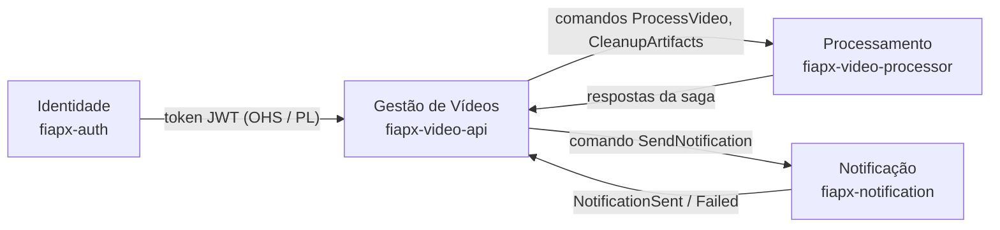

# Linguagem ubíqua

Glossário por bounded context. Os termos em português são usados na documentação e nas conversas com o
time; os identificadores em inglês são usados no código.

## Mapa de contextos

- **Identidade → Gestão de Vídeos:** *Open Host Service* com *Published Language*. O token JWT é o
  contrato; a Gestão de Vídeos só lê `sub`, `email` e `name`.
- **Gestão de Vídeos ↔ Processamento e Notificação:** cliente e fornecedor por mensagens assíncronas.
  Os contratos são os JSON Schemas de [`contracts/`](../contracts/).

## Identidade (`fiapx-auth`)

| Termo | Código | Definição |
|---|---|---|
| Usuário | `User` | Pessoa cadastrada que envia vídeos. Identificada por um UUID v7 |
| Credencial | `Email`, `Password` | Par e-mail e senha. O e-mail é único; a senha tem no mínimo 8 caracteres e é guardada como hash bcrypt (custo 12) |
| Cadastro | `RegisterUser` | Criação de um usuário a partir de nome, e-mail e senha |
| Autenticação | `AuthenticateUser` | Conferência da credencial e emissão do token de acesso |
| Token de acesso | `access_token` | JWT assinado com RS256, válido por 1 hora, com `sub`, `email`, `name`, `iss = fiapx-auth` e `aud = fiapx-api` |
| Autorizador | `authorizer` | Lambda que valida o token em cada requisição protegida e repassa o usuário para a API |
| Política de senha | `Password` | Mínimo de 8 e máximo de 72 caracteres, com pelo menos uma letra maiúscula, um número e um símbolo |
| Recuperação de senha | `RequestPasswordReset` | Pedido de um link de redefinição por e-mail. A resposta é sempre a mesma, exista ou não o cadastro |
| Token de redefinição | `PasswordResetToken` | Segredo aleatório enviado no link, válido por 30 minutos e de uso único. O banco guarda só o hash |
| Redefinição de senha | `ResetPassword` | Troca da senha a partir do link, que já autentica o usuário |
| Troca de senha | `ChangePassword` | Troca da senha por um usuário logado, conferindo a senha atual |

## Gestão de Vídeos (`fiapx-video-api`)

| Termo | Código | Definição |
|---|---|---|
| Vídeo | `Video` | Agregado que representa um arquivo enviado por um usuário e o seu ciclo de vida |
| Status do vídeo | `VideoStatus` | `PENDING_UPLOAD`, `UPLOADED`, `QUEUED`, `PROCESSING`, `COMPLETED`, `FAILED` ou `EXPIRED`. Os três últimos são finais |
| Autorização de envio | `UploadTicket` | POST pré-assinado do S3 (URL + campos) válido por 1 hora, que permite enviar o arquivo direto ao armazenamento |
| Formato de vídeo | `VideoFormat` | Extensão permitida: mp4, avi, mov, mkv, wmv, flv ou webm |
| Tamanho do arquivo | `FileSize` | Tamanho em bytes, no máximo 500 MB |
| Chave de armazenamento | `StorageKey` | Caminho do objeto no S3: `uploads/{video_id}.{ext}` para o vídeo e `results/{video_id}/frames.zip` para o pacote. O `video_id` na chave liga o evento do S3 ao vídeo |
| Motivo da falha | `FailureReason` | Código (`FFMPEG_ERROR`, `QUOTA_EXCEEDED`...) guardado no vídeo e trafegado nas mensagens, e o texto legível derivado dele para a tela e o e-mail |
| Cota de processamento | `ProcessingQuota` | Quantidade máxima de vídeos de um usuário em processamento ao mesmo tempo (padrão 5) |
| Reservar e liberar cota | `reserve()`, `release()` | Ocupar uma vaga da cota quando o vídeo entra na fila e devolvê-la ao final, com sucesso ou falha |
| Saga de processamento | `ProcessingSaga` | Máquina de estados que coordena validação, cota, processamento, conclusão e notificação de um vídeo |
| Passo da saga | `SagaStep` | `ValidateUpload`, `ReserveQuota`, `ProcessVideo`, `CompleteVideo` ou `NotifyUser` |
| Compensação | `compensate()` | Ação que desfaz o efeito de um passo anterior quando um passo posterior falha |
| Ponto sem retorno | — | Passo `CompleteVideo`. Depois dele não há compensação, só nova tentativa |
| Prazo | `Deadline` | Momento limite para o processamento responder (padrão 30 minutos). Vencido, a saga compensa |
| Outbox | `outbox_messages` | Tabela onde os comandos são gravados na mesma transação da mudança de estado, antes de ir para a fila |
| Mensagem processada | `processed_messages` | Registro de idempotência: uma mensagem com `message_id` repetido vira no-op |
| Link de download | `DownloadLink` | URL pré-assinada do zip, válida por 15 minutos, emitida só para vídeos `COMPLETED` |
| Expiração | `expire()` | Vídeo que ficou em `PENDING_UPLOAD` por mais de 1 hora passa para `EXPIRED` |

## Processamento (`fiapx-video-processor`)

| Termo | Código | Definição |
|---|---|---|
| Tarefa de processamento | `ProcessingJob` | Execução da extração de frames de um vídeo a partir do comando `ProcessVideo` |
| Frames por segundo | `FramesPerSecond` | Taxa de extração. Fixa em 1 |
| Frame | — | Imagem PNG extraída do vídeo (`frame_0001.png`, `frame_0002.png`...) |
| Conjunto de frames | `FrameSet` | Todos os frames extraídos de um vídeo |
| Pacote de frames | `frames.zip` | Arquivo zip com o conjunto de frames, gravado em `results/{video_id}/frames.zip` |
| Artefato | — | Qualquer arquivo gerado pelo processamento no S3. A compensação `CleanupArtifacts` apaga os parciais |
| Erro de processamento | `ProcessingError` | `FFMPEG_ERROR`, `NO_FRAMES`, `DOWNLOAD_ERROR` ou `UPLOAD_ERROR` |
| Falha definitiva | — | Erro que não se resolve tentando de novo, como vídeo corrompido. O worker responde a falha na hora |
| Falha transitória | — | Erro de rede ou do S3. A mensagem volta para a fila e é tentada até 3 vezes |
| Heartbeat | `VisibilityHeartbeat` | Extensão periódica do visibility timeout da mensagem enquanto o `ffmpeg` roda |

## Notificação (`fiapx-notification`)

| Termo | Código | Definição |
|---|---|---|
| Notificação | `Notification` | Um e-mail a ser enviado em resposta a um comando `SendNotification` |
| Destinatário | `Recipient` | Nome e e-mail de quem recebe. O e-mail é normalizado em minúsculas e é a partition key no DynamoDB |
| Modelo de mensagem | `Template` | `VIDEO_FAILED` (obrigatório), `VIDEO_COMPLETED` (opcional), `PASSWORD_RESET` e `PASSWORD_CHANGED`, em pt-BR, nas versões HTML e texto |
| Status da notificação | `NotificationStatus` | `PENDING`, `SENT`, `FAILED`, `DELIVERED`, `BOUNCED` ou `COMPLAINED` |
| Histórico de envios | tabela `notifications` | Todos os e-mails enviados para um destinatário, em ordem cronológica |
| Remetente | — | `nao-responda@hackfiapf5.click`, com nome de exibição "FIAP X" |

## Termos transversais

| Termo | Código | Definição |
|---|---|---|
| Envelope | `MessageEnvelope` | Formato comum de todas as mensagens: `message_id`, `type`, `version`, `saga_id`, `video_id`, `correlation_id`, `occurred_at` e `payload` |
| Comando | — | Mensagem que pede uma ação a outro serviço (`ProcessVideo`, `CleanupArtifacts`, `SendNotification`) |
| Resposta | — | Mensagem que informa o resultado de um comando à saga (`VideoProcessed`, `NotificationSent`...) |
| ID de correlação | `correlation_id` | Identificador que acompanha um vídeo por todos os serviços, logs e eventos de observabilidade |
| DLQ | `*-dlq` | Fila para onde vão as mensagens que falharam além do limite de tentativas |
