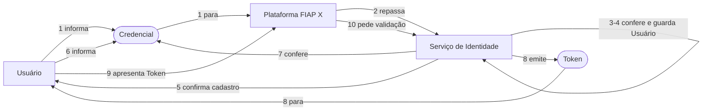

# DS-01 — Cadastro e login

**Objetivo do usuário:** ter acesso à plataforma para enviar os próprios vídeos.

## História

```text
1. Usuário                 --informa-->   nome, e-mail e senha (Credencial)   --para-->  Plataforma FIAP X
2. Plataforma FIAP X       --repassa-->   Credencial                          --para-->  Serviço de Identidade
3. Serviço de Identidade   --confere-->   e-mail ainda não cadastrado e senha com no mínimo 8 caracteres
4. Serviço de Identidade   --guarda-->    Usuário com a senha protegida (hash)
5. Serviço de Identidade   --confirma-->  cadastro                            --para-->  Usuário
6. Usuário                 --informa-->   e-mail e senha (Credencial)         --para-->  Plataforma FIAP X
7. Serviço de Identidade   --confere-->   Credencial
8. Serviço de Identidade   --emite-->     Token (válido por 1 hora)           --para-->  Usuário
9. Usuário                 --apresenta--> Token em cada pedido                --para-->  Plataforma FIAP X
10. Serviço de Identidade  --valida-->    Token                               --para-->  Plataforma FIAP X
```

## Diagrama



## Regras e exceções

- O e-mail é único. Se já existir, a resposta é genérica e não revela que o e-mail está cadastrado.
- Credencial errada no login gera a mesma mensagem genérica para e-mail inexistente e senha errada.
- Token vencido ou inválido: a plataforma recusa o pedido e o usuário volta para a tela de login.

## Onde isso vive no sistema

| Frase | Implementação |
|---|---|
| 1–5 | `POST /api/auth/register` → Lambda `register` (`fiapx-auth`) → tabela `fiapx_auth.users` |
| 6–8 | `POST /api/auth/login` → Lambda `login` → JWT RS256 com chave privada do Secrets Manager |
| 9–10 | Header `Authorization: Bearer` → Lambda `authorizer` no API Gateway (cache de 300 s) |
