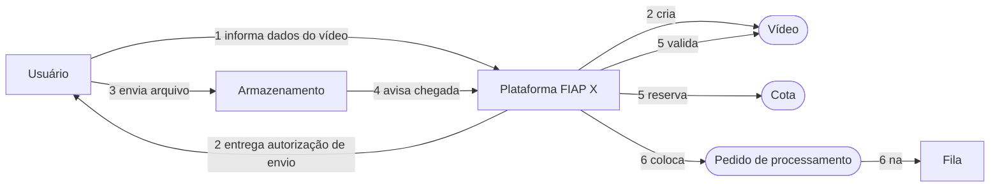

# DS-02 — Envio de vídeo

**Objetivo do usuário:** enviar um ou mais vídeos para extrair os frames.

## História

```text
1. Usuário            --informa-->  dados do vídeo (nome, tamanho, formato)  --para-->  Plataforma FIAP X
2. Plataforma FIAP X  --cria-->     Vídeo (aguardando envio) e autorização de envio  --para-->  Usuário
3. Usuário            --envia-->    arquivo de vídeo  --para-->  Armazenamento
4. Armazenamento      --avisa-->    chegada do Vídeo  --para-->  Plataforma FIAP X
5. Plataforma FIAP X  --valida-->   Vídeo  e  --reserva-->  Cota de processamento
6. Plataforma FIAP X  --coloca-->   Pedido de processamento  --na-->  Fila
```

O usuário pode repetir a história para vários arquivos ao mesmo tempo. Cada arquivo vira um Vídeo
independente.

## Diagrama



## Regras e exceções

- Formatos aceitos: mp4, avi, mov, mkv, wmv, flv e webm. Tamanho máximo: 500 MB por arquivo.
- A autorização de envio vale por 1 hora. Se o arquivo não chegar nesse prazo, o Vídeo expira.
- O arquivo vai direto para o Armazenamento, sem passar pela Plataforma. Se o usuário fechar o navegador
  depois do envio, o processamento continua, porque quem inicia a próxima etapa é o aviso do
  Armazenamento (frase 4).
- Arquivo inválido (não existe, tamanho ou formato errado): o Vídeo falha com o motivo "envio inválido",
  o arquivo é apagado e o usuário é avisado por e-mail (ver [DS-04](ds-04-falha-e-notificacao.md)).
- Cota cheia (5 vídeos do mesmo usuário em processamento): o Vídeo falha com o motivo "cota excedida" e
  o usuário é avisado.

## Onde isso vive no sistema

| Frase | Implementação |
|---|---|
| 1–2 | `POST /api/videos` → `RequestVideoUploadUseCase` → status `PENDING_UPLOAD` + POST pré-assinado |
| 3 | `POST` multipart do navegador direto no bucket S3 (`uploads/{video_id}.{ext}`) |
| 4 | Evento `s3:ObjectCreated` → fila `video-uploaded` → `saga-consumer` → `StartProcessingSaga` |
| 5 | Passos `ValidateUpload` (`HeadObject`) e `ReserveQuota` da SAGA, na mesma transação |
| 6 | Comando `ProcessVideo` gravado na outbox e publicado na fila `processing-commands` |
