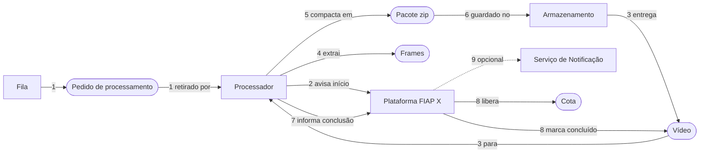

# DS-03 — Processamento com sucesso

**Objetivo do negócio:** transformar o vídeo enviado em um pacote zip com um frame por segundo.

## História

```text
1. Processador        --retira-->    Pedido de processamento  --da-->  Fila
2. Processador        --avisa-->     início do processamento  --para-->  Plataforma FIAP X
3. Processador        --busca-->     Vídeo  --no-->  Armazenamento
4. Processador        --extrai-->    Frames (1 por segundo)  --do-->  Vídeo
5. Processador        --compacta-->  Frames  --em-->  Pacote zip
6. Processador        --guarda-->    Pacote zip  --no-->  Armazenamento
7. Processador        --informa-->   conclusão (quantidade de frames)  --para-->  Plataforma FIAP X
8. Plataforma FIAP X  --marca-->     Vídeo como concluído  e  --libera-->  Cota
9. Plataforma FIAP X  --pede-->      aviso de conclusão (opcional)  --para-->  Serviço de Notificação
```

## Diagrama



## Regras e exceções

- Vários Processadores trabalham ao mesmo tempo, cada um com um vídeo. A quantidade cresce e diminui
  conforme o tamanho da Fila (de 1 a 10).
- Se o Pacote zip daquele vídeo já existir (pedido repetido), o Processador informa a conclusão sem
  processar de novo.
- Enquanto extrai os frames, o Processador renova a "posse" do pedido na Fila (heartbeat), para que
  outro Processador não pegue o mesmo vídeo.
- A conclusão (frase 8) é o ponto sem retorno: depois dela não há desfazer, só nova tentativa.
- Se o Processador não responder em 30 minutos, a Plataforma considera falha e segue a
  [DS-04](ds-04-falha-e-notificacao.md).

## Onde isso vive no sistema

| Frase | Implementação |
|---|---|
| 1 | `php artisan processor:consume` (long polling de 20 s na fila `processing-commands`) |
| 2 | Resposta `ProcessingStarted` na fila `saga-replies.fifo` → vídeo `PROCESSING` |
| 3–6 | `ProcessVideoUseCase`: download em stream para `/work`, `ffmpeg -vf fps=1`, `ZipArchive`, upload multipart para `results/{video_id}/frames.zip` |
| 7 | Resposta `VideoProcessed` com `zip_key`, `frame_count`, `zip_size_bytes`, `duration_ms` |
| 8 | `HandleSagaReplyUseCase` → passo `CompleteVideo`: `COMPLETED`, grava `zip_key` e `frame_count`, libera a cota |
| 9 | Comando `SendNotification` com template `VIDEO_COMPLETED` (opcional) |
