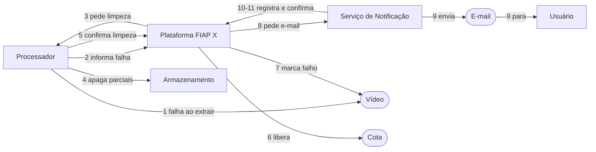

# DS-04 — Falha e notificação

**Objetivo do negócio:** quando um vídeo não puder ser processado, desfazer o que ficou pela metade e
avisar o usuário por e-mail (RF5).

## História

```text
1. Processador              --tenta extrair-->  Frames  --do-->  Vídeo  (e falha: arquivo corrompido)
2. Processador              --informa-->        falha e motivo  --para-->  Plataforma FIAP X
3. Plataforma FIAP X        --pede-->           limpeza dos arquivos parciais  --para-->  Processador
4. Processador              --apaga-->          Frames e Pacote zip parciais  --do-->  Armazenamento
5. Processador              --confirma-->       limpeza  --para-->  Plataforma FIAP X
6. Plataforma FIAP X        --libera-->         Cota
7. Plataforma FIAP X        --marca-->          Vídeo como falho, com o motivo
8. Plataforma FIAP X        --pede-->           E-mail de falha  --para-->  Serviço de Notificação
9. Serviço de Notificação   --envia-->          E-mail (nome do vídeo e motivo legível)  --para-->  Usuário
10. Serviço de Notificação  --guarda-->         registro do envio  --no-->  histórico do Usuário
11. Serviço de Notificação  --confirma-->       envio  --para-->  Plataforma FIAP X
```

## Diagrama



## Variações da mesma história

| Gatilho | O que muda |
|---|---|
| Envio inválido (passo `ValidateUpload`) | Não há processamento: a Plataforma apaga o arquivo enviado (compensação) e segue da frase 7 |
| Cota excedida (passo `ReserveQuota`) | A Plataforma apaga o arquivo enviado e segue da frase 7 com o motivo "cota excedida" |
| Processador não respondeu em 30 minutos | A Plataforma considera falha por tempo e segue da frase 3 |
| Falha transitória (rede ou S3) | O pedido volta para a Fila e é tentado até 3 vezes. Depois disso vai para a DLQ e o prazo de 30 minutos cobre a compensação |
| E-mail não pôde ser enviado | O Serviço de Notificação tenta 3 vezes. Depois disso registra a falha, a mensagem vai para a DLQ e um alerta dispara |

## Regras

- As compensações acontecem em ordem inversa aos passos já feitos.
- O e-mail de falha é obrigatório. O de conclusão é opcional.
- O motivo no e-mail é legível. Exemplo: `FFMPEG_ERROR` vira "O arquivo de vídeo está corrompido ou em
  um formato que não conseguimos ler".
- Um pedido de e-mail repetido não gera um segundo e-mail.

## Onde isso vive no sistema

| Frase | Implementação |
|---|---|
| 1–2 | Resposta `VideoProcessingFailed` (`error_code`, `error_message`, `attempt`) |
| 3–5 | Compensação `CleanupArtifacts` → resposta `ArtifactsCleaned`; saga em `COMPENSATING` |
| 6–7 | Compensação `ReleaseQuota`; vídeo `FAILED` com `failure_reason`; saga `COMPENSATED` |
| 8 | Comando `SendNotification` (template `VIDEO_FAILED`) na fila `notification-commands` |
| 9–10 | Lambda `notification`: `PutItem` condicional no DynamoDB (PK = e-mail, SK = `message_id`) e `SendEmail` no SES |
| 11 | Resposta `NotificationSent` → saga `NOTIFIED` |
