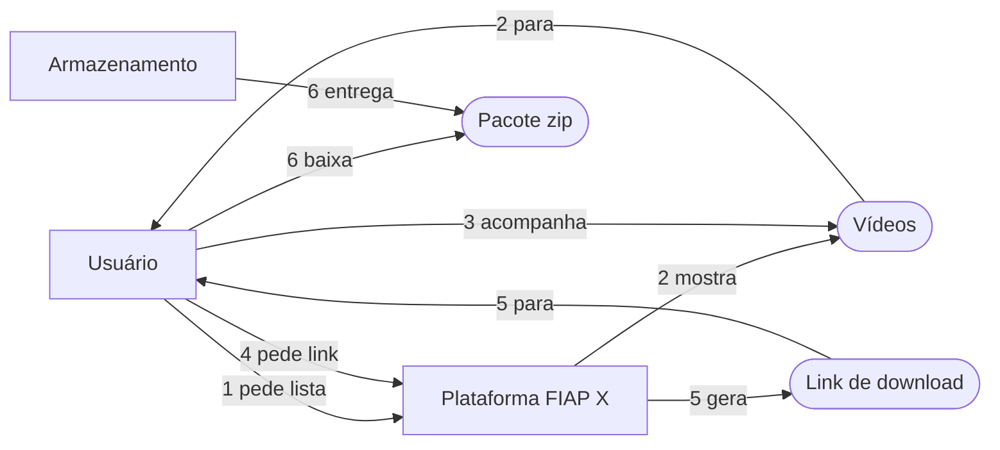

# DS-05 — Consulta de status e download

**Objetivo do usuário:** acompanhar os vídeos enviados e baixar o pacote de frames dos concluídos.

## História

```text
1. Usuário            --pede-->        lista dos seus Vídeos  --para-->  Plataforma FIAP X
2. Plataforma FIAP X  --mostra-->      Vídeos com status, frames e motivo de falha  --para-->  Usuário
3. Usuário            --acompanha-->   mudança de status (atualização automática)
4. Usuário            --pede-->        Link de download de um Vídeo concluído  --para-->  Plataforma FIAP X
5. Plataforma FIAP X  --gera-->        Link de download temporário (15 minutos)  --para-->  Usuário
6. Usuário            --baixa-->       Pacote zip  --do-->  Armazenamento
```

## Diagrama



## Regras e exceções

- O usuário só vê os próprios vídeos. Pedir um vídeo de outra pessoa dá "não encontrado".
- A lista é paginada (10 por página), filtrável por status e ordenada do mais recente para o mais antigo.
- A tela atualiza a cada 5 segundos enquanto houver vídeo em status não final.
- O link de download só existe para vídeos concluídos. Para os demais, a Plataforma responde que o
  pacote ainda não está pronto.
- O link vence em 15 minutos. O pacote fica disponível no Armazenamento por 30 dias.

## Onde isso vive no sistema

| Frase | Implementação |
|---|---|
| 1–2 | `GET /api/videos?status=&page=&per_page=` → `ListUserVideosUseCase` |
| 3 | Polling do `fiapx-web` com TanStack Query (`refetchInterval` de 5 s) |
| 4–5 | `GET /api/videos/{id}/download` → `GetDownloadLinkUseCase` → GET pré-assinado do S3 (200) ou 409 |
| 6 | Download direto do S3 pelo navegador; lifecycle de 30 dias no prefixo `results/` |
