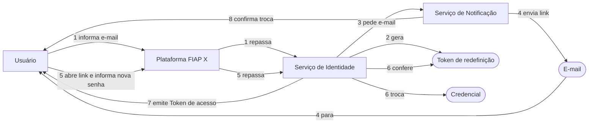

# DS-06 — Recuperação e troca de senha

**Objetivo do usuário:** voltar a acessar a conta quando esquecer a senha, ou trocar a senha estando
logado.

## História: recuperação

```text
1. Usuário                  --informa-->    e-mail cadastrado  --para-->  Plataforma FIAP X
2. Serviço de Identidade    --gera-->       Token de redefinição (30 min, uso único)
3. Serviço de Identidade    --pede-->       E-mail com o link  --para-->  Serviço de Notificação
4. Serviço de Notificação   --envia-->      E-mail com o link de redefinição  --para-->  Usuário
5. Usuário                  --abre-->       link  e  --informa-->  nova senha  --para-->  Plataforma FIAP X
6. Serviço de Identidade    --confere-->    Token  e  --troca-->  senha (Credencial)
7. Serviço de Identidade    --emite-->      Token de acesso  --para-->  Usuário
8. Serviço de Notificação   --envia-->      E-mail de confirmação da troca  --para-->  Usuário
```

## História: troca estando logado

```text
1. Usuário                  --informa-->    senha atual e nova senha  --para-->  Plataforma FIAP X
2. Serviço de Identidade    --confere-->    senha atual  e  --troca-->  senha (Credencial)
3. Serviço de Notificação   --envia-->      E-mail de confirmação da troca  --para-->  Usuário
```

## Diagrama



## Regras e exceções

- A resposta ao pedido de recuperação é sempre a mesma, exista ou não o e-mail.
- O link vale por 30 minutos e só pode ser usado uma vez. Um pedido novo invalida os links anteriores.
- Link inválido, expirado ou já usado: a Plataforma mostra a mesma mensagem e oferece pedir outro.
- A nova senha segue a política: de 8 a 72 caracteres, com letra maiúscula, número e símbolo, e
  diferente da atual.
- Toda troca, por link ou logado, gera um e-mail de confirmação.

## Onde isso vive no sistema

| Frase | Implementação |
|---|---|
| Recuperação 1–4 | `POST /api/auth/password/forgot` → Lambda `password` → `password_reset_tokens` (hash) → `SendNotification` `PASSWORD_RESET` → Lambda `notification` → SMTP (OCI Email Delivery) |
| Recuperação 5 | Tela "Criar nova senha": `POST /api/auth/password/reset/verify` ao abrir o link, depois `POST /api/auth/password/reset` |
| Recuperação 6–8 | Troca da senha e `used_at` na mesma transação; resposta com JWT; `SendNotification` `PASSWORD_CHANGED` |
| Troca logado 1–3 | `PUT /api/auth/password` (rota com authorizer) → `SendNotification` `PASSWORD_CHANGED` |

Decisão registrada no [ADR-017](../04-adrs/ADR-017-recuperacao-e-troca-de-senha.md).
