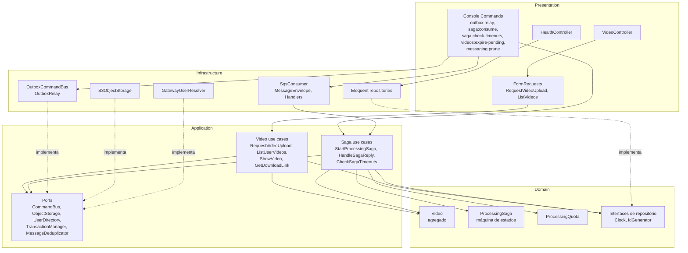

# C4 — Nível 3: componentes do `fiapx-video-api`

O `fiapx-video-api` segue DDD + Clean Architecture, no mesmo padrão do `tech-challenge-application` das
fases anteriores. As dependências apontam para dentro: Presentation → Application → Domain, e a
Infrastructure implementa as interfaces declaradas no Domain e na Application.

## Componentes

| Camada | Componente | Responsabilidade |
|---|---|---|
| Domain | `Video` | Agregado com `create()`, `markUploaded()`, `markQueued()`, `markProcessing()`, `complete()`, `fail()`, `expire()`. Rejeita transições inválidas |
| Domain | VOs | `VideoId`, `VideoStatus`, `StorageKey`, `FileName`, `FileSize` (≤ 500 MB), `VideoFormat` (7 extensões), `FailureReason` |
| Domain | `ProcessingSaga` | Estado, passo atual, prazo, histórico e compensações, sem dependência do Laravel |
| Domain | `ProcessingQuota` | `reserve()` e `release()` da cota de processamentos simultâneos (padrão 5) |
| Application | `RequestVideoUploadUseCase` | Cria o vídeo `PENDING_UPLOAD` e pede o POST pré-assinado ao `ObjectStorage` |
| Application | `ListUserVideosUseCase`, `ShowVideoUseCase` | Leitura filtrada pelo usuário do token |
| Application | `GetDownloadLinkUseCase` | URL pré-assinada do zip (15 min) se `COMPLETED`; senão, erro de domínio (409) |
| Application | `StartProcessingSagaUseCase` | Reage ao evento do S3: valida o upload, reserva a cota e grava `ProcessVideo` na outbox, em uma transação |
| Application | `HandleSagaReplyUseCase` | Aplica as respostas do processor e da notification, com deduplicação |
| Application | `CheckSagaTimeouts` | Compensa sagas `PROCESSING` com `deadline_at` vencido |
| Infrastructure | Eloquent repositories | Persistência no `fiapx_video`, com lock otimista (`version`) na saga |
| Infrastructure | `OutboxCommandBus` e `OutboxRelay` | Grava comandos na outbox; publica com `SELECT ... FOR UPDATE SKIP LOCKED` e marca `published_at` |
| Infrastructure | `SqsConsumer` | Long polling nas filas `video-uploaded` e `saga-replies.fifo`; `DeleteMessage` só após o commit |
| Infrastructure | `S3ObjectStorage` | POST pré-assinado, `HeadObject`, GET pré-assinado e `DeleteObject` |
| Infrastructure | `GatewayUserResolver` | Lê `x-user-id`, `x-user-email` e `x-user-name` e revalida o JWT com a chave pública (defesa em profundidade) |
| Presentation | Controllers e FormRequests | Convertem HTTP ↔ DTO. Sem try/catch: o handler global em `bootstrap/app.php` mapeia exceções |

## Mapeamento de exceções

| Exceção | Origem | HTTP |
|---|---|---|
| `\InvalidArgumentException` | VO inválido (formato, tamanho, nome) | 422 |
| `\DomainException` | Regra de negócio (download de vídeo não concluído) | 409 ou 422, conforme a regra |
| `ModelNotFound` / vídeo de outro usuário | Repositório | 404 |
| Falha de autenticação | `GatewayUserResolver` | 401 |

## Processos da mesma imagem

| Deployment | Comando | Escala |
|---|---|---|
| `video-api-web` | php-fpm + nginx | HPA por CPU (70%), 2 a 6 réplicas |
| `video-api-outbox-relay` | `php artisan outbox:relay` | 1 a 2 réplicas |
| `video-api-saga-consumer` | `php artisan saga:consume` | KEDA, 1 a 5 réplicas |
| CronJob | `php artisan schedule:run` (timeouts a cada minuto, expiração de uploads, `messaging:prune` diário) | 1 por minuto |
| Job pré-deploy | `php artisan migrate --force` | 1 por deploy |
