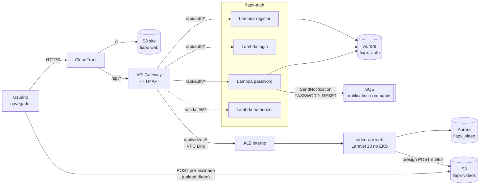
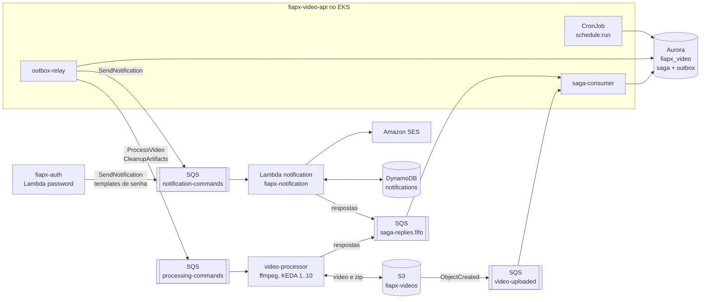

# C4 — Nível 2: containers

O nível 2 está dividido em dois diagramas para ficar legível: o caminho síncrono das requisições do
usuário e o processamento assíncrono coordenado pela SAGA.

## Caminho síncrono: navegador, autenticação e API

## Processamento assíncrono: SAGA, worker e notificação

Cada fila tem uma DLQ própria (`*-dlq`), com `maxReceiveCount = 3` (`5` na `video-uploaded`). Todos os
containers enviam APM, logs e métricas ao New Relic (omitido no diagrama para não poluir; ver
[observabilidade](../07-observabilidade/observabilidade.md)).

## Containers

| Container | Tecnologia | Repositório | Responsabilidade |
|---|---|---|---|
| CloudFront | AWS CloudFront | `fiapx-infra` | Única origem pública: `/*` serve o front-end, `/api/*` vai para o API Gateway |
| Site | S3 privado (OAC) | `fiapx-web` | Arquivos estáticos do React |
| API Gateway | HTTP API | `fiapx-infra` + rotas em `fiapx-auth` | Roteamento, authorizer, rate limit, logs de acesso |
| Lambdas `register`, `login`, `password`, `authorizer` | Node.js 24 | `fiapx-auth` | Cadastro, login (JWT RS256), recuperação e troca de senha, validação do token |
| ALB interno + VPC Link | AWS ALB | `fiapx-infra` | Leva o tráfego do API Gateway para dentro do EKS |
| `video-api-web` | PHP 8.4.27 + Laravel 13 | `fiapx-video-api` | Endpoints `/api/videos*` e `/api/health/*` |
| `outbox-relay` | mesma imagem, `php artisan outbox:relay` | `fiapx-video-api` | Publica nas filas os comandos gravados na outbox |
| `saga-consumer` | mesma imagem, `php artisan saga:consume` | `fiapx-video-api` | Consome `video-uploaded` e `saga-replies.fifo` e avança a SAGA |
| CronJob | mesma imagem, `php artisan schedule:run` | `fiapx-video-api` | Timeouts da SAGA e expiração de uploads pendentes |
| `video-processor` | PHP 8.4.27 + Laravel 13 + ffmpeg | `fiapx-video-processor` | Extrai os frames, gera o zip e responde à SAGA |
| Lambda `notification` | Node.js 24 | `fiapx-notification` | Envia e-mails pelo SES e registra o histórico no DynamoDB |
| Aurora MySQL Serverless v2 | MySQL 8.0 | `fiapx-infra` | Databases `fiapx_auth` e `fiapx_video`, um usuário por serviço |
| DynamoDB `notifications` | NoSQL | `fiapx-notification` | Histórico e idempotência dos e-mails |
| S3 `fiapx-videos` | S3 | `fiapx-infra` | Vídeos (`uploads/`, 7 dias) e zips (`results/`, 30 dias) |
| Filas SQS | SQS Standard e FIFO | `fiapx-infra` e `fiapx-notification` | Comandos, eventos e respostas da SAGA |

## Filas

| Fila | Tipo | Produtor | Consumidor | Visibility | DLQ (tentativas) |
|---|---|---|---|---|---|
| `fiapx-<env>-video-uploaded` | Standard | S3 (evento) | `saga-consumer` | 60 s | sim (5) |
| `fiapx-<env>-processing-commands` | Standard | `outbox-relay` | `video-processor` | 300 s + heartbeat | sim (3) |
| `fiapx-<env>-saga-replies.fifo` | FIFO (`MessageGroupId = saga_id`) | processor, notification | `saga-consumer` | 60 s | sim (3) |
| `fiapx-<env>-notification-commands` | Standard (criada pelo `fiapx-notification`) | `outbox-relay` | Lambda `notification` | 60 s | sim (3) |

## Comunicação

- **Síncrona:** só entre navegador, CloudFront, API Gateway, Lambdas de auth e `video-api-web`.
- **Assíncrona:** todo o processamento passa por SQS. Os serviços não chamam uns aos outros por HTTP.
- **Integração entre repositórios:** cada repositório lê do SSM Parameter Store (`/fiapx/<env>/...`) os
  recursos criados por outro, como URLs de filas e o nome do bucket.

Detalhe do `video-api` no [nível 3](c4-componentes-video-api.md).
