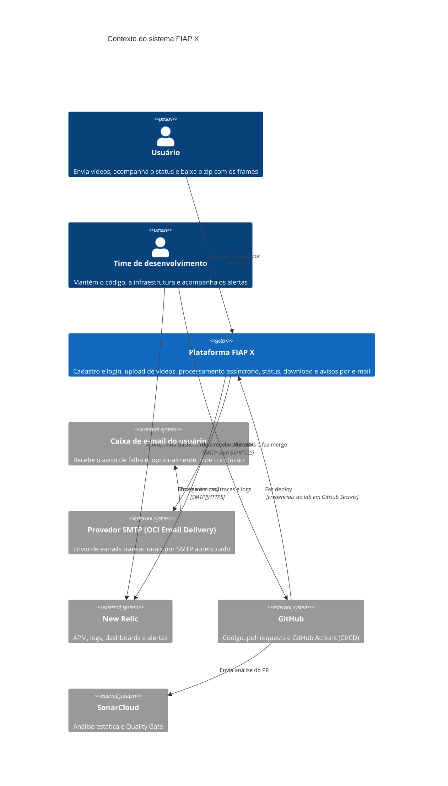

# C4 — Nível 1: contexto

A plataforma FIAP X recebe vídeos dos usuários, extrai um frame por segundo e devolve um pacote zip.
Este nível mostra quem usa o sistema e de quais sistemas externos ele depende.

## Elementos

| Elemento | Tipo | Responsabilidade |
|---|---|---|
| Usuário | Pessoa | Cadastra-se, faz login, envia vários vídeos, acompanha o status e baixa os zips |
| Time de desenvolvimento | Pessoa | Evolui o sistema por pull requests e responde aos alertas |
| Plataforma FIAP X | Sistema | Todo o escopo do hackathon, rodando na AWS Academy Learner Lab (detalhado no [nível 2](c4-containers.md)) |
| Provedor SMTP (OCI Email Delivery) | Externo | Envio de e-mails a partir de um remetente do time aprovado no provedor ([ADR-019](../04-adrs/ADR-019-deploy-na-aws-academy-learner-lab.md) e [ADR-020](../04-adrs/ADR-020-email-pelo-oci-email-delivery.md)) |
| New Relic | Externo | Observabilidade da aplicação, do cluster e das Lambdas |
| GitHub e SonarCloud | Externos | Versionamento, pipelines de CI/CD e Quality Gate |

## Requisitos atendidos neste nível

- **RF3:** o usuário só usa a plataforma depois de se autenticar.
- **RF5:** a plataforma avisa o usuário por e-mail, via SMTP num provedor externo.
- **RT3 e RT5:** código no GitHub, com CI/CD em GitHub Actions.
