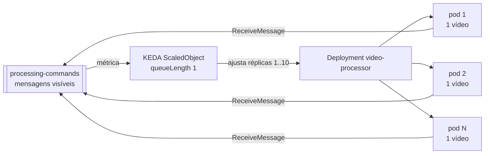

# Escalabilidade e resiliência

## Como atendemos RF1 e RF2

| Requisito | Mecanismo |
|---|---|
| RF1: vários vídeos ao mesmo tempo | O `video-processor` escala de 1 a 10 pods pelo tamanho da fila `processing-commands` (KEDA, `queueLength: 1`). Cada pod processa um vídeo, então até 10 vídeos rodam em paralelo |
| RF2: não perder requisições em picos | O vídeo vai direto para o S3. O evento do S3 cai em uma fila durável. Os comandos são gravados na outbox antes de ir para a fila. Toda fila tem DLQ, e todo consumidor é idempotente |

## Escala por componente

| Componente | Como escala | Limites |
|---|---|---|
| S3 (vídeos e site), API Gateway, SQS, DynamoDB | Gerenciados pela AWS, sem configuração de capacidade | Limites de conta (ex.: 10.000 req/s no API Gateway) |
| Lambdas `register`, `login`, `authorizer`, `notification` | Concorrência automática | Concorrência reservada na `notification` para não estourar o provedor SMTP (Brevo gratuito: 300 e-mails/dia) |
| `video-api-web` | HPA por CPU (70%), 2 a 6 réplicas | PDB com `minAvailable: 1` |
| `video-api-saga-consumer` | KEDA pelas filas `video-uploaded` e `saga-replies.fifo`, 1 a 5 réplicas | A FIFO garante ordem por `saga_id` mesmo com várias réplicas |
| `video-api-outbox-relay` | 1 a 2 réplicas | `SELECT ... FOR UPDATE SKIP LOCKED` evita publicação dupla entre réplicas |
| `video-processor` | KEDA `aws-sqs-queue`, 1 a 10 réplicas | `emptyDir` de 10Gi por pod; o managed node group (on-demand `t3.large`) vai de 2 a 4 nós, teto de 8 vCPUs dentro do limite do lab ([ADR-019](../04-adrs/ADR-019-deploy-na-aws-academy-learner-lab.md)) |
| Aurora MySQL | Serverless v2, de 0,5 a 2 ACU, uma instância (o lab não tem Multi-AZ); alternativa `db.t4g.medium` se o lab recusar `db.serverless` | Leituras e escritas são curtas; o arquivo nunca passa pelo banco |

## Pontos de resiliência

| Falha | O que acontece | Recuperação |
|---|---|---|
| Usuário fecha o navegador após o upload | Nada se perde: o evento do S3 inicia a saga | Automática |
| `saga-consumer` cai antes do commit | A mensagem não é apagada e volta à fila após o visibility timeout | Reprocessamento; idempotência por `processed_messages` |
| `outbox-relay` cai depois de publicar e antes de marcar | A mensagem é publicada de novo | O consumidor descarta a duplicata pelo `message_id` |
| Pod do processor morre no meio do `ffmpeg` | A mensagem volta à fila quando o heartbeat para | Outro pod reprocessa; se o zip já existir, só responde `VideoProcessed` |
| Erro transitório no S3 ou na rede | O worker não apaga a mensagem | Até 3 tentativas; depois DLQ e compensação por timeout (30 min) |
| Vídeo corrompido | Falha definitiva | `VideoProcessingFailed` imediato, compensação e e-mail |
| Provedor SMTP indisponível | Item fica `FAILED` no DynamoDB, a mensagem volta (`ReportBatchItemFailures`) | Até 3 tentativas; depois `NotificationFailed`, DLQ e alerta |
| Aurora escalando ou reiniciando | Erros de conexão por alguns segundos | Retry com backoff nos consumidores; mensagens permanecem nas filas |
| Deploy do processor durante um vídeo | `SIGTERM` tratado com `pcntl`: termina o vídeo atual e para de pegar mensagens | `terminationGracePeriodSeconds` maior que o tempo máximo esperado de processamento |

## Retentativas e prazos

| Item | Valor |
|---|---|
| `maxReceiveCount` das filas | 3 (5 na `video-uploaded`) |
| Visibility timeout de `processing-commands` | 300 s, estendido a cada 60 s pelo heartbeat |
| Prazo da saga para o processamento | 30 minutos (`deadline_at`) |
| Verificação de timeouts | A cada minuto (`saga:check-timeouts`) |
| Expiração de upload pendente | 1 hora |
| Validade do POST pré-assinado | 1 hora |
| Validade do link de download | 15 minutos |

## Cota por usuário

A cota (padrão 5 vídeos em processamento por usuário) evita que um único usuário ocupe todos os workers
num pico. O upload continua aceito; o vídeo que estoura a cota falha com `QUOTA_EXCEEDED` e o usuário é
avisado para reenviar.

## Validação de carga

Na Etapa 10, um script k6 (`tests/load/`) envia 30 vídeos curtos em 1 minuto. As evidências esperadas
são a fila crescendo (CloudWatch), o KEDA escalando o worker (New Relic), todos os vídeos em `COMPLETED` e
nenhuma mensagem nas DLQs.
