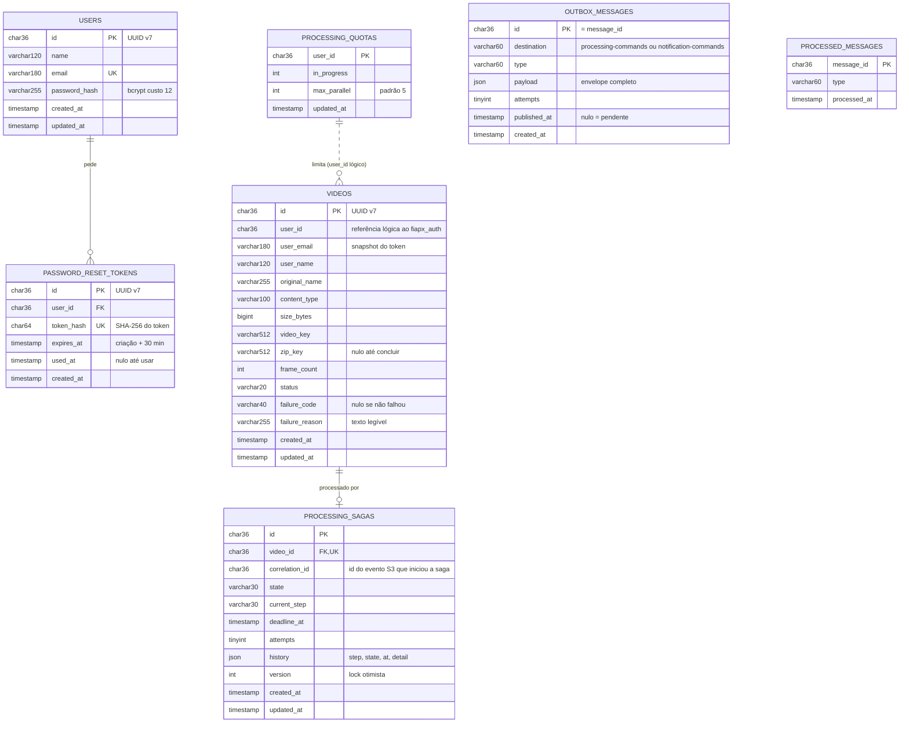

# Modelo de dados

Um cluster **Aurora MySQL Serverless v2** (MySQL 8.0, de 0,5 a 2 ACU) com um **database e um usuário por
serviço**. Nenhum serviço acessa o database de outro. O histórico de notificações fica no **DynamoDB** e
os arquivos no **S3**.

| Armazenamento | Dono | Conteúdo |
|---|---|---|
| Aurora `fiapx_auth` | `fiapx-auth` | Usuários, hashes de senha e tokens de redefinição (só o hash) |
| Aurora `fiapx_video` | `fiapx-video-api` | Vídeos, sagas, cotas, outbox e mensagens processadas |
| DynamoDB `fiapx-<env>-notifications` | `fiapx-notification` | Histórico e idempotência dos e-mails |
| S3 `fiapx-<env>-videos` | `fiapx-infra` (usado por video-api e processor) | `uploads/` (7 dias) e `results/` (30 dias) |

O `video-processor` não tem banco: é stateless e usa a chave `results/{video_id}/frames.zip` como chave
de idempotência.

## Diagrama ER

Os dois databases ficam no mesmo diagrama, mas não há chave estrangeira entre eles: `videos.user_id` é
uma referência lógica ao `fiapx_auth.users`. As tabelas `USERS` e `PASSWORD_RESET_TOKENS` são do
`fiapx_auth`; as demais, do `fiapx_video`.



`outbox_messages` e `processed_messages` não têm relação com as outras tabelas: são infraestrutura de
mensageria, gravadas na mesma transação do efeito de negócio. O comando agendado `messaging:prune` apaga
diariamente as mensagens da outbox já publicadas e os registros de `processed_messages` com mais de 7 dias.

`videos.failure_code` guarda o código da falha (`FFMPEG_ERROR`...) e `failure_reason` o texto legível
derivado dele. `processing_sagas.correlation_id` é copiado para todos os comandos da saga, inclusive os
disparados pelo timeout.

## Script de criação

O script de criação dos databases e usuários é um entregável. Ele fica em
`fiapx-infra/sql/create-databases.sql`; as tabelas vêm das migrations de cada serviço
(`fiapx-auth/migrations/*.sql` e `fiapx-video-api/database/migrations`). O schema consolidado abaixo é
a referência para a documentação.

```sql
-- fiapx-infra/sql/create-databases.sql
CREATE DATABASE IF NOT EXISTS fiapx_auth  CHARACTER SET utf8mb4 COLLATE utf8mb4_0900_ai_ci;
CREATE DATABASE IF NOT EXISTS fiapx_video CHARACTER SET utf8mb4 COLLATE utf8mb4_0900_ai_ci;

-- As senhas vêm do Secrets Manager no pipeline; nunca ficam no repositório.
CREATE USER IF NOT EXISTS 'fiapx_auth'@'%'  IDENTIFIED BY '${AUTH_DB_PASSWORD}';
CREATE USER IF NOT EXISTS 'fiapx_video'@'%' IDENTIFIED BY '${VIDEO_DB_PASSWORD}';

GRANT SELECT, INSERT, UPDATE, DELETE, CREATE, ALTER, INDEX, REFERENCES ON fiapx_auth.*  TO 'fiapx_auth'@'%';
GRANT SELECT, INSERT, UPDATE, DELETE, CREATE, ALTER, INDEX, REFERENCES ON fiapx_video.* TO 'fiapx_video'@'%';
```

```sql
-- fiapx_auth
CREATE TABLE users (
  id             CHAR(36)     NOT NULL PRIMARY KEY,
  name           VARCHAR(120) NOT NULL,
  email          VARCHAR(180) NOT NULL,
  password_hash  VARCHAR(255) NOT NULL,
  created_at     TIMESTAMP    NOT NULL DEFAULT CURRENT_TIMESTAMP,
  updated_at     TIMESTAMP    NOT NULL DEFAULT CURRENT_TIMESTAMP ON UPDATE CURRENT_TIMESTAMP,
  UNIQUE KEY uq_users_email (email)
) ENGINE=InnoDB DEFAULT CHARSET=utf8mb4 COLLATE=utf8mb4_0900_ai_ci;

CREATE TABLE password_reset_tokens (
  id          CHAR(36)  NOT NULL PRIMARY KEY,
  user_id     CHAR(36)  NOT NULL,
  token_hash  CHAR(64)  NOT NULL,
  expires_at  TIMESTAMP NOT NULL,
  used_at     TIMESTAMP NULL,
  created_at  TIMESTAMP NOT NULL DEFAULT CURRENT_TIMESTAMP,
  UNIQUE KEY uq_reset_token_hash (token_hash),
  KEY idx_reset_user_created (user_id, created_at),
  CONSTRAINT fk_reset_user FOREIGN KEY (user_id) REFERENCES users(id)
) ENGINE=InnoDB DEFAULT CHARSET=utf8mb4 COLLATE=utf8mb4_0900_ai_ci;
```

```sql
-- fiapx_video
CREATE TABLE videos (
  id              CHAR(36)     NOT NULL PRIMARY KEY,
  user_id         CHAR(36)     NOT NULL,
  user_email      VARCHAR(180) NOT NULL,
  user_name       VARCHAR(120) NOT NULL,
  original_name   VARCHAR(255) NOT NULL,
  content_type    VARCHAR(100) NOT NULL,
  size_bytes      BIGINT UNSIGNED NOT NULL,
  video_key       VARCHAR(512) NOT NULL,
  zip_key         VARCHAR(512) NULL,
  frame_count     INT UNSIGNED NULL,
  status          VARCHAR(20)  NOT NULL,
  failure_code    VARCHAR(40)  NULL,
  failure_reason  VARCHAR(255) NULL,
  created_at      TIMESTAMP NOT NULL DEFAULT CURRENT_TIMESTAMP,
  updated_at      TIMESTAMP NOT NULL DEFAULT CURRENT_TIMESTAMP ON UPDATE CURRENT_TIMESTAMP,
  KEY idx_videos_user_created (user_id, created_at),
  KEY idx_videos_status (status)
) ENGINE=InnoDB DEFAULT CHARSET=utf8mb4 COLLATE=utf8mb4_0900_ai_ci;

CREATE TABLE processing_sagas (
  id            CHAR(36)    NOT NULL PRIMARY KEY,
  video_id      CHAR(36)    NOT NULL,
  correlation_id CHAR(36)   NOT NULL,
  state         VARCHAR(30) NOT NULL,
  current_step  VARCHAR(30) NOT NULL,
  deadline_at   TIMESTAMP   NULL,
  attempts      TINYINT UNSIGNED NOT NULL DEFAULT 0,
  history       JSON        NOT NULL,
  version       INT UNSIGNED NOT NULL DEFAULT 0,
  created_at    TIMESTAMP NOT NULL DEFAULT CURRENT_TIMESTAMP,
  updated_at    TIMESTAMP NOT NULL DEFAULT CURRENT_TIMESTAMP ON UPDATE CURRENT_TIMESTAMP,
  UNIQUE KEY uq_sagas_video (video_id),
  KEY idx_sagas_state_deadline (state, deadline_at),
  CONSTRAINT fk_sagas_video FOREIGN KEY (video_id) REFERENCES videos(id)
) ENGINE=InnoDB DEFAULT CHARSET=utf8mb4 COLLATE=utf8mb4_0900_ai_ci;

CREATE TABLE processing_quotas (
  user_id        CHAR(36) NOT NULL PRIMARY KEY,
  in_progress    INT UNSIGNED NOT NULL DEFAULT 0,
  max_parallel   INT UNSIGNED NOT NULL DEFAULT 5,
  updated_at     TIMESTAMP NOT NULL DEFAULT CURRENT_TIMESTAMP ON UPDATE CURRENT_TIMESTAMP
) ENGINE=InnoDB DEFAULT CHARSET=utf8mb4 COLLATE=utf8mb4_0900_ai_ci;

CREATE TABLE outbox_messages (
  id            CHAR(36)     NOT NULL PRIMARY KEY,
  destination   VARCHAR(60)  NOT NULL,
  type          VARCHAR(60)  NOT NULL,
  payload       JSON         NOT NULL,
  attempts      TINYINT UNSIGNED NOT NULL DEFAULT 0,
  published_at  TIMESTAMP    NULL,
  created_at    TIMESTAMP    NOT NULL DEFAULT CURRENT_TIMESTAMP,
  KEY idx_outbox_pending (published_at, created_at)
) ENGINE=InnoDB DEFAULT CHARSET=utf8mb4 COLLATE=utf8mb4_0900_ai_ci;

CREATE TABLE processed_messages (
  message_id    CHAR(36)    NOT NULL PRIMARY KEY,
  type          VARCHAR(60) NOT NULL,
  processed_at  TIMESTAMP   NOT NULL DEFAULT CURRENT_TIMESTAMP,
  KEY idx_processed_at (processed_at)            -- limpeza diária (messaging:prune)
) ENGINE=InnoDB DEFAULT CHARSET=utf8mb4 COLLATE=utf8mb4_0900_ai_ci;
```

## DynamoDB `fiapx-<env>-notifications`

A **partition key é o e-mail do destinatário**. A sort key `message_id` guarda o histórico de todos os
envios para o mesmo e-mail (sem sobrescrever o último) e garante a idempotência.

| Atributo | Tipo | Papel |
|---|---|---|
| `email` | S | **Partition key**, normalizado em minúsculas |
| `message_id` | S | **Sort key**: id do `SendNotification` |
| `created_at` | S (ISO-8601) | Sort key do LSI `email-created_at-index` |
| `status` | S | `PENDING`, `SENT` ou `FAILED` |
| `template` | S | `VIDEO_FAILED` ou `VIDEO_COMPLETED` |
| `subject` | S | Assunto enviado |
| `video_id`, `saga_id`, `correlation_id` | S | Rastreabilidade com a SAGA |
| `provider_message_id` | S | Id da mensagem devolvido pelo provedor SMTP (o mesmo do `NotificationSent`) |
| `attempts` | N | Tentativas de envio |
| `last_error` | S | Última mensagem de erro |
| `sent_at`, `updated_at` | S | Timestamps |
| `expires_at` | N | TTL em epoch (90 dias) |

| Consulta | Operação |
|---|---|
| Todos os envios para o e-mail X, mais recentes primeiro | `Query` no LSI com `email = X`, `ScanIndexForward = false` |
| Esse comando já foi enviado? | `GetItem` por `email` + `message_id` |
| Gravar sem duplicar | `PutItem` com `attribute_not_exists(message_id) OR #status = :failed` |

Billing `PAY_PER_REQUEST`, PITR ligado e criptografia padrão. Criada pelo Terraform do
`fiapx-notification/infra`.

## S3 `fiapx-<env>-videos`

| Prefixo | Conteúdo | Escrito por | Lifecycle |
|---|---|---|---|
| `uploads/{video_id}.{ext}` | Vídeo original | Navegador (POST pré-assinado) | Expira em 7 dias |
| `results/{video_id}/frames.zip` | Pacote de frames | `video-processor` | Expira em 30 dias |

Block Public Access ligado, SSE-S3, CORS só para `POST` com origem igual à URL do site (S3 static website,
[ADR-019](../04-adrs/ADR-019-deploy-na-aws-academy-learner-lab.md)), e
notificação `s3:ObjectCreated:*` com filtro de prefixo `uploads/` para a fila `video-uploaded`.
