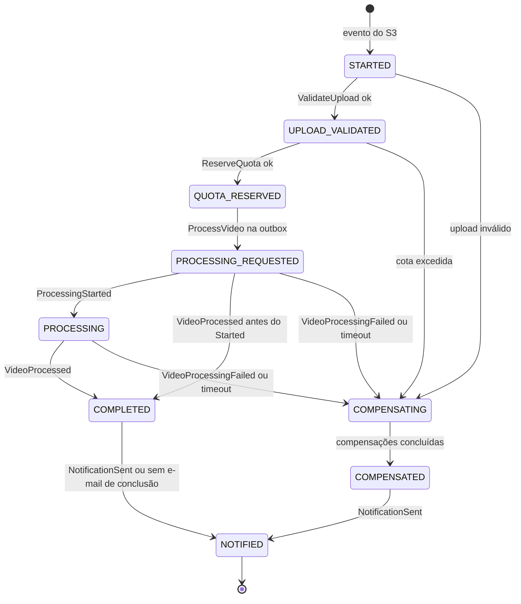

# SAGA orquestrada do processamento

O processamento de um vídeo envolve três serviços e quatro recursos (banco, S3, filas e e-mail). Para
manter tudo consistente sem transação distribuída, usamos uma **SAGA orquestrada**. O orquestrador vive
no `fiapx-video-api`: o agregado `ProcessingSaga` guarda o estado na tabela
`fiapx_video.processing_sagas`, reage a mensagens (evento do S3 e respostas) e emite comandos pela
**transactional outbox**. Decisão em [ADR-008](../04-adrs/README.md) e comparação em
[RFC-003](../05-rfcs/README.md).

## Passos

| # | Passo | Participante | Ação | Sucesso | Falha | Compensação |
|---|---|---|---|---|---|---|
| 1 | `ValidateUpload` | video-api (local) | `HeadObject`: o objeto existe, tamanho ≤ 500 MB, extensão permitida (mp4, avi, mov, mkv, wmv, flv, webm) e MIME `video/*` ou `application/octet-stream` (navegadores nem sempre reconhecem mkv, flv e wmv) | segue | `FAILED` (`INVALID_UPLOAD`) | `DeleteUploadedObject` |
| 2 | `ReserveQuota` | video-api (local) | Reserva 1 vaga na cota de processamentos simultâneos do usuário (padrão 5) | segue | `FAILED` (`QUOTA_EXCEEDED`) | `ReleaseQuota` |
| 3 | `ProcessVideo` | video-processor | Comando na fila `processing-commands` | `VideoProcessed` | `VideoProcessingFailed` ou timeout (30 min) | `CleanupArtifacts` (apaga `results/{id}/` parcial) |
| 4 | `CompleteVideo` | video-api (local) | `COMPLETED`, grava `zip_key` e `frame_count`, libera a cota | — | — | — (**ponto sem retorno**) |
| 5 | `NotifyUser` | notification | `SendNotification` (`VIDEO_FAILED` obrigatório, `VIDEO_COMPLETED` opcional) | `NotificationSent` | `NotificationFailed` → retry e DLQ | não compensa |

Os passos 1 e 2 são locais e rodam na mesma transação que grava o comando do passo 3 na outbox.

## Estados da saga



Sequência feliz: `STARTED → UPLOAD_VALIDATED → QUOTA_RESERVED → PROCESSING_REQUESTED → PROCESSING →
COMPLETED → NOTIFIED`. Falha: `COMPENSATING → COMPENSATED (vídeo FAILED) → NOTIFIED`.

O `VIDEO_COMPLETED` é opcional e fica ligado por padrão (`FIAPX_NOTIFY_ON_COMPLETED=true` no `fiapx-video-api`).
Desligado, a saga vai de `COMPLETED` direto para `NOTIFIED` ("sem e-mail de conclusão").

Se o `NotificationFailed` chegar, a saga registra o erro no histórico e permanece em `COMPLETED` ou
`COMPENSATED`; o alarme da DLQ avisa o time.

## Relação com o status do vídeo

| Estado da saga | Status do vídeo |
|---|---|
| (antes da saga) | `PENDING_UPLOAD` |
| `STARTED`, `UPLOAD_VALIDATED` | `UPLOADED` |
| `QUOTA_RESERVED`, `PROCESSING_REQUESTED` | `QUEUED` |
| `PROCESSING` | `PROCESSING` |
| `COMPLETED` e `NOTIFIED` após sucesso | `COMPLETED` |
| `COMPENSATING` | mantém o status anterior até terminar |
| `COMPENSATED` e `NOTIFIED` após falha | `FAILED` |
| (sem upload em 1 h, sem saga) | `EXPIRED` |

## Caminho de falha

```text
Falha no passo N → compensações dos passos < N em ordem inversa
                → vídeo FAILED com failure_reason
                → SendNotification(VIDEO_FAILED)   ← atende RF5
```

| Falha em | Compensações (em ordem) | `failure_reason` |
|---|---|---|
| `ValidateUpload` | `DeleteUploadedObject` | `INVALID_UPLOAD` |
| `ReserveQuota` | `DeleteUploadedObject` | `QUOTA_EXCEEDED` |
| `ProcessVideo` (erro) | `CleanupArtifacts` → `ReleaseQuota` | `error_code` recebido (`FFMPEG_ERROR`, `NO_FRAMES`, `DOWNLOAD_ERROR`, `UPLOAD_ERROR`) |
| `ProcessVideo` (timeout) | `CleanupArtifacts` → `ReleaseQuota` | `PROCESSING_TIMEOUT` |

O vídeo original em `uploads/` não é apagado na falha do processamento: o lifecycle do bucket o remove
em 7 dias, o que ajuda na investigação.

Motivos legíveis enviados ao usuário:

| Código | Texto no e-mail e na tela |
|---|---|
| `INVALID_UPLOAD` | O arquivo enviado não é um vídeo válido ou ultrapassa 500 MB |
| `QUOTA_EXCEEDED` | Você já tem 5 vídeos em processamento. Aguarde a conclusão e envie de novo |
| `FFMPEG_ERROR` | O arquivo de vídeo está corrompido ou em um formato que não conseguimos ler |
| `NO_FRAMES` | Não foi possível extrair imagens do vídeo. Ele pode ter menos de 1 segundo |
| `DOWNLOAD_ERROR`, `UPLOAD_ERROR` | Tivemos um problema temporário ao processar o vídeo. Tente enviar de novo |
| `PROCESSING_TIMEOUT` | O processamento demorou mais do que o esperado. Tente enviar de novo |

O banco e as mensagens guardam o **código** (`videos.failure_code`); o texto legível é derivado dele na
API (`failure_reason`) e nos templates de e-mail.

## Regras de robustez

| Regra | Como funciona |
|---|---|
| **Transactional outbox** | A mudança de estado da saga e o comando a enviar são gravados na mesma transação. O `outbox-relay` publica e marca `published_at`. Se o relay cair entre publicar e marcar, a mensagem sai de novo e o consumidor descarta a duplicata |
| **Idempotência** | Toda mensagem tem `message_id`. O consumidor grava em `processed_messages` na mesma transação do efeito. Mensagem repetida vira no-op |
| **Guardas de transição** | O agregado rejeita transições inválidas, como `VideoProcessed` em saga `COMPENSATING`. A mensagem é descartada com log de warning e não vai para a DLQ |
| **Ordem das respostas** | A fila `saga-replies.fifo` usa `MessageGroupId = saga_id`, então as respostas de uma saga chegam em ordem. Um `VideoProcessed` sem `ProcessingStarted` antes (falha do worker entre os dois envios) é aceito |
| **Lock otimista** | `processing_sagas.version` impede que dois consumidores avancem a mesma saga ao mesmo tempo |
| **Falhas no worker** | Definitiva (vídeo corrompido, sem frames, timeout do ffmpeg, vídeo inexistente no S3): `VideoProcessingFailed` na hora e a mensagem é apagada. Transitória (S3 ou rede): a mensagem não é apagada e volta à fila. Na **última tentativa** (`ApproximateReceiveCount` ≥ `FIAPX_MAX_ATTEMPTS`, padrão 3, igual ao `maxReceiveCount` da DLQ) o worker responde `VideoProcessingFailed` com `DOWNLOAD_ERROR` ou `UPLOAD_ERROR` e apaga a mensagem, para a saga compensar na hora em vez de esperar o timeout. Comando inválido (chave de vídeo de outro `video_id`) vai para a DLQ |
| **Timeout** | `deadline_at` é preenchido quando a saga entra em `PROCESSING_REQUESTED` (agora + 30 min) e renovado no `ProcessingStarted`. `saga:check-timeouts` (a cada minuto) compensa as sagas `PROCESSING_REQUESTED` ou `PROCESSING` com prazo vencido. Isso cobre também a mensagem que foi para a DLQ antes de qualquer resposta |
| **Worker idempotente** | Se `results/{video_id}/frames.zip` já existe, o worker responde `VideoProcessed` sem reprocessar |
| **Correlação** | O `correlation_id` da saga é o id do evento do S3 que a iniciou: o `MessageId` (UUID) da mensagem SQS que entregou o evento, já que o evento do S3 não tem um id em formato UUID. Fica em `processing_sagas.correlation_id` e é copiado para todos os comandos, inclusive os disparados pelo timeout. Numa notificação com mais de um registro, os demais recebem um UUID v5 derivado desse id |
| **Limpeza** | `messaging:prune` (diário) apaga as mensagens da outbox já publicadas e os registros de `processed_messages` com mais de 7 dias. O SQS retém mensagens por no máximo 4 dias, então uma duplicata não chega depois disso |
| **Expiração** | `videos:expire-pending` marca como `EXPIRED` os vídeos em `PENDING_UPLOAD` há mais de 1 hora |

## Cenários BDD obrigatórios

Os cenários abaixo viram features do Behat no `fiapx-video-api` (Etapa 4):

```gherkin
Funcionalidade: SAGA de processamento de vídeo

  Cenário: processamento com sucesso
    Dado um vídeo "aula.mp4" enviado por "ana@exemplo.com" com cota livre
    Quando o evento de upload chegar
    E o processador responder "ProcessingStarted" e depois "VideoProcessed" com 120 frames
    Então o vídeo fica "COMPLETED" com 120 frames
    E a cota de "ana@exemplo.com" volta a 0 em uso

  Cenário: falha no ffmpeg com compensação
    Dado um vídeo em processamento
    Quando o processador responder "VideoProcessingFailed" com "FFMPEG_ERROR"
    Então a saga envia "CleanupArtifacts"
    E ao receber "ArtifactsCleaned" o vídeo fica "FAILED" com motivo "FFMPEG_ERROR"
    E a cota é liberada
    E um "SendNotification" com template "VIDEO_FAILED" é gravado na outbox

  Cenário: timeout do processamento
    Dado um vídeo em "PROCESSING" com prazo vencido
    Quando a verificação de timeouts rodar
    Então a saga entra em "COMPENSATING" e envia "CleanupArtifacts"

  Cenário: cota excedida
    Dado um usuário com 5 vídeos em processamento
    Quando o evento de upload de um sexto vídeo chegar
    Então o vídeo fica "FAILED" com motivo "QUOTA_EXCEEDED"
    E o arquivo enviado é apagado

  Cenário: upload inválido
    Dado um evento de upload de um arquivo de 600 MB
    Quando a saga validar o upload
    Então o vídeo fica "FAILED" com motivo "INVALID_UPLOAD"

  Cenário: mensagem duplicada
    Dado que a resposta "VideoProcessed" com message_id "X" já foi processada
    Quando a mesma mensagem chegar de novo
    Então nada muda no vídeo, na saga e na cota

  Cenário: resposta fora de ordem
    Dado uma saga em "COMPENSATING"
    Quando chegar um "VideoProcessed" atrasado
    Então a resposta é descartada com log de warning
    E a saga continua em "COMPENSATING"
```

## Mensagens trocadas

Envelope e payloads em [`contracts/`](../contracts/). Resumo:

| Tipo | Direção | Fila |
|---|---|---|
| `ProcessVideo`, `CleanupArtifacts` | api → processor | `processing-commands` |
| `ProcessingStarted`, `VideoProcessed`, `VideoProcessingFailed`, `ArtifactsCleaned` | processor → api | `saga-replies.fifo` |
| `SendNotification` | api → notification | `notification-commands` |
| `NotificationSent`, `NotificationFailed` | notification → api | `saga-replies.fifo` |
