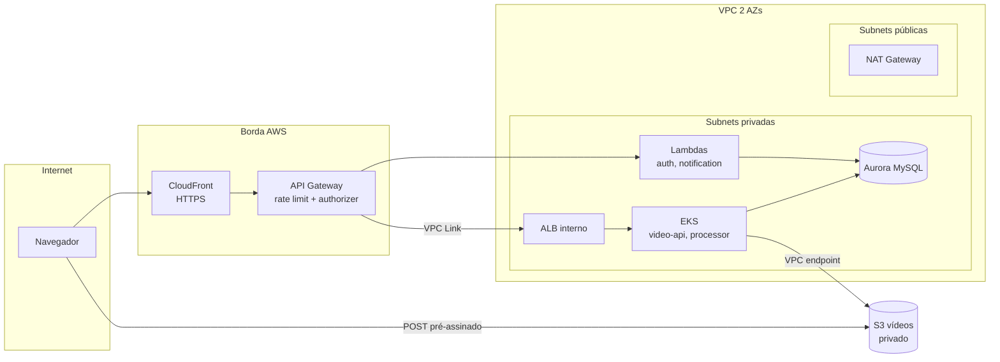

# Segurança

## Visão geral

## Identidade e acesso dos usuários

| Controle | Detalhe |
|---|---|
| Senhas | bcrypt com custo 12; de 8 a 72 caracteres, com letra maiúscula, número e símbolo; nunca registradas em log |
| Recuperação de senha | Resposta sempre igual (202), exista ou não o e-mail; token aleatório de 256 bits, válido por 30 min, de uso único, guardado só como hash SHA-256; pedido novo invalida os anteriores; no máximo 1 e-mail a cada 2 min por usuário |
| Troca de senha | Exige a senha atual; e-mail `PASSWORD_CHANGED` avisa o usuário de toda troca |
| Token | JWT RS256, validade de 1 hora, claims `sub`, `email`, `name`, `iss = fiapx-auth`, `aud = fiapx-api`, `exp` |
| Chave privada | Só no Secrets Manager; só as Lambdas `login` e `password` têm permissão de leitura |
| Chave pública | No SSM Parameter Store; o Terraform do `fiapx-auth` a passa ao `authorizer` por variável de ambiente (rotacionar exige novo deploy), e o `video-api` a lê do SSM |
| Authorizer | REQUEST, payload 2.0, cache de 300 s. Valida assinatura, `iss`, `aud` e `exp` e repassa `x-user-id`, `x-user-email` e `x-user-name` |
| Defesa em profundidade | O `video-api` revalida o JWT com a chave pública, mesmo atrás do authorizer, com as mesmas regras e os mesmos vetores de teste do authorizer ([contrato do JWT](../contracts/jwt/README.md)) |
| Mensagens de erro | Genéricas no cadastro e no login: não revelam se o e-mail existe |
| Rate limit | Throttling no stage do API Gateway, mais restrito nas rotas `/api/auth/*` e ainda mais em `/api/auth/password/*` |
| Isolamento entre usuários | Toda consulta do `video-api` filtra por `user_id` do token. Vídeo de outro usuário responde 404 |

## Rede

- VPC em 2 AZs. Subnets públicas só com o NAT Gateway (um único, para reduzir custo).
- EKS, Lambdas, Aurora e ALB em subnets privadas. O ALB interno só é alcançável pelo VPC Link.
- VPC endpoints para S3 e DynamoDB (gateway, sem custo) e para SQS, Secrets Manager e SSM (interface): o
  tráfego para esses serviços não sai pela internet. O SES é acessado pelo NAT.
- Security groups por componente, com regras mínimas (Aurora aceita 3306 só dos SGs do EKS e das Lambdas).

## Permissões (IAM)

Cada serviço tem uma role própria, com EKS Pod Identity no cluster e role de execução nas Lambdas.

| Identidade | Permissões |
|---|---|
| `video-api` | S3: POST/GET pré-assinados, `HeadObject` e `DeleteObject` em `uploads/` e `results/`; SQS: receber de `video-uploaded` e `saga-replies.fifo`, enviar para `processing-commands` e `notification-commands`; Secrets Manager: segredo do próprio usuário do banco |
| `video-processor` | S3: `GetObject` em `uploads/`, `PutObject` e `DeleteObject` em `results/`; SQS: receber e alterar visibilidade em `processing-commands`, enviar para `saga-replies.fifo` |
| KEDA | SQS: `GetQueueAttributes` das filas monitoradas |
| Lambda `login` | Secrets Manager: chave privada do JWT e segredo do banco `fiapx_auth` |
| Lambda `password` | Secrets Manager: chave privada do JWT (o reset já autentica) e segredo do banco `fiapx_auth`; SQS: enviar para `notification-commands` |
| Lambdas `register` e `authorizer` | Segredo do banco (`register`) e parâmetro SSM da chave pública (`authorizer`) |
| Lambda `notification` | SQS: consumir `notification-commands`, enviar para `saga-replies.fifo`; DynamoDB: `PutItem`, `UpdateItem`, `GetItem`, `Query` na própria tabela; SES: `SendEmail` com o configuration set |
| GitHub Actions | OIDC com uma role por repositório, limitada ao repositório e à branch `main` (apply) ou a PRs (plan) |

## Dados

| Dado | Proteção |
|---|---|
| Vídeos e zips | Bucket privado, Block Public Access, SSE-S3, acesso só por URL pré-assinada de curta duração (upload 1 h, download 15 min) |
| Upload | POST pré-assinado com `content-length-range` (até 500 MB) e `Content-Type` fixado na política |
| CORS do bucket | Só `POST`, só a origem do CloudFront |
| Banco | Aurora com criptografia em repouso, TLS, usuário por serviço com privilégio mínimo, senhas no Secrets Manager |
| DynamoDB | Criptografia padrão, PITR, TTL de 90 dias para dados pessoais (e-mail) |
| Logs | JSON sem senha, token ou URL pré-assinada; e-mail só nos campos necessários para rastreabilidade |

## Segredos

- Nada de segredo no Git: `.env` e chaves estão no `.gitignore`; cada repositório tem um `.env.example`.
- Segredos de aplicação no Secrets Manager; configurações não sensíveis no SSM Parameter Store.
- GitHub Actions sem access keys: OIDC com roles por repositório.
- Licença do New Relic como GitHub Secret no CI e como segredo no cluster.

## Cadeia de entrega

- Imagens com tag igual ao SHA do commit, scan com Trivy (o pipeline falha em `CRITICAL`) e scan on push
  no ECR.
- Containers com usuário não-root e `HEALTHCHECK`.
- SonarCloud com Quality Gate e `checkov` no Terraform.
- `main` protegida: mudança só por pull request.

## Ameaças consideradas

| Ameaça | Mitigação |
|---|---|
| Força bruta no login | Rate limit no API Gateway, bcrypt custo 12, mensagem genérica |
| Enumeração de e-mails pela recuperação de senha | Resposta 202 idêntica para qualquer e-mail |
| Link de redefinição vazado | Validade de 30 min, uso único, token fora da URL da API e fora dos logs |
| Token roubado | Validade curta (1 h), HTTPS em todo o caminho, token em memória e `sessionStorage` (não em `localStorage`) |
| Acesso a vídeo de outro usuário | Filtro por `user_id` em toda consulta; URLs pré-assinadas por objeto |
| Upload de arquivo gigante ou malicioso | `content-length-range`, validação de extensão e MIME na saga, `ffmpeg` em container isolado com `emptyDir` limitado |
| Path traversal no download (problema do projeto base) | Não há leitura de caminho vindo do cliente: a chave do zip é montada a partir do `video_id` do banco |
| Mensagem forjada na fila | Filas sem acesso público; políticas IAM restritas aos produtores; validação contra JSON Schema |
