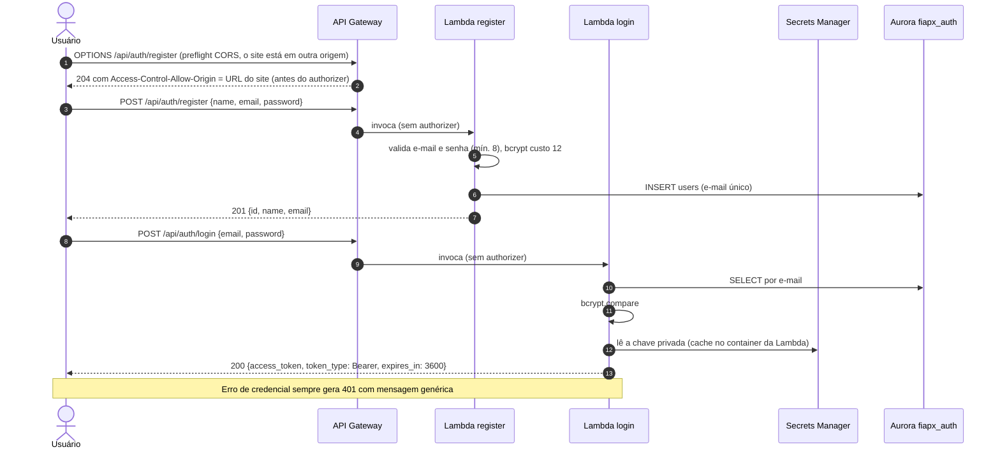
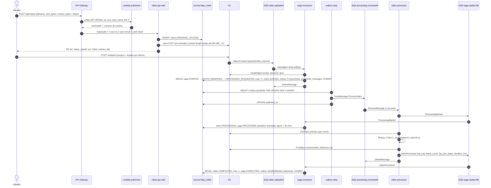
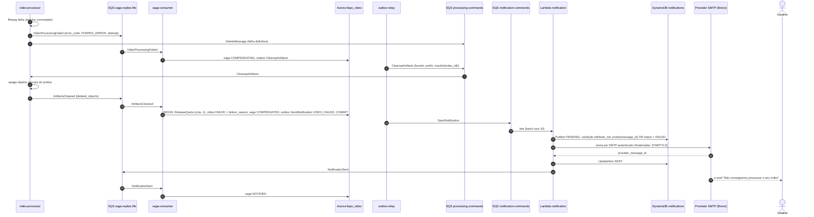
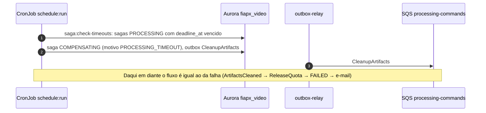
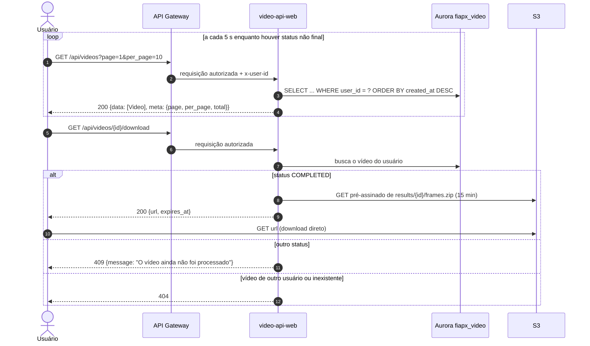
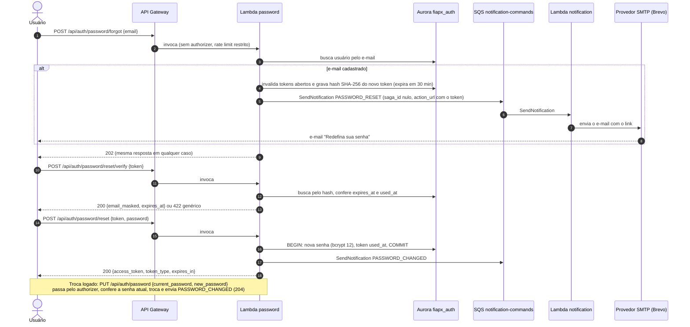

# Diagramas de sequência

Quatro fluxos: login, upload com processamento, falha com compensação e download.

## 1. Cadastro e login

## 2. Upload e processamento com sucesso

## 3. Falha no processamento com compensação

### Timeout

## 4. Consulta e download

## 5. Recuperação e troca de senha

