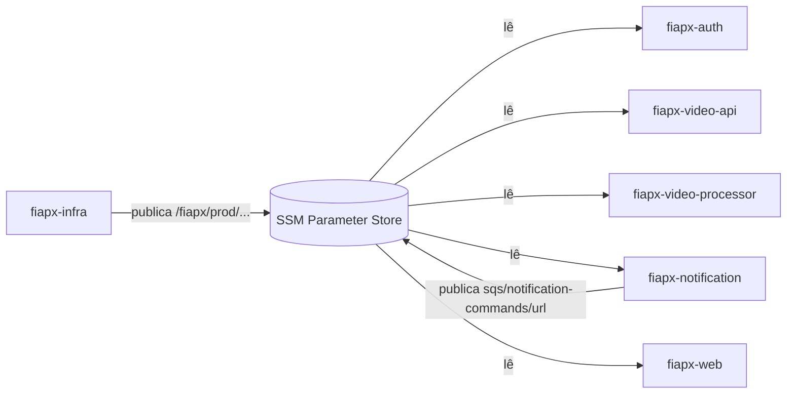

# ADR-001 — Um repositório por serviço (polyrepo) e comunicação entre repositórios via SSM Parameter Store

- **Status:** Aceito
- **Data:** 2026-11-16
- **Decisores:** Diego Fenille, Eduardo Santos
- **Relacionados:** [ADR-002](ADR-002-aws-e-terraform-com-backend-s3-e-lock-nativo.md), [ADR-012](ADR-012-ci-cd-com-github-actions-oidc-e-ordem-de-deploy.md), [ADR-016](ADR-016-terraform-apply-somente-via-github-actions.md)

## Contexto

O projeto base do FIAP X é um único `main.go` com tudo junto: HTTP, processamento, arquivos e página web. A solução nova tem quatro bounded contexts (Identidade, Gestão de Vídeos, Processamento e Notificação), um front-end, a infraestrutura compartilhada e a documentação. Cada parte usa uma stack diferente (Terraform, Node.js 24, PHP 8.4.27 + Laravel 13, React) e tem um ciclo de deploy diferente (Terraform, Lambda, EKS, S3 + CloudFront).

O enunciado pede o código versionado no GitHub (RT3) e um link para cada repositório. Os serviços precisam de valores criados pela infraestrutura (IDs de subnets, URLs de filas, endpoint do Aurora, IDs do API Gateway), mas não devem depender do state interno do Terraform de outro repositório.

## Decisão

Adotamos **polyrepo**: um repositório por serviço na organização GitHub **`hackathon-fiap-soat`**, todos com o prefixo `fiapx-`.

| Repositório | Responsabilidade |
| --- | --- |
| `fiapx-docs` | documentação, ADRs, RFCs, contratos (JSON Schema) e OpenAPI |
| `fiapx-infra` | VPC, EKS e add-ons, Aurora, S3, SQS compartilhadas, SES, ECR, API Gateway, ALB interno, OIDC, SSM |
| `fiapx-auth` | Lambdas `register`, `login` e `authorizer`, database `fiapx_auth` |
| `fiapx-video-api` | aplicação principal, orquestrador da SAGA, database `fiapx_video` |
| `fiapx-video-processor` | worker `ffmpeg` no EKS |
| `fiapx-notification` | fila `notification-commands`, Lambda, SES e DynamoDB |
| `fiapx-web` | SPA React servida pelo CloudFront |

A integração entre repositórios é feita pelo **AWS SSM Parameter Store**, no padrão `/fiapx/<env>/...`:

- O `fiapx-infra` publica as saídas pelo módulo `ssm-outputs`: `/fiapx/prod/vpc/private_subnet_ids`, `/fiapx/prod/eks/cluster_name`, `/fiapx/prod/aurora/endpoint`, `/fiapx/prod/aurora/secret_arn`, `/fiapx/prod/s3/videos_bucket`, `/fiapx/prod/sqs/<fila>/url`, `/fiapx/prod/sqs/<fila>/arn`, `/fiapx/prod/apigw/api_id`, `/fiapx/prod/apigw/vpc_link_id`, `/fiapx/prod/alb/target_group_arn`, `/fiapx/prod/ecr/<repo>/url`, `/fiapx/prod/ses/from_address`, `/fiapx/prod/web/bucket`, `/fiapx/prod/web/url`, entre outros.
- Um serviço também pode publicar: o `fiapx-notification` publica `/fiapx/prod/sqs/notification-commands/url`, que o `fiapx-video-api` lê.
- O Terraform dos serviços lê esses valores com `data "aws_ssm_parameter"`. **Não usamos `terraform_remote_state`.**
- Os manifests Kubernetes ficam no repositório de cada serviço (`k8s/`). O `fiapx-infra` cria só o cluster e os add-ons compartilhados.

Todos os repositórios têm `main` protegida, PR obrigatório e acesso para o usuário `soat-architecture`. Detalhes em [ADR-012](ADR-012-ci-cd-com-github-actions-oidc-e-ordem-de-deploy.md).

## Alternativas consideradas

| Alternativa | Por que não |
| --- | --- |
| Monorepo com todos os serviços | Mistura stacks e pipelines diferentes no mesmo repositório. Exige filtros por caminho em todos os workflows e deixa as fronteiras entre bounded contexts menos visíveis |
| `terraform_remote_state` entre repositórios | Cada consumidor passa a ler o state inteiro do `fiapx-infra` e depende da estrutura interna dele. Também exige permissão de leitura no bucket de state para todas as roles |
| Valores copiados em `tfvars` ou GitHub Secrets | Duplicação manual, que fica desatualizada depois de qualquer `apply` |
| Outputs no Secrets Manager | Custa por segredo e serve para dados sensíveis. A maioria das saídas não é sensível |

## Consequências

### Positivas

- Cada serviço tem pipeline, permissões OIDC e ciclo de deploy próprios. Um deploy do worker não reimplanta a autenticação.
- As fronteiras dos bounded contexts ficam claras e cada repositório é dono dos seus dados.
- O contrato entre repositórios é uma lista pequena de chaves SSM, e não o state inteiro.
- As roles dos serviços precisam só de `ssm:GetParameter` em `/fiapx/<env>/*`, sem acesso ao bucket de state.

### Negativas / riscos

- Sete repositórios para configurar (proteção de branch, SonarCloud, OIDC, templates de PR).
- Mudanças que atravessam serviços, como um contrato de mensagem, exigem PRs coordenados.
- Existe uma ordem de deploy na primeira subida, porque os serviços precisam dos parâmetros publicados.
- Renomear uma chave SSM quebra quem a lê. O Terraform não detecta isso entre repositórios.

### Mitigações

- Os contratos de mensagens ficam em JSON Schema no `fiapx-docs/contracts/` e são validados nos testes de cada serviço. Mudanças incompatíveis sobem a `version` do envelope ([ADR-007](ADR-007-amazon-sqs-como-mensageria.md)).
- A ordem de deploy está documentada em [ADR-012](ADR-012-ci-cd-com-github-actions-oidc-e-ordem-de-deploy.md) e em `06-deploy/fluxo-de-deploy.md`.
- As chaves SSM ficam documentadas e só mudam por PR no `fiapx-infra`. Uma chave nova é criada antes de a antiga ser removida.
- O `fiapx-docs/README.md` lista os 7 repositórios e os links.
