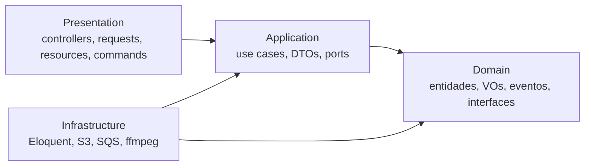

# ADR-003 — DDD + Clean Architecture nos serviços Laravel

- **Status:** Aceito
- **Data:** 2026-11-16
- **Decisores:** Diego Fenille, Eduardo Santos
- **Relacionados:** [ADR-008](ADR-008-saga-orquestrada-com-outbox-e-consumidores-idempotentes.md), [ADR-009](ADR-009-worker-laravel-no-eks-escalado-por-keda.md)

## Contexto

O projeto base mistura, em um único arquivo, regra de negócio (formatos aceitos, extração de frames), I/O (disco, `ffmpeg`) e HTTP. Não há como testar a regra sem subir o servidor e o `ffmpeg`.

A solução nova tem regras de negócio não triviais: o ciclo de vida do vídeo (`PENDING_UPLOAD` → `UPLOADED` → `QUEUED` → `PROCESSING` → `COMPLETED`/`FAILED`/`EXPIRED`), a máquina de estados da SAGA com compensações e a cota de processamentos simultâneos por usuário. Essas regras precisam ser testadas com cobertura ≥ 80% e cenários BDD, sem depender de AWS, banco ou framework.

O time já aplicou DDD + Clean Architecture no `tech-challenge-application` (Fases 1 a 4) e quer manter o mesmo padrão. Os dois serviços PHP (`fiapx-video-api` e `fiapx-video-processor`) usam PHP 8.4.27 + Laravel 13.

## Decisão

Os serviços Laravel seguem **DDD + Clean Architecture** em quatro camadas dentro de `app/`, com as dependências apontando para dentro:

Regras de ouro:

- **Domain** é PHP puro: sem Laravel, Eloquent ou AWS SDK. Contém entidades e agregados (`Video`, `ProcessingSaga`, `ProcessingQuota`, `ProcessingJob`), value objects (`VideoId`, `VideoStatus`, `StorageKey`, `FileSize`, `VideoFormat`, `FailureReason`, `SagaState`, `Deadline`, `FramesPerSecond`...), eventos e interfaces de repositório.
- **Application** contém os use cases (`RequestVideoUploadUseCase`, `ListUserVideosUseCase`, `StartProcessingSagaUseCase`, `HandleSagaReplyUseCase`, `CheckSagaTimeoutsUseCase`, `ProcessVideoUseCase`, `CleanupArtifactsUseCase`...) e depende só de interfaces (ports como `CommandBus`, `ObjectStorage`, `TransactionManager`, `MessageDeduplicator`).
- **Infrastructure** implementa as interfaces: repositórios Eloquent, `S3ObjectStorage`, `OutboxCommandBus`, `SqsConsumer`, `FfmpegFrameExtractor`, `ZipFrameArchiver`, `VisibilityHeartbeat`.
- **Presentation** só converte HTTP ou console em DTO e chama o use case.
- Toda interface é ligada à implementação no `RepositoryServiceProvider`.
- **Exceções:** VOs lançam `\InvalidArgumentException`; regras de negócio lançam `\DomainException` (→ HTTP 422); recurso inexistente → 404. Tudo é tratado pelo handler global em `bootstrap/app.php`. Não há try/catch em controllers e use cases. A única exceção é o loop dos consumidores de fila, que precisa decidir entre ack e retry.
- **Identificadores:** UUID v7 gerado no domínio com `ramsey/uuid` (biblioteca, não framework), atrás da interface `IdGenerator`. O relógio fica atrás da interface `Clock`.

Os serviços Node.js (`fiapx-auth`, `fiapx-notification`) seguem a mesma separação em `src/domain`, `src/application`, `src/infrastructure` e `src/handlers`, sem Laravel.

## Alternativas consideradas

| Alternativa | Por que não |
| --- | --- |
| MVC padrão do Laravel (Eloquent nos controllers e models com regra) | Acopla a regra ao ORM e ao HTTP. A máquina de estados da SAGA ficaria difícil de testar isoladamente |
| Arquitetura hexagonal sem DDD tático | Isola a infraestrutura, mas não dá linguagem nem agregados para modelar vídeo, saga e cota |
| Microframework (Slim, Lumen) | O Laravel já traz fila, scheduler, console, migrations e testes. O próprio Laravel não recomenda mais o Lumen para projetos novos |
| Go, como no projeto base | Decisão fechada do time por PHP 8.4.27 + Laravel 13 nos serviços principais |

## Consequências

### Positivas

- O domínio (estados do vídeo, transições da saga, cota) é testado com PHPUnit puro, rápido e sem I/O.
- Os cenários BDD da SAGA (Behat) exercitam os use cases com adapters falsos.
- Trocar SQS, S3 ou `ffmpeg` afeta só a camada Infrastructure.
- Padrão conhecido pelo time, reaproveitado do `tech-challenge-application`.

### Negativas / riscos

- Mais arquivos e mapeamento entre entidades de domínio e models Eloquent.
- Risco de "vazamento" do framework para o Domain com o tempo.
- Curva de aprendizado maior para quem espera o Laravel "padrão".

### Mitigações

- `phpstan` (nível 6+) e `pint` no CI ([ADR-012](ADR-012-ci-cd-com-github-actions-oidc-e-ordem-de-deploy.md)).
- Revisão de PR com atenção a imports de `Illuminate\*` e `Aws\*` dentro de `app/Domain`. Uma regra de arquitetura automatizada pode ser adicionada no CI.
- A estrutura de pastas fica documentada em `03-arquitetura/c4-componentes-video-api.md` e no README de cada serviço.
