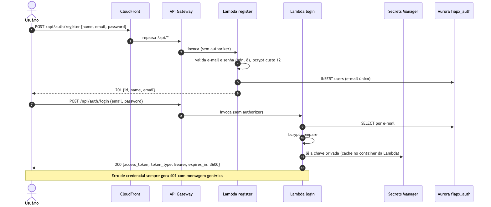

# ADR-004 — Autenticação com API Gateway + Lambda Node.js + Lambda Authorizer e JWT RS256

- **Status:** Aceito
- **Data:** 2026-11-16
- **Decisores:** Diego Fenille, Eduardo Santos
- **Relacionados:** RFC-004 (autenticação), [ADR-005](ADR-005-aurora-mysql-serverless-v2-um-database-por-servico.md), [ADR-010](ADR-010-api-gateway-vpc-link-alb-interno-e-targetgroupbinding.md), [ADR-014](ADR-014-front-end-react-vite-em-s3-cloudfront-mesma-origem.md)

## Contexto

O RF3 exige que o sistema seja protegido por usuário e senha. O projeto base não tem autenticação e usa CORS `*`.

Precisamos de cadastro, login e validação de token em todas as rotas de vídeo, e o `video-api` precisa saber quem é o usuário (id, e-mail e nome, que a SAGA usa na notificação). A identidade é um bounded context próprio (Usuário, Credencial, Token de acesso). A autenticação é uma decisão fechada do time: API Gateway (HTTP API) com Lambdas em Node.js 24.

## Decisão

O repositório `fiapx-auth` contém três Lambdas Node.js 24 e o database `fiapx_auth` no Aurora ([ADR-005](ADR-005-aurora-mysql-serverless-v2-um-database-por-servico.md)):

- **`register`** — `POST /api/auth/register` `{name, email, password}` → `201`. E-mail único (`uq_users_email`), senha com no mínimo 8 caracteres, hash **bcrypt com custo 12**.
- **`login`** — `POST /api/auth/login` `{email, password}` → `{access_token, token_type: "Bearer", expires_in: 3600}`.
- **`authorizer`** — Lambda Authorizer do tipo REQUEST, payload 2.0, respostas simples, **cache de 300 s**.

Token:

- **JWT RS256** com claims `sub` (user_id), `email`, `name`, `iss: fiapx-auth`, `aud: fiapx-api` e `exp` (1 hora).
- A **chave privada** fica no **Secrets Manager** e só a Lambda `login` tem permissão de leitura.
- A **chave pública** fica no **SSM Parameter Store**. O `authorizer` e o `video-api` a leem.

Validação em duas camadas:

1. O `authorizer` valida assinatura, `iss`, `aud` e `exp` e repassa `user_id`, `email` e `name` no contexto. O API Gateway injeta esses valores nos headers `x-user-id`, `x-user-email` e `x-user-name` para o `video-api`.
2. O `video-api` (`GatewayUserResolver`) lê os headers `x-user-*` e **revalida o JWT com a chave pública**, como defesa em profundidade.

Diagrama mantido em [sequencias.md](../03-arquitetura/sequencias.md#1-cadastro-e-login).

Segurança adicional: respostas de erro genéricas (não revelam se o e-mail existe) e rate limit no stage do API Gateway. As Lambdas rodam dentro da VPC para acessar o Aurora.

## Alternativas consideradas

| Alternativa | Por que não |
| --- | --- |
| Amazon Cognito | Resolve o problema, mas esconde a regra de identidade em um serviço gerenciado e reduz o código a demonstrar. A decisão do time foi implementar o bounded context de Identidade |
| JWT emitido e validado só no Laravel | Concentra a identidade no `video-api` e mistura bounded contexts. Requisições não autenticadas chegariam ao cluster |
| JWT HS256 (segredo compartilhado) | Todos os validadores precisariam do segredo, que também serve para assinar. Com RS256 só o `login` assina |
| Sessão com cookie | Exige estado no servidor ou sticky session, o que não combina com Lambdas e pods escaláveis |

A comparação completa está na RFC-004.

## Consequências

### Positivas

- Requisições sem token válido são barradas no API Gateway e não consomem recursos do EKS.
- Só um componente (Lambda `login`) consegue emitir tokens.
- O `video-api` recebe a identidade pronta nos headers e ainda confere a assinatura.
- O cache de 300 s do authorizer reduz invocações e latência.

### Negativas / riscos

- Lambdas em VPC têm cold start maior, e o bcrypt com custo 12 é propositalmente lento.
- Com o cache do authorizer, um token pode continuar aceito por até 300 s depois de deixar de ser válido. Não há revogação de token: ele vale até o `exp`.
- A rotação da chave RSA exige atualizar o Secrets Manager e o SSM de forma coordenada.
- Conexões MySQL abertas por Lambdas concorrentes podem pressionar o Aurora.

### Mitigações

- Expiração curta (`expires_in: 3600`). O front-end volta ao login ao receber 401 (sem header) ou 403 (token inválido ou expirado: é o que o authorizer com respostas simples devolve).
- O procedimento de rotação da chave deve ser descrito em `03-arquitetura/seguranca.md`.
- Conexão `mysql2` reaproveitada entre invocações e rate limit no stage.
- Testes Jest (unit + integração com o MySQL do compose) cobrem aceitar e rejeitar tokens (assinatura, `iss`, `aud`, `exp`).
