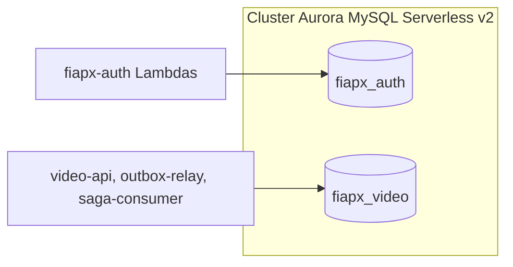

# ADR-005 — Aurora MySQL Serverless v2 com um database por serviço no mesmo cluster

- **Status:** Aceito, parcialmente substituído por [ADR-019](ADR-019-deploy-na-aws-academy-learner-lab.md)
- **Data:** 2026-11-16
- **Decisores:** Diego Fenille, Eduardo Santos
- **Relacionados:** RFC-007 (banco de dados e cache), [ADR-001](ADR-001-polyrepo-e-integracao-via-ssm-parameter-store.md), [ADR-004](ADR-004-autenticacao-api-gateway-lambda-authorizer-jwt-rs256.md), [ADR-008](ADR-008-saga-orquestrada-com-outbox-e-consumidores-idempotentes.md), [ADR-013](ADR-013-notificacao-sqs-lambda-ses-e-historico-no-dynamodb.md)

> **Atualização ([ADR-019](ADR-019-deploy-na-aws-academy-learner-lab.md)):** no lab, o Aurora é **provisionado `db.t3.medium`**, numa instância só (sem Multi-AZ, Enhanced Monitoring nem Performance Insights): o lab nega `rds:CreateDBInstance` com `db.serverless`, então o Serverless v2 deste ADR não é aplicado ali. A classe é a variável `aurora_instance_class`; numa conta própria, `db.serverless` volta a valer. O uso da instância (`CPUUtilization`, `FreeableMemory`) é acompanhado no CloudWatch, não no New Relic. Um database por serviço no mesmo cluster continua.

## Contexto

O RT1 exige persistência. No projeto base, o "banco de dados" é a listagem da pasta `outputs/`. A solução nova precisa guardar usuários, vídeos, o estado da SAGA, a cota de processamento por usuário, a outbox e as mensagens já processadas (idempotência). As operações de SAGA e outbox precisam de **transações ACID** que gravam várias tabelas juntas.

Microsserviços pedem que cada serviço seja dono dos seus dados. Por outro lado, um cluster de banco por serviço multiplica o custo em um projeto acadêmico que precisa ser ligado e desligado. O enunciado recomenda PostgreSQL + Redis; o time escolheu MySQL, e a justificativa está na RFC-007.

## Decisão

- **Um cluster Aurora MySQL v3** (compatível com MySQL 8.0), **Serverless v2**, com mínimo de **0,5 ACU** e máximo de **4 ACU**, em subnets privadas.
- **Um database e um usuário por serviço**, no mesmo cluster. Nenhum serviço acessa o database de outro:

| Database | Dono | Tabelas |
| --- | --- | --- |
| `fiapx_auth` | `fiapx-auth` | `users` |
| `fiapx_video` | `fiapx-video-api` | `videos`, `processing_sagas`, `processing_quotas`, `outbox_messages`, `processed_messages` |

- O `fiapx-video-processor` **não tem banco** (stateless). A idempotência dele vem da chave determinística `results/{video_id}/frames.zip`.
- O `fiapx-notification` usa **DynamoDB** (`fiapx-<env>-notifications`), não o Aurora ([ADR-013](ADR-013-notificacao-sqs-lambda-ses-e-historico-no-dynamodb.md)).
- **Sem FKs entre serviços:** `videos.user_id` é uma referência lógica ao usuário de `fiapx_auth`. `user_email` e `user_name` são um snapshot do token, usado na notificação.
- **Identificadores** `CHAR(36)` com UUID v7 gerado no domínio ([ADR-003](ADR-003-ddd-e-clean-architecture-nos-servicos-laravel.md)).
- **Lock otimista** na saga (`processing_sagas.version`) e unicidade `uq_sagas_video (video_id)`.
- **Script de criação:** `fiapx-infra/sql/create-databases.sql` cria os databases e os usuários com GRANT mínimo. Cada serviço versiona as próprias migrations (Laravel em `database/migrations`, Node em `migrations/*.sql`).
- A senha do master fica no Secrets Manager. O ARN desse secret é publicado no SSM em `/fiapx/<env>/aurora/secret_arn` e o endpoint em `/fiapx/<env>/aurora/endpoint`.
- **Sem Redis:** não há cache nem fila que precise dele. A fila é o SQS ([ADR-007](ADR-007-amazon-sqs-como-mensageria.md)), a cota fica em `processing_quotas` (transacional) e a validação do token é feita pelo cache do authorizer no API Gateway.

## Alternativas consideradas

| Alternativa | Por que não |
| --- | --- |
| Aurora PostgreSQL + Redis (recomendado no enunciado) | Funciona, mas não há necessidade de cache para justificar o Redis. MySQL é a escolha do time. Detalhes na RFC-007 |
| RDS MySQL provisionado | Instância fixa cobra mesmo ociosa. O Serverless v2 ajusta a capacidade em ACUs |
| Um cluster por serviço | Custo multiplicado. A separação por database e usuário já garante que um serviço não leia o banco do outro |
| DynamoDB para tudo | SAGA e outbox precisam de transações entre tabelas e consultas por estado e prazo (`idx_sagas_state_deadline`). O modelo relacional encaixa melhor |

## Consequências

### Positivas

- Transações ACID para gravar o estado da saga e o comando na outbox juntos ([ADR-008](ADR-008-saga-orquestrada-com-outbox-e-consumidores-idempotentes.md)).
- Isolamento lógico por serviço com custo de um cluster só.
- Capacidade elástica entre 0,5 e 4 ACU, adequada a picos de demonstração.

### Negativas / riscos

- O cluster é um ponto único de falha compartilhado: uma indisponibilidade afeta auth e video-api.
- Um serviço com consumo alto pode afetar o outro no mesmo cluster.
- O Aurora continua sendo um dos itens mais caros mesmo no mínimo de ACU.
- Sem FK entre serviços, um `user_id` inexistente não é barrado pelo banco.

### Mitigações

- `prevent_destroy` no cluster e procedimento de destroy documentado ([ADR-016](ADR-016-terraform-apply-somente-via-github-actions.md)).
- O teto de 4 ACU limita o custo. O consumo do Aurora é monitorado no New Relic ([ADR-011](ADR-011-observabilidade-com-new-relic.md)).
- O `user_id` vem de um JWT validado duas vezes ([ADR-004](ADR-004-autenticacao-api-gateway-lambda-authorizer-jwt-rs256.md)), então só chegam ids emitidos pelo `fiapx-auth`.
- Se for necessário, um database pode migrar para outro cluster sem mudar o código, porque nenhum serviço faz join com o database de outro.
