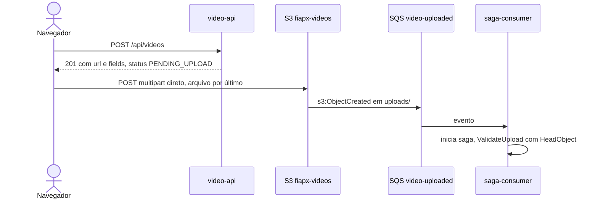

# ADR-006 — Upload direto ao S3 via POST pré-assinado e início da SAGA pelo evento do S3

- **Status:** Aceito
- **Data:** 2026-11-16
- **Decisores:** Diego Fenille, Eduardo Santos
- **Relacionados:** RFC-002 (upload de arquivos grandes), [ADR-007](ADR-007-amazon-sqs-como-mensageria.md), [ADR-008](ADR-008-saga-orquestrada-com-outbox-e-consumidores-idempotentes.md), [ADR-014](ADR-014-front-end-react-vite-em-s3-cloudfront-mesma-origem.md)

## Contexto

No projeto base, o vídeo é enviado no `POST /upload`, gravado em disco e processado dentro da mesma requisição. Isso não escala e perde trabalho se o processo cair.

Na AWS, as rotas públicas passam pelo API Gateway HTTP API, que tem **limite de payload de 10 MB e timeout de 30 s**. Vídeos são maiores que isso. O RF2 exige que nenhuma requisição se perca em picos, e o processamento não pode depender de o navegador continuar aberto depois do envio.

## Decisão

### 1. Upload direto ao S3 com POST pré-assinado

O vídeo não passa pelo API Gateway nem pelo EKS.

- `POST /api/videos` `{filename, size_bytes, content_type}` cria o `Video` em `PENDING_UPLOAD` e responde `201 {id, status, upload: {url, fields, expires_at}}`.
- A policy do POST tem `content-length-range` para limitar o tamanho e uma chave fixa no prefixo `uploads/`.
- O navegador faz o `POST` multipart direto no bucket, com os `fields` recebidos e o arquivo como **último** campo. O progresso vem do `XMLHttpRequest`.
- O bucket tem Block Public Access, SSE-S3 e **CORS só para o `POST` de upload**, com origem igual ao domínio do CloudFront ([ADR-014](ADR-014-front-end-react-vite-em-s3-cloudfront-mesma-origem.md)).
- Lifecycle: `uploads/` expira em 7 dias e `results/` em 30 dias.
- Um vídeo que fica em `PENDING_UPLOAD` por mais de 1 hora vai para `EXPIRED` (comando agendado de expiração de uploads pendentes).

### 2. A SAGA começa pelo evento do S3, não por uma chamada do cliente

- O bucket envia `s3:ObjectCreated` (filtro no prefixo `uploads/`) para a fila `fiapx-<env>-video-uploaded` (SQS Standard, visibility 60 s, DLQ com `maxReceiveCount = 5`).
- O `saga-consumer` do `video-api` consome o evento e inicia a `ProcessingSaga`. O primeiro passo, `ValidateUpload`, faz `HeadObject` e confere existência, tamanho e extensão/MIME (mp4, avi, mov, mkv, wmv, flv, webm). Se o upload for inválido, o vídeo vai para `FAILED` com motivo `INVALID_UPLOAD` e o objeto é apagado (`DeleteUploadedObject`).

## Alternativas consideradas

| Alternativa | Por que não |
| --- | --- |
| Upload pela API (API Gateway → video-api) | Esbarra no limite de 10 MB e no timeout de 30 s do API Gateway e ocupa pods da API com tráfego de arquivo |
| PUT pré-assinado | Não permite limitar o tamanho na policy (`content-length-range` só existe no POST) |
| Multipart upload pré-assinado | Necessário só para arquivos muito grandes. Exige várias URLs e um passo de finalização no cliente |
| Cliente chama `POST /api/videos/{id}/complete` para iniciar o processamento | Se o navegador fechar depois do upload, o vídeo nunca é processado. Também confia no cliente para dizer que o arquivo chegou |

A comparação completa está na RFC-002.

## Consequências

### Positivas

- Tamanho de vídeo independente dos limites do API Gateway. Os pods da API não carregam bytes de vídeo.
- O evento do S3 é durável na SQS: se o `saga-consumer` estiver fora do ar, o processamento começa quando ele voltar (RF2).
- O cliente pode cair depois do upload que o vídeo continua sendo processado.
- O S3 é a fonte da verdade de que o arquivo chegou, não o cliente.

### Negativas / riscos

- O S3 entrega eventos **pelo menos uma vez** e pode duplicá-los.
- O cliente pode enviar um arquivo diferente do declarado (tamanho ou tipo).
- Uploads que nunca acontecem deixam registros `PENDING_UPLOAD`.
- O CORS do bucket precisa conhecer o domínio do CloudFront, o que cria dependência entre os módulos `storage` e `web-hosting`.

### Mitigações

- `uq_sagas_video (video_id)` e a tabela `processed_messages` tornam o início da saga idempotente ([ADR-008](ADR-008-saga-orquestrada-com-outbox-e-consumidores-idempotentes.md)).
- `content-length-range` na policy e `ValidateUpload` com `HeadObject` no servidor.
- O comando agendado marca como `EXPIRED` o que ficou pendente por mais de 1 hora, e o lifecycle limpa `uploads/` em 7 dias.
- Os dois módulos ficam no mesmo `fiapx-infra`, que passa o domínio do CloudFront ao CORS do bucket.
