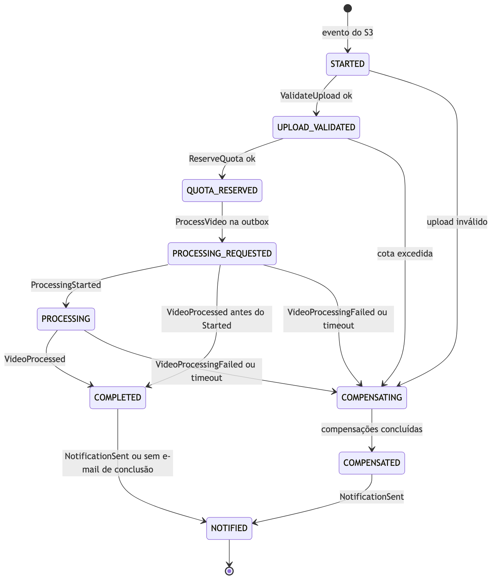

# ADR-008 — SAGA orquestrada no video-api com transactional outbox e consumidores idempotentes

- **Status:** Aceito
- **Data:** 2026-11-16
- **Decisores:** Diego Fenille, Eduardo Santos
- **Relacionados:** RFC-003 (estratégia da SAGA), [ADR-005](ADR-005-aurora-mysql-serverless-v2-um-database-por-servico.md), [ADR-006](ADR-006-upload-direto-s3-e-inicio-da-saga-pelo-evento.md), [ADR-007](ADR-007-amazon-sqs-como-mensageria.md), [ADR-009](ADR-009-worker-laravel-no-eks-escalado-por-keda.md), [ADR-013](ADR-013-notificacao-sqs-lambda-ses-e-historico-no-dynamodb.md)

## Contexto

O processamento de um vídeo envolve três serviços (`video-api`, `video-processor` e `notification`) e recursos que precisam ser desfeitos em caso de falha: a vaga na cota do usuário, o objeto enviado e o zip parcial. Não existe transação distribuída entre Aurora, S3 e SQS.

Sem coordenação, um vídeo pode ficar preso em `PROCESSING`, a cota pode nunca ser liberada e o usuário pode não ser avisado da falha (RF5). Gravar no banco e depois publicar na fila em passos separados também abre a janela do *dual write*: o estado muda, mas o comando se perde (ou o contrário).

## Decisão

Adotamos uma **SAGA orquestrada** cujo orquestrador vive no `fiapx-video-api`. O agregado `ProcessingSaga` (PHP puro, [ADR-003](ADR-003-ddd-e-clean-architecture-nos-servicos-laravel.md)) guarda o estado em `fiapx_video.processing_sagas`, reage ao evento de upload e às respostas e emite comandos.

| # | Passo | Participante | Falha | Compensação |
| --- | --- | --- | --- | --- |
| 1 | `ValidateUpload` | video-api | `FAILED` (`INVALID_UPLOAD`) | `DeleteUploadedObject` |
| 2 | `ReserveQuota` (padrão 5 simultâneos) | video-api | `FAILED` (`QUOTA_EXCEEDED`) | `ReleaseQuota` |
| 3 | `ProcessVideo` | video-processor | `VideoProcessingFailed` ou timeout (30 min) | `CleanupArtifacts` |
| 4 | `CompleteVideo` | video-api | — | ponto sem retorno |
| 5 | `NotifyUser` | notification | `NotificationFailed` → retry e DLQ | não compensa |

Estados: `STARTED → UPLOAD_VALIDATED → QUOTA_RESERVED → PROCESSING_REQUESTED → PROCESSING → COMPLETED → NOTIFIED`; na falha, `COMPENSATING → COMPENSATED (FAILED) → NOTIFIED`. Uma falha no passo N executa as compensações dos passos anteriores em ordem inversa, marca o vídeo como `FAILED` com `failure_reason` e envia `SendNotification(VIDEO_FAILED)`.

Diagrama mantido em [saga.md](../03-arquitetura/saga.md#estados-da-saga).

Regras de robustez:

- **Transactional outbox:** a mudança de estado da saga e o comando são gravados na **mesma transação** (`processing_sagas` + `outbox_messages`). O `outbox-relay` (`php artisan outbox:relay`, 1 a 2 réplicas, `SELECT ... FOR UPDATE SKIP LOCKED`) publica na SQS e marca `published_at`.
- **Idempotência:** toda mensagem tem `message_id`. O consumidor grava em `processed_messages` na mesma transação do efeito. Mensagem repetida vira no-op.
- **Guardas de transição:** o agregado rejeita transições inválidas (por exemplo, `VideoProcessed` em saga `COMPENSATING`). A mensagem é descartada com log de warning e **não vai para a DLQ**.
- **Concorrência:** lock otimista pela coluna `version` e uma saga por vídeo (`uq_sagas_video`).
- **Timeout:** `saga:check-timeouts` roda a cada minuto (CronJob `schedule:run`) e dispara a compensação das sagas `PROCESSING_REQUESTED` ou `PROCESSING` com `deadline_at` vencido. O prazo é preenchido em `PROCESSING_REQUESTED` (agora + 30 min) e renovado no `ProcessingStarted`.
- **Consumo:** o `saga-consumer` (`php artisan saga:consume`, KEDA 1 a 5) faz long polling em `video-uploaded` e `saga-replies.fifo`.
- **Testes BDD obrigatórios (Behat):** sucesso; falha no ffmpeg com compensação; timeout; cota excedida; upload inválido; mensagem duplicada; resposta fora de ordem.

## Alternativas consideradas

| Alternativa | Por que não |
| --- | --- |
| AWS Step Functions | Tira a regra de negócio do domínio e a coloca em ASL. Exige integrar callbacks com o worker no EKS e mais um serviço pago |
| Coreografia com SNS/SQS | Sem um dono do fluxo, o estado fica espalhado. Timeout e compensação ficam difíceis de rastrear e testar |
| Publicar na SQS direto do use case, sem outbox | *Dual write*: se a publicação falhar depois do commit (ou o commit falhar depois da publicação), estado e mensagem divergem |
| Deduplicação só pela fila FIFO | Não cobre as filas Standard nem reentregas depois da janela de deduplicação de 5 minutos |

A comparação completa está na RFC-003.

## Consequências

### Positivas

- Fluxo explícito, auditável (`processing_sagas.history`) e testável com BDD.
- Nenhum comando se perde entre o banco e a fila (RF2), e mensagens duplicadas não causam efeito duplo.
- Toda falha termina em `FAILED` com notificação ao usuário (RF5) e cota liberada.

### Negativas / riscos

- O `video-api` concentra a coordenação e fica mais complexo.
- A outbox adiciona latência (intervalo do relay) e um processo a mais para operar.
- As tabelas `outbox_messages` e `processed_messages` crescem sem limite.
- Consistência eventual: o status visto pelo usuário pode atrasar alguns segundos.

### Mitigações

- Máquina de estados em PHP puro, coberta por testes unitários e BDD.
- Alertas para sagas vencidas (`PROCESSING` com deadline vencido) e mensagens em DLQ ([ADR-011](ADR-011-observabilidade-com-new-relic.md)).
- Limpeza periódica: o comando agendado `messaging:prune` (diário) apaga as mensagens da outbox já publicadas e os registros de `processed_messages` com mais de 7 dias (o SQS retém mensagens por no máximo 4 dias).
- O front-end atualiza a lista de status automaticamente.
