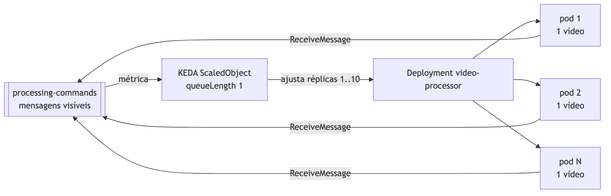

# ADR-009 — Worker Laravel no EKS escalado por KEDA (1 vídeo por pod, heartbeat de visibility)

- **Status:** Aceito, parcialmente substituído por [ADR-019](ADR-019-deploy-na-aws-academy-learner-lab.md)
- **Data:** 2026-11-16
- **Decisores:** Diego Fenille, Eduardo Santos
- **Relacionados:** RFC-005 (escala do processamento), [ADR-003](ADR-003-ddd-e-clean-architecture-nos-servicos-laravel.md), [ADR-007](ADR-007-amazon-sqs-como-mensageria.md), [ADR-008](ADR-008-saga-orquestrada-com-outbox-e-consumidores-idempotentes.md)

> **Atualização ([ADR-019](ADR-019-deploy-na-aws-academy-learner-lab.md)):** no lab não há EKS Pod Identity nem role própria: os pods do worker usam as credenciais da `LabRole` dos nós pelo IMDS (`http_put_response_hop_limit = 2`), e o KEDA usa a identidade do operador (`identityOwner: keda`). Os nós são on-demand `t3.large` (2 a 4), sem spot. O resto deste ADR continua.

## Contexto

O RF1 exige processar mais de um vídeo ao mesmo tempo. No projeto base, o `ffmpeg` roda dentro da requisição HTTP, sem limite de concorrência, e uploads no mesmo segundo colidem no timestamp.

Extrair frames é um trabalho pesado em CPU e disco, com duração proporcional ao tamanho do vídeo, que pode passar de vários minutos. A carga chega em rajadas: no pico a fila cresce e fora dele fica vazia. Também é preciso evitar que uma mensagem volte a ficar visível na fila enquanto o vídeo ainda está sendo processado, o que faria outro pod processá-lo de novo.

## Decisão

O `fiapx-video-processor` é um worker **PHP 8.4.27 + Laravel 13** com `ffmpeg` na imagem, rodando no **EKS** e escalado pelo **KEDA** com base no tamanho da fila `fiapx-<env>-processing-commands`.

- **Um vídeo por pod:** `php artisan processor:consume` faz `ReceiveMessage` com long polling de 20 s e uma mensagem por vez. A concorrência vem do número de pods.
- **KEDA `ScaledObject`:** trigger `aws-sqs-queue`, `queueLength: 1`, `minReplicaCount: 1`, `maxReplicaCount: 10`. O KEDA usa só `sqs:GetQueueAttributes`, com identidade IAM própria.
- **Heartbeat de visibility:** a visibility inicial da fila é 300 s. Enquanto o `ffmpeg` roda, o `VisibilityHeartbeat` chama `ChangeMessageVisibility` a cada 60 s, estendendo +300 s.
- **Fluxo:** `ProcessingStarted` → baixa `uploads/...` em stream para `/work` → `ffmpeg -i <video> -vf fps=1 -y <dir>/frame_%04d.png` → zip com `ZipArchive` em streaming → multipart upload para `results/{video_id}/frames.zip` → `VideoProcessed` em `saga-replies.fifo`. O `DeleteMessage` acontece **só depois** de subir o zip e publicar a resposta.
- **Idempotência:** se `results/{video_id}/frames.zip` já existir, o worker responde `VideoProcessed` sem reprocessar. O worker não tem banco.
- **Falha definitiva** (vídeo corrompido, sem frames): responde `VideoProcessingFailed` (`FFMPEG_ERROR`, `NO_FRAMES`...) e apaga a mensagem.
- **Falha transitória** (S3, rede): não apaga a mensagem, que volta à fila. Depois de 3 recebimentos (`maxReceiveCount = 3`) vai para a DLQ, e o timeout da saga cobre a compensação.
- **Disco:** `/work` em `emptyDir` com `sizeLimit` (ex.: 10Gi), limpo sempre no `finally`.
- **Graceful shutdown:** `SIGTERM` tratado com `pcntl`. O pod termina o vídeo atual e não pega novas mensagens, com `terminationGracePeriodSeconds` maior que o tempo máximo de processamento esperado.
- **Imagem:** `php:8.4.27-cli-alpine` + `ffmpeg` + extensões `zip` e `pcntl`, usuário não-root. Permissões IAM por EKS Pod Identity (ou IRSA): S3 get/put/delete nos prefixos próprios e SQS.

Diagrama mantido em [escalabilidade-e-resiliencia.md](../03-arquitetura/escalabilidade-e-resiliencia.md#escala-por-componente).

## Alternativas consideradas

| Alternativa | Por que não |
| --- | --- |
| HPA por CPU | A CPU não reflete o trabalho pendente: com fila cheia e poucos pods, a escala atrasa. Não escala pelo backlog |
| Lambda com imagem de container | Limite de 15 minutos e de disco temporário (10 GB). Vídeos longos podem não caber |
| AWS Batch | Bom para lotes, mas adiciona mais um orquestrador e a latência de subir jobs para cada vídeo |
| Vários vídeos por pod (pool de processos) | Concorrência mais difícil de controlar e de dimensionar em memória e disco. Uma falha afeta vários vídeos |
| Visibility fixa e longa (ex.: 2 h) | Se o pod morrer, a mensagem fica presa até a visibility expirar |

A comparação completa está na RFC-005.

## Consequências

### Positivas

- O número de pods acompanha o tamanho da fila: vários vídeos em paralelo (RF1), até 10 ao mesmo tempo.
- Requests e limits de CPU, memória e disco são previsíveis, porque cada pod processa um vídeo.
- Se um pod morrer, a mensagem volta à fila em até ~300 s e outro pod assume.
- Reaproveita a stack PHP e o padrão DDD do `video-api`.

### Negativas / riscos

- `minReplicaCount: 1` mantém um pod ligado mesmo sem trabalho.
- Imagem maior por causa do `ffmpeg`. Subir um pod novo leva alguns segundos.
- O teto de 10 pods limita o throughput em picos muito grandes (a fila absorve o excedente).
- Os nós do EKS precisam ter capacidade para 10 pods, senão eles ficam pendentes.

### Mitigações

- `minReplicaCount: 1` evita a latência de subir o primeiro pod e é ajustável.
- Dockerfile enxuto, usuário não-root e scan Trivy no CI ([ADR-012](ADR-012-ci-cd-com-github-actions-oidc-e-ordem-de-deploy.md)).
- O teste de carga com k6 (30 vídeos em 1 minuto) gera evidências do KEDA escalando e da fila sendo drenada.
- Alerta para `processing-commands` com mais de 50 mensagens por 10 min ([ADR-011](ADR-011-observabilidade-com-new-relic.md)).
