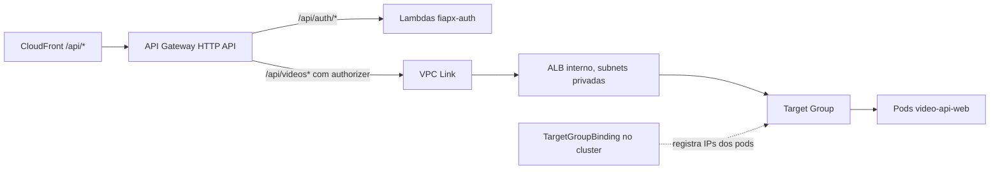

# ADR-010 — Exposição da API: API Gateway → VPC Link → ALB interno + TargetGroupBinding

- **Status:** Aceito
- **Data:** 2026-11-16
- **Decisores:** Diego Fenille, Eduardo Santos
- **Relacionados:** [ADR-001](ADR-001-polyrepo-e-integracao-via-ssm-parameter-store.md), [ADR-004](ADR-004-autenticacao-api-gateway-lambda-authorizer-jwt-rs256.md), [ADR-014](ADR-014-front-end-react-vite-em-s3-cloudfront-mesma-origem.md)

## Contexto

As rotas públicas têm dois destinos: as Lambdas do `fiapx-auth` (`/api/auth/*`) e o `video-api` no EKS (`/api/videos*`). Todas as rotas de vídeo precisam passar pelo Lambda Authorizer ([ADR-004](ADR-004-autenticacao-api-gateway-lambda-authorizer-jwt-rs256.md)), e o cluster não deve ficar exposto diretamente na internet.

Expor um serviço Kubernetes costuma ser feito com um `Ingress`, que faz o AWS Load Balancer Controller criar o ALB. Só que o API Gateway e o VPC Link são criados pelo Terraform e precisam do ARN do listener do ALB. Se o ALB nasce do Kubernetes, o Terraform depende de algo que só existe depois do deploy da aplicação, e a aplicação depende do Terraform para existir: um problema de "ovo e galinha" entre `fiapx-infra` e `fiapx-video-api`.

## Decisão

- Um **API Gateway HTTP API** é o ponto de entrada único das rotas `/api/*`, atrás do CloudFront ([ADR-014](ADR-014-front-end-react-vite-em-s3-cloudfront-mesma-origem.md)).
- `/api/videos*` é integrado por **VPC Link** a um **ALB interno** em subnets privadas, alcançável só pelo VPC Link.
- **O ALB, o listener e o Target Group são criados pelo Terraform** do `fiapx-infra` (módulo `edge`), junto com o stage, o VPC Link e os logs de acesso.
- O `fiapx-video-api` se registra no Target Group com um recurso **`TargetGroupBinding`** do **AWS Load Balancer Controller** (`k8s/targetgroupbinding`), apontando para o `Service` do `video-api-web`. O controller mantém os IPs dos pods registrados conforme o HPA escala (CPU 70%, 2 a 6 réplicas).
- A integração entre repositórios usa o SSM ([ADR-001](ADR-001-polyrepo-e-integracao-via-ssm-parameter-store.md)): `/fiapx/<env>/alb/target_group_arn`, `/fiapx/<env>/apigw/api_id` e `/fiapx/<env>/apigw/vpc_link_id`.
- As rotas `/api/auth/*` e o authorizer são criados pelo Terraform do `fiapx-auth` no mesmo API Gateway, lendo `api_id` do SSM.
- `/api/health/live` e `/api/health/ready` ficam sem authorizer e servem de probe do Kubernetes e smoke test pelo gateway. O `ready` testa banco e SQS.
- Rate limit configurado no stage do API Gateway.

## Alternativas consideradas

| Alternativa | Por que não |
| --- | --- |
| `Ingress` criando o ALB pelo Kubernetes | O ARN do listener só existe depois do deploy da aplicação, mas o Terraform do API Gateway precisa dele: dependência circular |
| ALB público, sem API Gateway | Perde o Lambda Authorizer, o rate limit do stage e o roteamento unificado com as Lambdas |
| `Service` tipo `LoadBalancer` (NLB) | Mesmo problema de ciclo de vida do `Ingress`: o balanceador nasce do Kubernetes, depois do Terraform |
| API Gateway REST API | Mais caro e com mais configuração. O HTTP API atende com payload 2.0 e authorizer com respostas simples |

## Consequências

### Positivas

- O Terraform cria toda a borda de uma vez, sem esperar o Kubernetes. O deploy da aplicação só registra os pods.
- O cluster não tem nenhum endpoint público: o tráfego entra só pelo API Gateway e pelo VPC Link.
- Autorização, rate limit e logs de acesso centralizados no API Gateway.

### Negativas / riscos

- Depende do AWS Load Balancer Controller instalado no cluster (`eks-addons`).
- O Target Group fica sem alvos até o primeiro deploy do `video-api`, e o gateway responde 503 nesse intervalo.
- Health check do Target Group e probes do Kubernetes precisam estar alinhados.
- O API Gateway mantém o limite de 30 s de timeout para as rotas de vídeo.

### Mitigações

- O controller é instalado via Helm pelo `fiapx-infra`, antes de qualquer deploy de aplicação ([ADR-012](ADR-012-ci-cd-com-github-actions-oidc-e-ordem-de-deploy.md)).
- A ordem de deploy garante `fiapx-infra` antes do `fiapx-video-api`, e o smoke test (`/api/health/ready` via gateway) confirma a integração.
- O health check do Target Group pode usar a mesma rota das probes (`/api/health/live`), mantendo os dois alinhados.
- As rotas de vídeo são leves: o upload vai direto ao S3 ([ADR-006](ADR-006-upload-direto-s3-e-inicio-da-saga-pelo-evento.md)) e o processamento é assíncrono.
