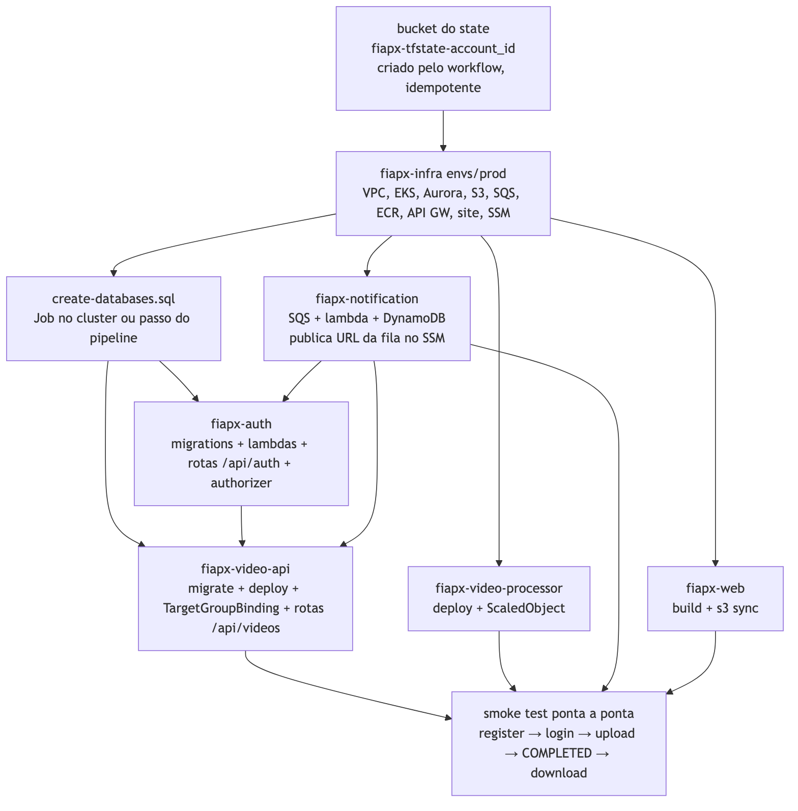

# ADR-012 — CI/CD com GitHub Actions + OIDC e ordem de deploy entre repositórios

- **Status:** Aceito
- **Data:** 2026-11-16
- **Decisores:** Diego Fenille, Eduardo Santos
- **Relacionados:** [ADR-001](ADR-001-polyrepo-e-integracao-via-ssm-parameter-store.md), [ADR-002](ADR-002-aws-e-terraform-com-backend-s3-e-lock-nativo.md), [ADR-016](ADR-016-terraform-apply-somente-via-github-actions.md)

## Contexto

O enunciado exige CI/CD (RT5) e testes que garantam a qualidade (RT4). São sete repositórios ([ADR-001](ADR-001-polyrepo-e-integracao-via-ssm-parameter-store.md)) com quatro tipos de deploy: Terraform, Lambdas, EKS e site estático no S3.

Chaves de acesso fixas da AWS guardadas no GitHub são um risco: vazam, não expiram e costumam ter permissão demais. Além disso, na primeira subida os serviços dependem de parâmetros publicados por outros repositórios, então existe uma ordem obrigatória.

O time tem dois integrantes, o que torna inviável exigir aprovação de outra pessoa em todo PR sem travar o trabalho.

## Decisão

### Plataforma e credenciais

- **GitHub Actions** em todos os repositórios.
- Autenticação na AWS por **OIDC → uma IAM Role por repositório**, criadas no `bootstrap` do `fiapx-infra`. Nenhuma access key fixa.

### Proteção da `main`

- **PR obrigatório** para chegar à `main`.
- **Aprovação opcional:** decisão do time. Qualquer integrante, **inclusive o autor**, pode fazer o merge.
- **Checks obrigatórios** (lint, testes, cobertura ≥ 80%, Quality Gate do SonarCloud) passam a ser exigidos na proteção da branch **quando o CI de cada repositório existir** (Etapa 8). Antes disso, só o PR é obrigatório.
- Acesso ao usuário `soat-architecture` em todos os repositórios.

### Pipelines por tipo de repositório

| Repositório | PR | Merge na `main` |
| --- | --- | --- |
| `fiapx-docs` | markdownlint, validação dos JSON Schemas, Spectral no OpenAPI | publica (GitHub Pages opcional) |
| `fiapx-infra` | `fmt -check`, `validate`, `tflint`, `checkov`, `plan` comentado no PR | `apply` no environment `prod` |
| `fiapx-auth`, `fiapx-notification` | eslint, jest (cov ≥ 80%), Sonar, `terraform plan` | build do zip → `terraform apply` → smoke test |
| `fiapx-web` | eslint, vitest (cov ≥ 80%), Sonar, build | build → `s3 sync` → invalidação do CloudFront → Playwright smoke |
| `fiapx-video-api` | pint, phpstan (nível 6+), phpunit (cov ≥ 80%, MySQL como service container), behat, Sonar, build + Trivy | push no ECR → Job `migrate` → `kustomize edit set image` → `kubectl apply -k` → `rollout status` → smoke `/api/health/ready` |
| `fiapx-video-processor` | pint, phpstan, phpunit (com `ffmpeg` real e vídeo de 3 s em `tests/fixtures`), Sonar, build + Trivy | push no ECR → `kubectl apply -k` → `rollout status` |

- Imagens com **tag = SHA do commit** e scan **Trivy** que falha em vulnerabilidade `CRITICAL`.
- Deploy em produção **só na `main`**, com o **GitHub Environment `prod`** (aprovação manual opcional no `terraform apply`). A política de apply está em [ADR-016](ADR-016-terraform-apply-somente-via-github-actions.md).
- Commits no padrão Conventional Commits, uma branch e um PR por etapa e repositório.

### Ordem de deploy (primeira subida)

Diagrama mantido em [fluxo-de-deploy.md](../06-deploy/fluxo-de-deploy.md#ordem-entre-repositórios-primeira-subida).
A subida e o destroy do ambiente inteiro nessa ordem são feitos pelo orquestrador do `fiapx-infra`
([ADR-018](ADR-018-orquestracao-do-deploy-no-github-actions.md)).

Depois da primeira subida, cada repositório faz deploy de forma independente.

**Rollback:** aplicação → `kubectl rollout undo` (ou reverter o PR, que reimplanta a imagem anterior); Lambdas → reverter o PR (alias ou versão anterior); infra → reverter o PR + `apply`.

## Alternativas consideradas

| Alternativa | Por que não |
| --- | --- |
| Access keys da AWS em GitHub Secrets | Credenciais de longa duração que podem vazar. O OIDC gera credenciais temporárias por execução |
| Uma role OIDC compartilhada por todos os repositórios | Viola o menor privilégio: o repositório do front-end poderia alterar o EKS |
| Aprovação obrigatória de outra pessoa em todo PR | Com dois integrantes, trava o fluxo quando um deles está indisponível |
| Exigir os checks desde a criação do repositório | Sem workflow, nenhum check existe e nenhum PR poderia ser mergeado |
| GitLab CI, Jenkins ou CodePipeline | O código já está no GitHub. Seria mais uma ferramenta para operar |

## Consequências

### Positivas

- Nenhuma credencial fixa da AWS fora da AWS. Cada repositório tem só as permissões de que precisa.
- Merge na `main` gera deploy automático, com smoke test no final.
- Qualidade garantida por checks automáticos (cobertura, Sonar, Trivy), não por revisão manual.

### Negativas / riscos

- Sem aprovação obrigatória, um integrante pode mergear sozinho uma mudança com problema.
- Até o CI existir, a `main` só exige PR, sem checks.
- A primeira subida exige seguir a ordem: um serviço que sobe antes do `fiapx-infra` falha por falta de parâmetros SSM.

### Mitigações

- Os checks obrigatórios e o `plan` comentado no PR substituem parte da revisão humana. O template de PR traz um checklist (inclusive a atualização do README).
- A Etapa 8 tem como DoD um PR com todos os checks verdes em cada repositório. A proteção da branch é atualizada nesse momento.
- Rollback documentado acima e em `06-deploy/fluxo-de-deploy.md`. O `prod` pode exigir aprovação manual no `terraform apply`.
- A ordem de deploy fica no diagrama acima e no `06-deploy/fluxo-de-deploy.md`.
