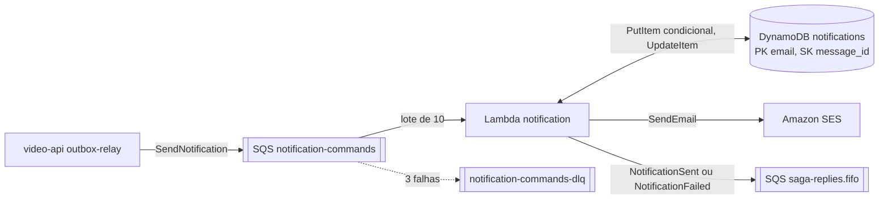

# ADR-013 — Notificação: SQS → Lambda Node.js → SES, com histórico e idempotência no DynamoDB (PK `email`, SK `message_id`)

- **Status:** Aceito, parcialmente substituído por [ADR-019](ADR-019-deploy-na-aws-academy-learner-lab.md)
- **Data:** 2026-11-16
- **Decisores:** Diego Fenille, Eduardo Santos
- **Relacionados:** RFC-008 (registro de notificações), [ADR-007](ADR-007-amazon-sqs-como-mensageria.md), [ADR-008](ADR-008-saga-orquestrada-com-outbox-e-consumidores-idempotentes.md), [ADR-015](ADR-015-remetente-de-email-dominio-proprio-e-sandbox-do-ses.md)

> **Atualização ([ADR-019](ADR-019-deploy-na-aws-academy-learner-lab.md)):** o e-mail sai por **SMTP autenticado (Nodemailer) num provedor externo**, o OCI Email Delivery ([ADR-020](ADR-020-email-pelo-oci-email-delivery.md); antes, o OCI Email Delivery), no lugar do SES. Credenciais no Secrets Manager (`fiapx/<env>/notification/smtp`), host e porta no SSM; localmente o mesmo adaptador aponta para o Mailpit. O handler opcional de eventos do SES (e os status `DELIVERED`, `BOUNCED` e `COMPLAINED`) deixa de existir, e o smoke test não usa mais o mailbox simulator. SQS → Lambda, histórico e idempotência no DynamoDB continuam.

## Contexto

O RF5 exige notificar o usuário em caso de erro. A notificação é o último passo da SAGA (`NotifyUser`, depois do ponto sem retorno): `VIDEO_FAILED` é obrigatório e `VIDEO_COMPLETED` é opcional.

Notificação é um bounded context próprio (Notificação, Destinatário, Modelo de mensagem), com carga baixa e intermitente. O comando `SendNotification` pode chegar duplicado (filas Standard entregam pelo menos uma vez), e o usuário não pode receber o mesmo e-mail duas vezes. O time também quer o histórico de **todos** os envios de um mesmo e-mail, com a partition key igual ao e-mail do destinatário.

## Decisão

O repositório `fiapx-notification` é um serviço autônomo, dono da **própria fila**, da **própria Lambda** e da **própria tabela NoSQL**:

- Fila `fiapx-<env>-notification-commands` (Standard, visibility 60 s) com DLQ `notification-commands-dlq` (`maxReceiveCount = 3`) e alarme. A URL é publicada em `/fiapx/<env>/sqs/notification-commands/url`.
- Lambda **Node.js 24** com event source mapping `batch_size = 10` e `function_response_types = ["ReportBatchItemFailures"]`.
- Envio via **Amazon SES** com configuration set. Localmente, `EMAIL_DRIVER=smtp` envia para o **Mailpit**; na AWS, `EMAIL_DRIVER=ses`.
- Resposta à SAGA em `saga-replies.fifo`: `NotificationSent` ou `NotificationFailed`.

### Tabela DynamoDB `fiapx-<env>-notifications`

| Atributo | Papel |
| --- | --- |
| `email` (S) | **Partition key**: destinatário, normalizado em minúsculas |
| `message_id` (S) | **Sort key**: id do `SendNotification`. Garante a idempotência |
| `created_at` (S) | Sort key do LSI `email-created_at-index` (histórico cronológico) |
| `status` (S) | `PENDING`, `SENT`, `FAILED`, `DELIVERED`, `BOUNCED`, `COMPLAINED` |
| `template`, `subject` | `VIDEO_FAILED` ou `VIDEO_COMPLETED`, assunto enviado |
| `video_id`, `saga_id`, `correlation_id` | rastreabilidade com a SAGA |
| `ses_message_id`, `attempts`, `last_error` | resultado do envio |
| `sent_at`, `updated_at`, `expires_at` | timestamps e **TTL de 90 dias** |

Billing `PAY_PER_REQUEST`, PITR ligado e criptografia padrão. Consultas: `Query email = X` no LSI (mais recentes primeiro) e `GetItem email + message_id`.

### Regras

- `PutItem` com status `PENDING` e condição `attribute_not_exists(message_id) OR #status = :failed`: só reenvia o que falhou.
- Mensagem duplicada de algo já enviado: responde `NotificationSent` sem reenviar o e-mail.
- Erro no SES: `status = FAILED`, `attempts + 1`, e o item volta para a fila (`ReportBatchItemFailures`). Na 3ª tentativa, `NotificationFailed` e a mensagem vai para a DLQ.
- O payload é validado contra o JSON Schema `SendNotification` (`fiapx-docs/contracts`). Payload inválido é registrado como `FAILED` e não é reenviado.
- Templates em pt-BR (`video-failed`, `video-completed`, HTML e texto), com nome do vídeo, motivo legível (`FFMPEG_ERROR` → "O arquivo de vídeo está corrompido ou em um formato que não conseguimos ler") e link para o front-end (`/fiapx/<env>/web/url`).
- Opcional: configuration set com destino de eventos (SNS ou EventBridge) → `ses-events-handler` atualiza o item para `DELIVERED`, `BOUNCED` ou `COMPLAINED`.

## Alternativas consideradas

| Alternativa | Por que não |
| --- | --- |
| Tabela no Aurora | Acopla a notificação ao banco relacional e a uma conexão na VPC. O acesso é sempre por chave, ideal para DynamoDB |
| Só logs | Não permite consultar o histórico por e-mail nem garantir idempotência |
| PK `email` sem sort key | Cada envio sobrescreveria o anterior e o histórico se perderia |
| Enviar e-mail direto do `video-api` | Mistura bounded contexts e prende o envio ao ciclo de deploy do EKS |
| Amazon SNS para e-mail | Exige assinatura confirmada pelo destinatário e não permite templates HTML próprios |

A comparação completa está na RFC-008.

## Consequências

### Positivas

- Usuário avisado de toda falha (RF5), sem e-mail duplicado.
- Histórico completo por e-mail, consultável em ordem cronológica, com limpeza automática pelo TTL.
- Custo proporcional ao uso (Lambda e DynamoDB on-demand).

### Negativas / riscos

- Entre o `SendEmail` e o `UpdateItem` para `SENT` existe uma janela: se a Lambda cair ali, o retry pode reenviar o e-mail.
- Um LSI precisa ser criado junto com a tabela e limita cada partition key a 10 GB.
- O SES em sandbox só envia para destinatários verificados ([ADR-015](ADR-015-remetente-de-email-dominio-proprio-e-sandbox-do-ses.md)).

### Mitigações

- Essa janela é pequena e um e-mail duplicado raro é aceitável para o caso. O `ses_message_id` gravado permite auditar.
- O LSI faz parte do Terraform desde a criação. O volume por e-mail é pequeno e expira em 90 dias.
- Testes com o mailbox simulator do SES e smoke test no pipeline (`success@simulator.amazonses.com` + conferência do item no DynamoDB).

## Atualização

O [ADR-017](ADR-017-recuperacao-e-troca-de-senha.md) acrescenta os templates `PASSWORD_RESET` e
`PASSWORD_CHANGED`, emitidos pelo `fiapx-auth` fora da saga (`saga_id` e `video_id` nulos). Para essas
mensagens a Lambda não publica resposta na `saga-replies.fifo`, e o `action_url` (que contém o token de
redefinição) não é gravado no DynamoDB nem em log.
