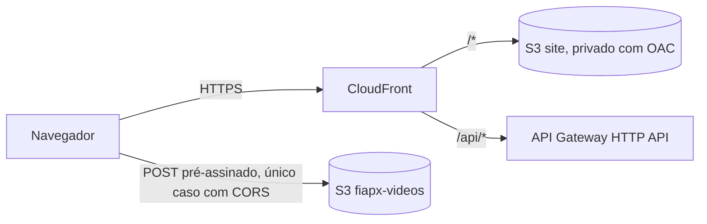

# ADR-014 — Front-end React + Vite em S3 + CloudFront, com `/api/*` na mesma origem

- **Status:** Aceito
- **Data:** 2026-11-16
- **Decisores:** Diego Fenille, Eduardo Santos
- **Relacionados:** RFC-009 (hospedagem do front-end), [ADR-004](ADR-004-autenticacao-api-gateway-lambda-authorizer-jwt-rs256.md), [ADR-006](ADR-006-upload-direto-s3-e-inicio-da-saga-pelo-evento.md), [ADR-010](ADR-010-api-gateway-vpc-link-alb-interno-e-targetgroupbinding.md)

## Contexto

No projeto base, a interface é uma página HTML embutida como string no `main.go`, e o CORS é `*`. A solução nova precisa de telas de cadastro, login, upload de vários vídeos com progresso, lista de status com atualização automática e download do zip, consumindo `/api/auth/*`, `/api/videos*` e o POST pré-assinado do S3.

Se o site e a API ficarem em domínios diferentes, cada chamada do navegador vira uma requisição cross-origin. Isso exige CORS no API Gateway, preflight `OPTIONS` antes de chamadas autenticadas e cuidado com headers como `Authorization`. O front-end é estático e não precisa de servidor.

## Decisão

- **SPA mínima em React + Vite + TypeScript + Tailwind**, no repositório `fiapx-web`. O layout inicial é gerado pelo time a partir do `Prompt-layout-web.md` e integrado aos contratos reais.
- **Hospedagem em S3 + CloudFront**: bucket do site privado, acessado só pelo CloudFront via OAC. Bucket e distribuição são criados pelo `fiapx-infra` (módulo `web-hosting`) e publicados em `/fiapx/<env>/web/bucket`, `/fiapx/<env>/web/cloudfront_distribution_id` e `/fiapx/<env>/web/url`.
- **Uma única origem para o usuário:** o CloudFront serve `/*` a partir do bucket do site e encaminha **`/api/*` para o API Gateway**, sem reescrita de caminho.
- Por isso **todas as rotas públicas ficam sob `/api`** (`/api/auth/register`, `/api/auth/login`, `/api/videos`...), no API Gateway e no Laravel (prefixo padrão de `routes/api.php`).
- `VITE_API_BASE_URL=/api`. **Sem CORS na API.**
- **Exceção:** o upload vai direto ao bucket de vídeos, que tem CORS só para `POST`, com origem igual ao domínio do CloudFront ([ADR-006](ADR-006-upload-direto-s3-e-inicio-da-saga-pelo-evento.md)).
- O upload usa `XMLHttpRequest` (o `fetch` não informa progresso de upload), com o arquivo como último campo do multipart.
- O token fica em memória + `sessionStorage`. Resposta 401 → volta para o login.
- **Modo mock** com MSW para desenvolver e demonstrar o layout sem back-end.
- **Testes:** Vitest + Testing Library (cobertura ≥ 80%) e um E2E com Playwright (login → upload → status).
- **Deploy:** `npm run build` → `aws s3 sync dist/` para o bucket → invalidação do CloudFront → Playwright smoke na URL pública.

## Alternativas consideradas

| Alternativa | Por que não |
| --- | --- |
| AWS Amplify Hosting | Mais um serviço e outro fluxo de deploy. Não permite, de forma tão direta, compor `/api/*` com o API Gateway na mesma distribuição criada pelo nosso Terraform |
| Container com nginx no EKS | Ocupa o cluster com conteúdo estático e adiciona deploy, HPA e imagem sem necessidade |
| Site e API em domínios diferentes, com CORS | Preflight em toda chamada autenticada e configuração de CORS no API Gateway, sem ganho |
| Next.js com SSR | Exige servidor. O front-end é mínimo e não precisa de SEO nem renderização no servidor |

A comparação completa está na RFC-009.

## Consequências

### Positivas

- Sem CORS na API e sem preflight: menos configuração e menos latência.
- Hospedagem estática barata, com cache na borda e HTTPS do CloudFront.
- Um único domínio para o usuário, o que também simplifica o CORS do bucket de vídeos.

### Negativas / riscos

- O CloudFront precisa repassar `Authorization` e não pode cachear `/api/*`. Uma configuração errada pode servir resposta de um usuário para outro.
- Invalidação do CloudFront a cada deploy. Arquivos antigos podem ficar em cache.
- O token em `sessionStorage` é acessível a JavaScript, o que exige atenção a XSS.

### Mitigações

- Comportamento `/api/*` com cache desabilitado e repasse de headers, query string e corpo, definido no Terraform do `web-hosting` e verificado pelo smoke test.
- Build do Vite com nomes de arquivo com hash, e invalidação no pipeline.
- React escapa conteúdo por padrão. O token expira em 1 hora ([ADR-004](ADR-004-autenticacao-api-gateway-lambda-authorizer-jwt-rs256.md)).
