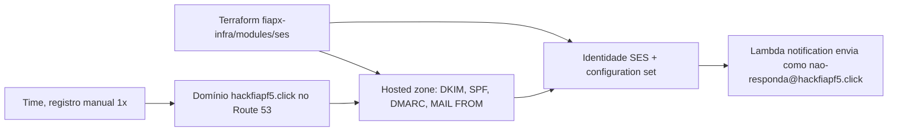

# ADR-015 — Remetente de e-mail: domínio próprio no Route 53 com DKIM/SPF/DMARC e uso do sandbox do SES

- **Status:** Substituído por [ADR-019](ADR-019-deploy-na-aws-academy-learner-lab.md)
- **Data:** 2026-11-16
- **Decisores:** Diego Fenille, Eduardo Santos
- **Relacionados:** [ADR-013](ADR-013-notificacao-sqs-lambda-ses-e-historico-no-dynamodb.md), [ADR-002](ADR-002-aws-e-terraform-com-backend-s3-e-lock-nativo.md)

> **Atualização ([ADR-019](ADR-019-deploy-na-aws-academy-learner-lab.md)):** este ADR deixou de valer. A AWS Academy Learner Lab nega o SES (e o Route 53 Domains), então não há domínio `hackfiapf5.click`, DKIM/SPF/DMARC nem sandbox. O e-mail sai por SMTP externo (OCI Email Delivery), com um remetente do time verificado no provedor. O texto abaixo fica como registro histórico.

## Contexto

A notificação de falha (RF5) é enviada por e-mail pelo Amazon SES ([ADR-013](ADR-013-notificacao-sqs-lambda-ses-e-historico-no-dynamodb.md)). O SES só envia a partir de uma identidade verificada (domínio ou endereço). Sem autenticação do domínio (DKIM, SPF e DMARC alinhados), os e-mails tendem a cair em spam ou ser rejeitados.

Toda conta nova do SES começa no **sandbox**: só envia para destinatários verificados, até 200 e-mails por dia. É preciso decidir de qual identidade o e-mail sai e como ela é autenticada.

## Decisão

**Opção A:** domínio novo **`hackfiapf5`**, registrado no Route 53 e verificado no SES pelo Terraform.

- **Domínio:** `hackfiapf5.click` (a extensão mais barata no Route 53). Antes de registrar, confere-se a disponibilidade com `aws route53domains check-domain-availability`. Se não estiver livre, tenta-se nesta ordem: **`hackfiapf5.link`** e **`hackfiapf5.com`**.
- **Remetente:** `nao-responda@hackfiapf5.click`, com nome de exibição "FIAP X". Publicado em `/fiapx/<env>/ses/from_address`.
- **MAIL FROM personalizado:** `mail.hackfiapf5.click`.
- **DKIM:** Easy DKIM do SES. **SPF** no MAIL FROM.
- **DMARC:** `v=DMARC1; p=quarantine; rua=mailto:dmarc@hackfiapf5.click`.
- **Configuration set** do SES, publicado em `/fiapx/<env>/ses/configuration_set`.
- **Responsabilidades:** o registro do domínio é **manual e feito uma única vez pelo time** (cobrança anual e contato do titular). A hosted zone, os registros DKIM/SPF/DMARC/MAIL FROM e a identidade SES ficam no Terraform (`fiapx-infra/modules/ses`).

> **Domínio efetivamente registrado:** a confirmar na **Etapa 7** (infra AWS). Se `hackfiapf5.click` não estiver disponível, este ADR será atualizado com o domínio usado (`hackfiapf5.link` ou `hackfiapf5.com`), e o remetente, o MAIL FROM e o DMARC mudam para o mesmo domínio.

### Sandbox do SES

- O projeto **permanece no sandbox**: isso basta para o hackathon. Os e-mails dos integrantes e das contas de demonstração são verificados como destinatários depois do `apply`.
- Pedir saída do sandbox é opcional (exige domínio, opção A ou B).
- **Testes automatizados e demonstração de falha** usam o **mailbox simulator do SES**, que funciona no sandbox e sem verificação: `success@simulator.amazonses.com`, `bounce@simulator.amazonses.com` e `complaint@simulator.amazonses.com`.
- Localmente, os e-mails vão para o **Mailpit** (`EMAIL_DRIVER=smtp`).

## Alternativas consideradas

| Opção | Custo | Prós | Contras |
| --- | --- | --- | --- |
| **A. Domínio novo no Route 53** (`hackfiapf5.click`), remetente `nao-responda@hackfiapf5.click` **(escolhida)** | ~US$ 3–15/ano + US$ 0,50/mês da hosted zone | Easy DKIM + SPF + DMARC alinhados, criados 100% pelo Terraform; e-mails não caem em spam; pode-se pedir saída do sandbox | Precisa registrar o domínio (uma vez) |
| B. Subdomínio de um domínio que o time já tenha (ex.: `fiapx.<dominio-existente>`) | zero | Mesmos prós da A | Depende de acesso ao DNS desse domínio |
| C. Gmail dedicado do projeto, verificado como *email identity* | zero | Rápido para começar | Sem DKIM do domínio: tende a cair em spam ou ser rejeitado (DMARC do Gmail); não serve para sair do sandbox |

## Consequências

### Positivas

- E-mails autenticados (DKIM, SPF e DMARC alinhados), com boa entregabilidade.
- Toda a configuração de DNS e SES é código, recriável depois de um `destroy`.
- O mailbox simulator permite testar sucesso, bounce e complaint sem e-mails reais.

### Negativas / riscos

- Custo anual do domínio e mensal da hosted zone.
- Um passo manual (registro) fora do Terraform.
- No sandbox, um usuário cadastrado com e-mail não verificado **não recebe** a notificação: o SES rejeita o envio.
- A propagação de DNS e a verificação DKIM podem levar algum tempo depois do `apply`.

### Mitigações

- O custo é baixo e entra na estimativa de custos de `06-deploy/ambientes.md`.
- O registro manual está na Etapa 7, com conferência da verificação DKIM no SES depois do apply.
- Nas demonstrações, usar e-mails verificados ou o mailbox simulator. O erro de envio é registrado no DynamoDB como `FAILED` e vira `NotificationFailed` para a SAGA ([ADR-013](ADR-013-notificacao-sqs-lambda-ses-e-historico-no-dynamodb.md)).
- A saída do sandbox pode ser pedida depois, já que o domínio próprio atende ao pré-requisito.
