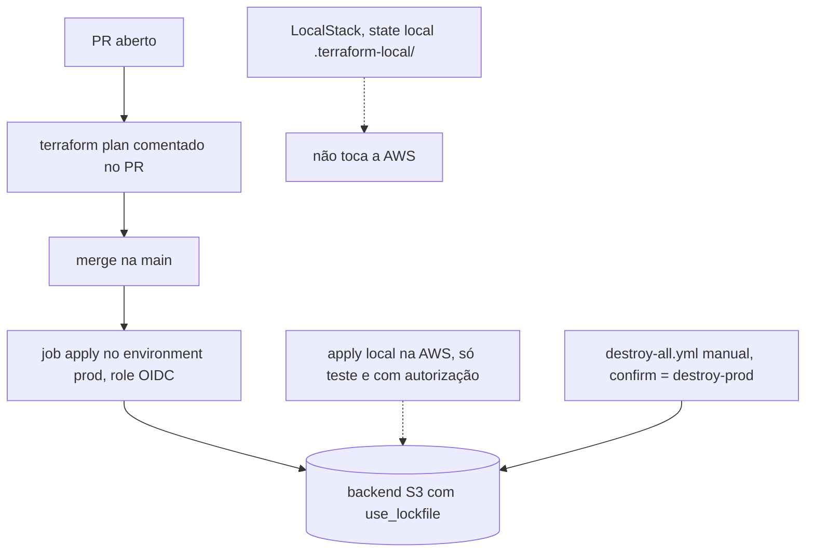

# ADR-016 — `terraform apply` somente via GitHub Actions; apply local apenas para testes (§11.5)

- **Status:** Aceito, parcialmente substituído por [ADR-019](ADR-019-deploy-na-aws-academy-learner-lab.md)
- **Data:** 2026-11-16
- **Decisores:** Diego Fenille, Eduardo Santos
- **Relacionados:** [ADR-002](ADR-002-aws-e-terraform-com-backend-s3-e-lock-nativo.md), [ADR-012](ADR-012-ci-cd-com-github-actions-oidc-e-ordem-de-deploy.md)

> "§11.5" no título refere-se à seção "Política de `terraform apply`" da especificação do projeto (`Projeto-hackton.md`).
>
> **Atualização ([ADR-019](ADR-019-deploy-na-aws-academy-learner-lab.md)):** a exceção do bootstrap acabou: **todo** `apply` na AWS é feito pelo GitHub Actions, sem exceção, e o próprio workflow cria o bucket do state. A autenticação é pelas credenciais do lab em GitHub Secrets, não por role OIDC. O apply local fica só no LocalStack (no lab não há perfil AWS SSO por integrante, e o SES deixou de existir). O destroy fora das demonstrações e o `prevent_destroy` continuam.

## Contexto

Três repositórios aplicam Terraform na mesma conta AWS: `fiapx-infra`, `fiapx-auth` e `fiapx-notification` (além do `infra/` de qualquer outro repositório que venha a ter). Se cada integrante aplicar mudanças da própria máquina, o ambiente real passa a divergir do código na `main`, um apply pode desfazer o do outro e fica difícil saber o que está de fato em produção.

Por outro lado, há recursos que o LocalStack não simula (EKS, SES de verdade), e às vezes é preciso testar contra a AWS antes de abrir o PR. O ambiente também precisa ser destruído fora das demonstrações para controlar o custo, sem perder dados por acidente.

## Decisão

O `terraform apply` na AWS acontece **pelo GitHub Actions**. Apply local é permitido só para testes, nas condições abaixo:

| Onde | Quando | Como |
| --- | --- | --- |
| **GitHub Actions (padrão)** | Todo merge na `main` de `fiapx-infra`, `fiapx-auth`, `fiapx-notification` (e o `infra/` de qualquer repo) | Job `apply` no environment `prod`, role OIDC do repositório, mesmo backend S3 com lock nativo. O PR sempre roda `plan` e comenta o resultado |
| **Destroy** | Fora das demonstrações | Workflow manual `destroy-all.yml` no `fiapx-infra`, com confirmação digitada (`input: confirm = "destroy-prod"`), que derruba todos os repositórios na ordem inversa ([ADR-018](ADR-018-orquestracao-do-deploy-no-github-actions.md)) |
| **Local — LocalStack** | Desenvolvimento e testes do Terraform a qualquer momento | `tflocal` ou provider apontando para `http://localhost:4566`, state local em `.terraform-local/` (no `.gitignore`) |
| **Local — AWS real** | **Só quando necessário para testar** algo que o LocalStack não cobre (ex.: EKS, SES de verdade) | Perfil AWS SSO do integrante, **mesmo backend remoto** (o lock evita colisão com o CI). Registrar no PR o que foi aplicado. O código precisa estar no PR antes ou logo depois, para o próximo apply do CI não reverter |

### Bloqueios

- O workflow de `apply` **nunca roda em PR de fork**.
- `prevent_destroy` no **Aurora**, no **bucket de vídeos** e na **tabela DynamoDB** `fiapx-<env>-notifications`.
- O `destroy-all.yml` desliga essas proteções por **variável explícita**.
- Apply local na AWS real exige **autorização do time**.
- O GitHub Environment `prod` pode exigir aprovação manual antes do `apply` (opcional, [ADR-012](ADR-012-ci-cd-com-github-actions-oidc-e-ordem-de-deploy.md)).
- **Exceção:** o `fiapx-infra/bootstrap/` (bucket do tfstate e roles OIDC) roda uma única vez, manualmente e com state local, porque é ele que cria o que o CI precisa para autenticar ([ADR-002](ADR-002-aws-e-terraform-com-backend-s3-e-lock-nativo.md)).

## Alternativas consideradas

| Alternativa | Por que não |
| --- | --- |
| Apply local livre por qualquer integrante | O ambiente diverge da `main` e um apply pode reverter o outro sem que ninguém perceba |
| Proibir totalmente o apply local | Impede testar o que o LocalStack não cobre (EKS, SES real) antes do PR |
| Terraform Cloud / HCP Terraform | Mais uma plataforma e outra forma de credencial. O GitHub Actions com OIDC já atende |
| Destroy pelo console da AWS ou local | Sem registro nem confirmação. Recursos com dados poderiam ser apagados por engano |

## Consequências

### Positivas

- A `main` reflete o que está na AWS. Todo apply tem `plan` revisável e log no GitHub.
- O lock nativo do S3 impede applies simultâneos (CI e integrante).
- Destroy controlado, com confirmação digitada, sem apagar dados por acidente.
- Desenvolvimento rápido no LocalStack, sem custo e sem risco para a AWS.

### Negativas / riscos

- Um apply local na AWS sem o código no PR é revertido pelo próximo apply do CI.
- Mudanças só chegam à AWS depois do merge, o que deixa o ciclo de teste na AWS mais lento.
- Se o lock ficar preso (job cancelado), os applies seguintes falham até a liberação.
- O `destroy-all.yml` com as proteções desligadas apaga dados de verdade.

### Mitigações

- Regra explícita: registrar no PR o que foi aplicado localmente e subir o código antes ou logo depois.
- LocalStack para a maior parte dos testes. Apply local na AWS só com autorização do time.
- O procedimento de `terraform force-unlock` deve constar no README do `fiapx-infra`.
- Confirmação digitada (`destroy-prod`) e variável explícita para desligar `prevent_destroy`. Procedimento descrito em `06-deploy/ambientes.md`.
