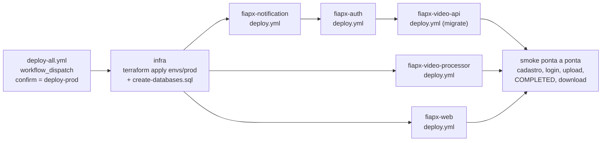

# ADR-018 — Orquestração do deploy do ambiente inteiro no GitHub Actions (`fiapx-infra`)

- **Status:** Aceito
- **Data:** 2026-11-16
- **Decisores:** Diego Fenille, Eduardo Santos
- **Relacionados:** [ADR-001](ADR-001-polyrepo-e-integracao-via-ssm-parameter-store.md), [ADR-012](ADR-012-ci-cd-com-github-actions-oidc-e-ordem-de-deploy.md), [ADR-016](ADR-016-terraform-apply-somente-via-github-actions.md)

> **Atualização ([ADR-019](ADR-019-deploy-na-aws-academy-learner-lab.md)):** sem OIDC, não há personalização do `sub` nem trust policy por `job_workflow_ref`: o `deploy.yml` de cada repositório, chamado pelo merge ou pelo orquestrador, usa as credenciais do lab dos GitHub Secrets da organização. Antes de cada `deploy-all` ou `destroy-all`, é preciso iniciar a sessão do lab e atualizar os 3 Secrets. O resto deste ADR continua.

## Contexto

O FIAP X tem 7 repositórios, e a primeira subida exige uma ordem: infraestrutura, notificação, auth,
video-api, processor e front-end ([ordem de deploy](../06-deploy/fluxo-de-deploy.md#ordem-entre-repositórios-primeira-subida)).
O ambiente `prod` é destruído fora das demonstrações para controlar o custo, então essa subida se repete
várias vezes (demonstrações, teste de carga e gravação do vídeo).

Sem orquestração, alguém precisa disparar 7 workflows na mão, esperar cada um terminar e conferir o
resultado antes do próximo. O destroy tem o mesmo problema, na ordem inversa. Isso é lento, sujeito a
erro e não deixa um registro único do que foi feito.

## Decisão

### Um orquestrador no `fiapx-infra`

Dois workflows manuais (`workflow_dispatch`) no `fiapx-infra`:

| Workflow | Confirmação digitada | O que faz |
|---|---|---|
| `deploy-all.yml` | `deploy-prod` | Sobe o ambiente inteiro, em ordem, e roda o smoke test ponta a ponta |
| `destroy-all.yml` | `destroy-prod` | Derruba tudo na ordem inversa (substitui o `destroy.yml` do ADR-016) |

O `deploy-all` aceita o input opcional `a_partir_de` (ex.: `video-api`) para retomar uma subida que
falhou no meio, sem refazer os passos que já passaram.

### Cada repositório expõe o próprio deploy como workflow reutilizável

Cada repositório de serviço tem um `deploy.yml` com dois gatilhos:

- `workflow_call`: chamado pelo orquestrador;
- `push` na `main`: chamado pelo merge (decisão do time: **todo merge na `main` faz deploy**).

O conteúdo do deploy fica em um lugar só e é o mesmo nos dois caminhos. O mesmo vale para `destroy.yml`
(`workflow_call`) nos repositórios que criam recursos (`fiapx-auth`, `fiapx-notification`,
`fiapx-video-api`, `fiapx-video-processor`, `fiapx-web`).



`fiapx-video-processor` e `fiapx-web` dependem só da infraestrutura e rodam em paralelo com a cadeia
notification → auth → video-api. O `destroy-all` segue o caminho inverso: web, processor e video-api
(`kubectl delete -k`, para o `TargetGroupBinding` liberar o ALB), auth, notification e por último a
infraestrutura, com o `prevent_destroy` desligado por variável explícita.

### Autenticação na AWS

Um workflow reutilizável roda no contexto de quem o chama. Por isso, o `sub` do token OIDC é
personalizado na organização para incluir o `job_workflow_ref`, e a role de cada serviço confia no
**workflow de deploy daquele serviço**, seja qual for o chamador:

```text
sub: repo:hackathon-fiap-soat/<chamador>:environment:prod:job_workflow_ref:hackathon-fiap-soat/fiapx-auth/.github/workflows/deploy.yml@refs/heads/main
```

Assim, a role do `fiapx-auth` só é assumida pelo `deploy.yml` do `fiapx-auth` na `main`, tanto no merge
quanto pelo orquestrador. O menor privilégio do ADR-012 continua valendo.

### Regras

- O workflow chamado faz `actions/checkout` com `repository:` explícito, porque, sem isso, o checkout pega
  o repositório do chamador.
- Os repositórios são públicos, então o orquestrador chama os workflows reutilizáveis sem token extra.
- Nenhum passo do deploy depende de estado local: tudo o que um serviço precisa vem do SSM
  ([parâmetros](../06-deploy/parametros-ssm.md)). Com o ambiente fora do ar, um deploy disparado por
  merge falha logo ao ler o SSM, com mensagem dizendo para rodar o `deploy-all`.
- O Terraform já tem lock nativo no S3 ([ADR-002](ADR-002-aws-e-terraform-com-backend-s3-e-lock-nativo.md)):
  um merge e o orquestrador nunca aplicam o mesmo state ao mesmo tempo.
- O resumo do job (`$GITHUB_STEP_SUMMARY`) do `deploy-all` lista cada etapa, a duração e a URL final do
  front-end.

## Alternativas consideradas

| Alternativa | Por que não |
|---|---|
| Disparar os workflows de cada repositório na mão | Lento e sujeito a erro; sem registro único da subida |
| `repository_dispatch` em cadeia entre repositórios | Precisa de token pessoal ou GitHub App para disparar outro repositório, e de *polling* para esperar cada um terminar |
| Repositório novo `fiapx-deploy` só para a orquestração | Um 8º repositório e mais uma role OIDC. O `fiapx-infra` já é o primeiro passo da ordem e já tem o destroy |
| Monorepo | Contraria o polyrepo do ADR-001 |
| Deploy só pelo orquestrador (merge não faz deploy) | O time decidiu que todo merge na `main` faz deploy |

## Consequências

### Positivas

- Um botão sobe o ambiente inteiro, na ordem certa, com um log único. Isso também ajuda na gravação do vídeo.
- O destroy fica simétrico e confiável, o que reduz o custo de manter o ambiente desligado.
- A lógica de deploy de cada serviço continua no próprio repositório, sem cópia no orquestrador.

### Negativas / riscos

- Um merge na `main` com o ambiente destruído gera um deploy que falha (vermelho no Actions).
- Mudar o `sub` do OIDC na organização afeta as trust policies de todas as roles.
- Uma mudança incompatível no `deploy.yml` de um serviço quebra o orquestrador.

### Mitigações

- Mensagem clara no deploy que falha por falta de parâmetros SSM; o time sabe que basta rodar o `deploy-all`.
- As trust policies são criadas pelo `fiapx-infra/bootstrap` junto com a personalização do `sub`.
- Os inputs do `deploy.yml` (só `ref` e `environment`) são documentados no README de cada repositório e
  mudam por PR.
