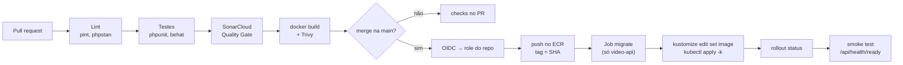
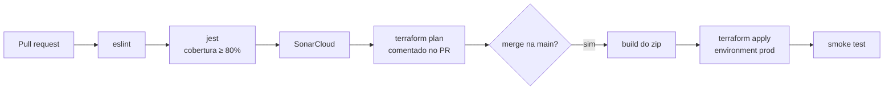
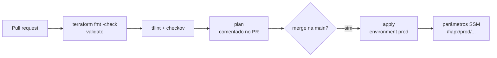
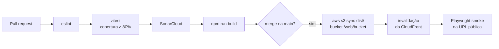
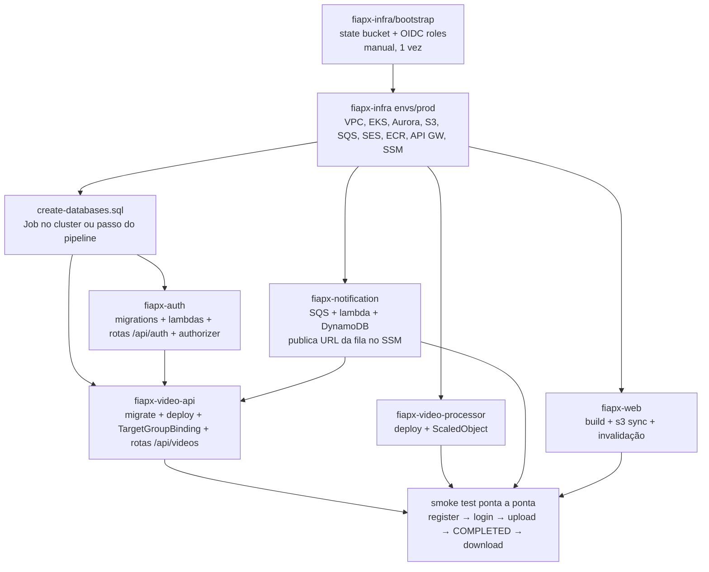

# Fluxo de deploy

Cada repositório tem a própria pipeline no GitHub Actions. A autenticação na AWS usa **OIDC**, com uma
IAM Role por repositório criada no `fiapx-infra/bootstrap`: não existe access key fixa.

## Princípios

- **Pull request obrigatório** para mudar a `main`. A aprovação é opcional (decisão do time): qualquer
  integrante, inclusive o autor, pode fazer o merge depois que os checks passarem.
- **Checks obrigatórios** em todo PR: lint, testes, cobertura ≥ 80% e Quality Gate do SonarCloud.
- **Deploy só na `main`**, com o GitHub Environment `prod`.
- **Imagens imutáveis:** tag igual ao SHA do commit, scan com Trivy (falha em `CRITICAL`).
- **`terraform apply` só pelo GitHub Actions.** Apply local só no LocalStack ou, quando um teste exigir a
  AWS real, seguindo a política do [ADR-016](../04-adrs/README.md).
- **Integração por SSM:** cada repositório lê de `/fiapx/<env>/...` os recursos criados por outro; nenhum
  usa `terraform_remote_state`.

## Pipelines por tipo de repositório

| Repositório | Pull request | Merge na `main` |
|---|---|---|
| `fiapx-docs` | markdownlint, validação dos JSON Schemas e exemplos, lint do OpenAPI (Spectral), renderização dos diagramas Mermaid | GitHub Pages (opcional) |
| `fiapx-infra` | `fmt -check`, `validate`, `tflint`, `checkov`, `plan` comentado no PR | `apply` no environment `prod` |
| `fiapx-auth` e `fiapx-notification` | eslint, jest (cobertura ≥ 80%), Sonar, `terraform plan` | build do zip → `terraform apply` → smoke test |
| `fiapx-web` | eslint, vitest (cobertura ≥ 80%), Sonar, build | build → `s3 sync` → invalidação do CloudFront → smoke com Playwright |
| `fiapx-video-api` | pint, phpstan (nível 6+), phpunit (cobertura ≥ 80%, MySQL como service container), behat (SAGA), Sonar, build + Trivy | push no ECR → Job `migrate` → `kustomize edit set image` → `kubectl apply -k` → `rollout status` → smoke test |
| `fiapx-video-processor` | pint, phpstan, phpunit (inclui integração com `ffmpeg` real e um vídeo de 3 s), Sonar, build + Trivy | push no ECR → `kustomize edit set image` → `kubectl apply -k` → `rollout status` |

### Aplicações no EKS (`fiapx-video-api` e `fiapx-video-processor`)

### Lambdas com Terraform (`fiapx-auth` e `fiapx-notification`)

Smoke tests: no `fiapx-auth`, cadastro e login de um usuário de teste; no `fiapx-notification`, envio
para `success@simulator.amazonses.com` e conferência do item `SENT` no DynamoDB.

### Infraestrutura (`fiapx-infra`)

### Front-end (`fiapx-web`)

## Ordem entre repositórios (primeira subida)

Por que essa ordem:

1. O `bootstrap` cria o bucket do state e as roles OIDC. Sem ele nenhuma pipeline autentica na AWS.
2. O `fiapx-infra` publica no SSM tudo o que os outros repositórios precisam.
3. Os databases precisam existir antes das migrations do `fiapx-auth` e do `fiapx-video-api`.
4. O `fiapx-video-api` depende do authorizer (`fiapx-auth`) para as rotas `/api/videos` e da fila
   `notification-commands` (`fiapx-notification`) para publicar `SendNotification`.

Depois da primeira subida, cada repositório faz deploy de forma independente.

## Mudanças de contrato

Mudança compatível (campo novo opcional) entra direto. Mudança incompatível sobe uma nova `version` no
envelope, e os consumidores aceitam as duas versões durante a transição:

1. O consumidor passa a aceitar `version` 1 e 2 (deploy primeiro).
2. O produtor passa a emitir a `version` 2.
3. Depois que as filas esvaziarem da `version` 1, o consumidor remove o suporte antigo.

## Rollback

| Tipo | Como |
|---|---|
| Aplicação no EKS | `kubectl rollout undo deployment/<nome>` ou reverter o PR (a pipeline reimplanta a imagem anterior) |
| Lambdas | Reverter o PR: o apply volta o código e o alias para a versão anterior |
| Infraestrutura | Reverter o PR e deixar o `apply` do CI rodar |
| Migration | Migrations são aditivas (expand/contract): a versão anterior da aplicação continua funcionando com o schema novo |
