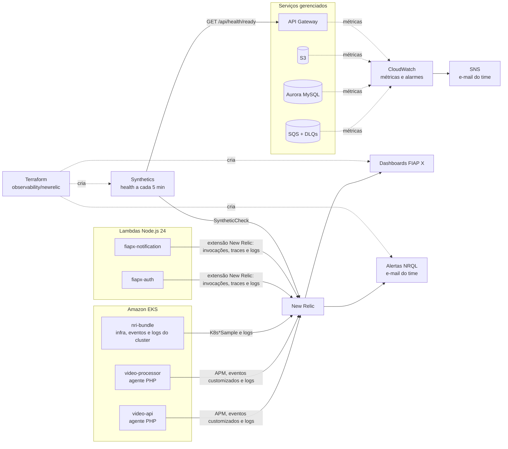

# Observabilidade

Como o FIAP X é observado: no New Relic, a instrumentação de cada camada, o padrão de logs, os eventos
customizados da SAGA, os dashboards, os alertas e o Synthetics; no CloudWatch, as métricas e os alarmes dos serviços
gerenciados. Fonte: `Projeto-hackton.md` §10, ADR-011 / RFC-010,
[ADR-019](../04-adrs/ADR-019-deploy-na-aws-academy-learner-lab.md) e
[ADR-021](../04-adrs/ADR-021-observabilidade-como-codigo-no-new-relic.md).

Na AWS Academy Learner Lab não é possível criar a role do CloudWatch Metric Streams nem a da integração da
conta AWS no New Relic (ADR-019). Por isso o New Relic fica com APM, Kubernetes, logs e Lambdas, e as
métricas de SQS, DLQs, Aurora e API Gateway ficam no CloudWatch.

## Visão geral



Atributo comum para seguir um vídeo de ponta a ponta: `video_id`, junto com `saga_id` e `correlation_id`
(presentes no envelope de todas as mensagens, ver [`contracts/`](../contracts/README.md)).

## Instrumentação por camada

| Camada | Instrumentação | Onde é configurada | O que chega no New Relic |
|---|---|---|---|
| EKS | Helm `nri-bundle` (infraestrutura, kube-state-metrics, eventos do Kubernetes, logs dos pods) | `fiapx-infra/modules/eks-addons` | `K8sClusterSample`, `K8sNodeSample`, `K8sPodSample`, `K8sDeploymentSample`, `K8sHpaSample`, `InfrastructureEvent`, `Log` |
| video-api e video-processor | Agente New Relic PHP na imagem Docker; logs JSON (Monolog `JsonFormatter`) no stdout | Dockerfile e `config/logging.php` de cada repositório | `Transaction`, `TransactionError`, `Span`, eventos customizados, `Log` (logs in context) |
| Lambdas (auth e notification) | Layer `NewRelicNodeJS24XARM64` (versão fixa) com a extensão e o agente Node.js; o handler vira `newrelic-lambda-wrapper.handler` e o original fica em `NEW_RELIC_LAMBDA_HANDLER`. A extensão lê a license key do segredo `fiapx/<env>/<repo>/newrelic` e envia direto, sem integração da conta AWS. Logs JSON no stdout | `infra/newrelic.tf` de cada repositório | `AwsLambdaInvocation`, `AwsLambdaInvocationError`, `Span`, `Log` |
| Disponibilidade externa | Monitor simples do New Relic Synthetics em `/api/health/ready`, a cada 5 minutos | `fiapx-infra/observability/newrelic` (só com o ambiente no ar) | `SyntheticCheck` |
| SQS, DLQs, Aurora, API Gateway, S3, DynamoDB | Métricas nativas do CloudWatch e alarmes com SNS (não chegam ao New Relic) | `fiapx-infra` e `fiapx-notification` (Terraform) | nada; ver [CloudWatch](#serviços-gerenciados-no-cloudwatch) |

Nomes das aplicações no APM (`newrelic.appname` / `NEW_RELIC_APP_NAME`): `fiapx-video-api`,
`fiapx-video-processor`, `fiapx-auth` e `fiapx-notification`. A license key fica no Secrets Manager e é
injetada como variável de ambiente; nunca vai para o repositório.

Os processos de linha de comando do `video-api` (`outbox:relay`, `saga:consume`, `schedule:run`) e o
`processor:consume` também rodam com o agente PHP:

- **Processos que não terminam** (`saga:consume`, `processor:consume`, `outbox:relay`): o agente só envia uma
  transação (e os eventos customizados dela) quando ela termina. Por isso cada mensagem processada vira uma
  transação *background* (`newrelic_start_transaction` / `newrelic_end_transaction`) com o nome do tipo da
  mensagem (ex.: `SagaConsumer/VideoProcessed`); no `outbox:relay`, cada ciclo que publicou algo
  (`OutboxRelay/publish`).
- **Processos curtos** (o CronJob `schedule:run`, a cada minuto): o daemon local do pod morreria antes de
  conectar e enviar. Eles usam o **daemon compartilhado** `newrelic-php-daemon` (Deployment + Service no
  namespace `fiapx`, imagem `newrelic/php-daemon`), com `NEW_RELIC_DAEMON_ADDRESS=newrelic-php-daemon:31339`
  e `newrelic.daemon.app_connect_timeout` para a primeira transação esperar a conexão do app.

## Padrão de logs

Todos os serviços escrevem **uma linha JSON por evento no stdout**. O agente (PHP), o `nri-bundle` (pods) ou a
layer (Lambda) encaminham para o New Relic com `trace.id`, `span.id` e `entity.guid` (logs in context).

Formato (o mesmo do Monolog `JsonFormatter`, também seguido pelas Lambdas Node.js para que as consultas
sejam iguais em todos os serviços):

```json
{
  "datetime": "2026-11-16T12:00:47.123456+00:00",
  "level_name": "INFO",
  "channel": "fiapx-video-api",
  "message": "Saga concluída",
  "context": {
    "env": "prod",
    "correlation_id": "0192f1c4-7a2b-7c3d-8e4f-5a6b7c8d9e10",
    "video_id": "0192f1c4-7a2b-7c3d-8e4f-5a6b7c8d9e0f",
    "saga_id": "0192f1c4-7d00-7e4f-8a5b-6c7d8e9f0a1d",
    "user_id": "0192f1c4-6a00-7b00-8c00-1d2e3f4a5b6c",
    "message_id": "0192f1c4-8004-7a00-9b00-000000000004",
    "message_type": "VideoProcessed"
  },
  "extra": {}
}
```

| Campo | Obrigatório | Descrição |
|---|---|---|
| `datetime` | sempre | ISO-8601 com fuso |
| `level_name` | sempre | `DEBUG`, `INFO`, `WARNING`, `ERROR`, `CRITICAL` |
| `channel` | sempre | Nome do serviço (`fiapx-video-api`, `fiapx-video-processor`, `fiapx-auth`, `fiapx-notification`) |
| `message` | sempre | Texto curto e estável (sem valores variáveis), para agrupar |
| `context.env` | sempre | `local` ou `prod` |
| `context.correlation_id` | sempre que existir | Vem do envelope; nas rotas HTTP, do `requestId` do API Gateway |
| `context.video_id` | quando houver vídeo | Id do vídeo |
| `context.saga_id` | quando houver saga | Id da saga |
| `context.user_id` | quando houver usuário | `sub` do JWT / header `x-user-id` |
| `context.message_id`, `context.message_type` | nos consumidores e produtores de mensagens | Campos do envelope |
| `context.error_code`, `context.exception` | em erros | Código de negócio e classe/stack da exceção |

No Laravel, um *processor* do Monolog preenche `context` a partir de um contexto por requisição/mensagem
(Infrastructure), para que use cases e controllers não precisem repetir os campos.

**Nunca registrar:** senha, JWT, chave privada, URL pré-assinada completa (a assinatura dá acesso ao arquivo),
`fields` do POST pré-assinado e o e-mail completo do usuário (usar `user_id`; na notification, mascarar como
`m***@example.com`).

Consulta típica (todos os logs de um vídeo, em ordem):

```sql
SELECT datetime, channel, level_name, message, context.saga_id, context.message_type
FROM Log
WHERE context.video_id = '0192f1c4-7a2b-7c3d-8e4f-5a6b7c8d9e0f'
SINCE 1 day ago LIMIT MAX
```

## Eventos customizados

### `VideoSagaTransition` (video-api)

Registrado a cada mudança de estado da saga ou de status do vídeo, depois do commit da transação
(`newrelic_record_custom_event`, pela porta `Telemetry` com o adapter `NewRelicTelemetry` na Infrastructure).
Mensagem duplicada, ignorada ou descartada (rollback) não gera evento. O `saga:consume` não termina, então cada
mensagem é uma transação de background (`SagaConsumer/<tipo>`): o agente envia os eventos quando ela fecha.

| Atributo | Tipo | Descrição |
|---|---|---|
| `video_id` | string | Id do vídeo |
| `saga_id` | string | Id da saga (vazio nas transições de vídeo sem saga, ver abaixo) |
| `correlation_id` | string | Do envelope |
| `user_id` | string | Dono do vídeo |
| `from_state` | string | Estado da saga antes (`NONE` na criação) |
| `to_state` | string | Estado da saga depois (`STARTED`, `UPLOAD_VALIDATED`, `QUOTA_RESERVED`, `PROCESSING_REQUESTED`, `PROCESSING`, `COMPLETED`, `NOTIFIED`, `COMPENSATING`, `COMPENSATED`) |
| `step` | string | Passo em execução na transição (`ValidateUpload`, `ReserveQuota`, `ProcessVideo`, `CompleteVideo`, `NotifyUser`) ou, ao entrar em `COMPENSATING`, a compensação iniciada (`DeleteUploadedObject`, `ReleaseQuota`, `CleanupArtifacts`) |
| `duration_ms` | número | Tempo que a saga ficou em `from_state` (0 em `NONE → STARTED` e na criação do vídeo; na expiração, o tempo em `PENDING_UPLOAD`) |
| `video_status` | string | Status do vídeo no fim da transação (`PENDING_UPLOAD` … `EXPIRED`); as transições do início da saga saem todas com `QUEUED` |
| `trigger` | string | O que causou a transição: tipo da mensagem recebida, `S3ObjectCreated`, `Timeout`, `POST /api/videos` (criação) ou `videos:expire-pending` (expiração) |
| `failure_reason` | string | Motivo da falha (`INVALID_UPLOAD`, `QUOTA_EXCEEDED`, `FFMPEG_ERROR`, `NO_FRAMES`, `DOWNLOAD_ERROR`, `UPLOAD_ERROR`, `PROCESSING_TIMEOUT`), só nas falhas |

Transições do vídeo fora da saga (criação em `PENDING_UPLOAD` pelo `POST /api/videos` e expiração em
`EXPIRED`) também geram o evento, com `saga_id`, `from_state` e `to_state` vazios e `step` igual a
`RequestVideoUpload` ou `ExpirePendingUpload`. Assim o widget "Vídeos por status" cobre todos os status.

### `VideoProcessed` (video-processor)

Registrado quando o zip foi gravado no S3, antes de publicar a resposta `VideoProcessed`.

| Atributo | Tipo | Descrição |
|---|---|---|
| `video_id`, `saga_id`, `correlation_id` | string | Do envelope do `ProcessVideo` |
| `worker_id` | string | Nome do pod |
| `duration_ms` | número | Duração total (download + `ffmpeg` + zip + upload) |
| `ffmpeg_ms` | número | Só a extração dos frames |
| `frame_count` | número | Frames no zip |
| `video_size_bytes` | número | Tamanho do vídeo baixado |
| `zip_size_bytes` | número | Tamanho do zip |
| `reused` | booleano | `true` quando o zip já existia (worker idempotente) e não houve reprocessamento |

No caminho reaproveitado (`reused = true`), `duration_ms` vem dos metadados do zip existente e `ffmpeg_ms` e
`video_size_bytes` são 0. Por isso as consultas de tempo de processamento filtram `WHERE reused IS false`.

### `SagaTimeoutCheck` (video-api, apoio aos alertas)

O New Relic não consulta o Aurora, então "sagas presas" é medido pelo próprio `saga:check-timeouts`
(a cada minuto): antes de compensar, ele conta as sagas em `PROCESSING_REQUESTED` ou `PROCESSING` com
`deadline_at` vencido (os mesmos estados que ele compensa).

| Atributo | Tipo | Descrição |
|---|---|---|
| `overdue_count` | número | Sagas em `PROCESSING_REQUESTED` ou `PROCESSING` com `deadline_at` vencido no início da execução |
| `compensated_count` | número | Sagas cuja compensação foi disparada nessa execução |

Se `overdue_count` continua acima de zero minuto após minuto, a compensação não está andando (relay parado,
fila travada ou erro no consumidor).

## Dashboards

Os dashboards, os alertas e o monitor Synthetics são criados pelo Terraform (ADR-021), na stack
[`fiapx-infra/observability/newrelic`](https://github.com/hackathon-fiap-soat/fiapx-infra/tree/main/observability/newrelic), aplicada pelo `deploy-all` depois do smoke e destruída
pelo `destroy-all`. Os dashboards ficam em JSON no formato de export do New Relic
(`dashboards/*.json.tftpl`, com o id da conta como variável): mudar um widget é mudar o JSON e abrir PR.

| Dashboard | Páginas | Para quê |
|---|---|---|
| **FIAP X — Processamento de vídeos** | "Processamento" e "Worker, API e Lambdas" | Saúde da SAGA, tempo de processamento, falhas, worker, `video-api` e Lambdas |
| **FIAP X — Kubernetes (EKS)** | "Cluster fiapx-prod" | Nós, pods, réplicas (KEDA), CPU e memória por container e eventos do cluster |

Filas, DLQs, Aurora e API Gateway não estão neles: ficam no CloudWatch. Os nomes do cluster e das funções
assumem o ambiente `prod` (`fiapx-prod*`).

## Consultas dos widgets

As consultas abaixo são as mesmas dos JSON dos dashboards.

### Página "Processamento"

**Vídeos por status (hoje)** (`viz.pie`)

```sql
SELECT count(*) AS 'Vídeos' FROM (SELECT latest(video_status) AS status FROM VideoSagaTransition WHERE video_id IS NOT NULL FACET video_id LIMIT MAX) FACET status SINCE today
```

**Taxa de falha (24 h)** (`viz.billboard`)

```sql
SELECT percentage(count(*), WHERE to_state = 'COMPENSATED') AS 'Falhas (%)' FROM VideoSagaTransition WHERE to_state IN ('COMPLETED', 'COMPENSATED') SINCE 1 day ago
```

**Throughput de uploads** (`viz.line`)

```sql
SELECT count(*) AS 'Envios solicitados' FROM Transaction WHERE appName = 'fiapx-video-api' AND request.method = 'POST' AND request.uri = '/api/videos' TIMESERIES 5 minutes SINCE 6 hours ago
SELECT count(*) AS 'Uploads recebidos (saga iniciada)' FROM VideoSagaTransition WHERE to_state = 'STARTED' TIMESERIES 5 minutes SINCE 6 hours ago
```

**Tempo de processamento p50/p95 (s)** (`viz.line`)

```sql
SELECT percentile(duration_ms / 1000, 50, 95) FROM VideoProcessed WHERE reused IS false TIMESERIES 15 minutes SINCE 1 day ago
```

**Taxa de falha ao longo do tempo (%)** (`viz.line`)

```sql
SELECT percentage(count(*), WHERE to_state = 'COMPENSATED') AS 'Falhas (%)' FROM VideoSagaTransition WHERE to_state IN ('COMPLETED', 'COMPENSATED') TIMESERIES 15 minutes SINCE 1 day ago
```

**Motivos de falha (24 h)** (`viz.bar`)

```sql
SELECT count(*) AS 'Falhas' FROM VideoSagaTransition WHERE to_state = 'COMPENSATED' FACET failure_reason SINCE 1 day ago
```

**Sagas presas (PROCESSING com deadline vencido)** (`viz.billboard`)

```sql
SELECT latest(overdue_count) AS 'Sagas vencidas' FROM SagaTimeoutCheck SINCE 30 minutes ago
```

**Sagas vencidas ao longo do tempo** (`viz.line`)

```sql
SELECT max(overdue_count) AS 'Vencidas', sum(compensated_count) AS 'Compensadas por timeout' FROM SagaTimeoutCheck TIMESERIES 5 minutes SINCE 1 day ago
```

### Página "Worker, API e Lambdas"

**Filas e serviços gerenciados** (`viz.markdown`): lembra que filas, DLQs, Aurora e API Gateway ficam no
CloudWatch.

**Réplicas do worker (KEDA)** (`viz.line`)

```sql
SELECT latest(podsAvailable) AS 'Pods disponíveis', latest(podsDesired) AS 'Pods desejados' FROM K8sDeploymentSample WHERE clusterName LIKE 'fiapx-prod%' AND deploymentName LIKE '%video-processor%' TIMESERIES 1 minute SINCE 6 hours ago
```

Na demonstração de carga, este gráfico é mostrado ao lado do gráfico de `ApproximateNumberOfMessagesVisible`
da fila `processing-commands` no CloudWatch.

**video-api — latência p50/p95 (s)** (`viz.line`)

```sql
SELECT percentile(duration, 50, 95) FROM Transaction WHERE appName = 'fiapx-video-api' AND transactionType = 'Web' TIMESERIES 5 minutes SINCE 6 hours ago
```

**video-api — taxa de erro 5xx (%)** (`viz.line`)

```sql
SELECT percentage(count(*), WHERE http.statusCode >= 500) AS '5xx (%)' FROM Transaction WHERE appName = 'fiapx-video-api' AND transactionType = 'Web' TIMESERIES 5 minutes SINCE 6 hours ago
```

**Lambdas — invocações e erros** (`viz.table`)

```sql
SELECT count(*) AS 'Invocações', filter(count(*), WHERE error IS true) AS 'Erros', average(duration) * 1000 AS 'Duração média (ms)' FROM AwsLambdaInvocation WHERE aws.lambda.arn LIKE '%:function:fiapx-prod-%' FACET name SINCE 1 day ago
```

Sem a integração da conta AWS, os eventos das Lambdas não têm `entityName`: o filtro usa `aws.lambda.arn` e o
facet usa `name` (`WebTransaction/Function/<função>` ou `OtherTransaction/Function/<função>`).

### Dashboard "FIAP X — Kubernetes (EKS)"

Todas as consultas filtram `clusterName = 'fiapx-prod'` e, onde indicado, `namespaceName = 'fiapx'`.

| Widget | Visualização | Consulta (resumida) |
|---|---|---|
| Nós | `viz.billboard` | `SELECT uniqueCount(nodeName) FROM K8sNodeSample` |
| Pods rodando (fiapx) | `viz.billboard` | `SELECT uniqueCount(podName) FROM K8sPodSample WHERE status = 'Running'` |
| Pods pendentes | `viz.billboard` | `SELECT uniqueCount(podName) FROM K8sPodSample WHERE status = 'Pending' AND createdKind != 'Job'` |
| Restarts de container (1 h) | `viz.billboard` | `SELECT sum(restartCountDelta) FROM K8sContainerSample` |
| CPU e memória dos nós (%) | `viz.line` | `SELECT average(allocatableCpuCoresUtilization)` / `average(allocatableMemoryUtilization) FROM K8sNodeSample FACET nodeName` |
| Réplicas por deployment | `viz.line` | `SELECT latest(podsAvailable) FROM K8sDeploymentSample FACET deploymentName` |
| Worker (KEDA): desejados x disponíveis | `viz.line` | `SELECT latest(podsDesired), latest(podsAvailable) FROM K8sDeploymentSample WHERE deploymentName = 'video-processor'` |
| CPU e memória por container | `viz.line` | `SELECT average(cpuUsedCores)` / `average(memoryWorkingSetBytes) / 1e6 FROM K8sContainerSample FACET containerName` |
| Pods da aplicação | `viz.table` | `SELECT latest(status), latest(nodeName) FROM K8sPodSample FACET podName, deploymentName` |
| Containers: uso x reserva | `viz.table` | `SELECT average(cpuUsedCores), latest(cpuRequestedCores), average(memoryWorkingSetBytes)/1e6, latest(memoryLimitBytes)/1e6, sum(restartCountDelta) FROM K8sContainerSample FACET podName, containerName` |
| Eventos do Kubernetes | `viz.table` | ``SELECT `event.involvedObject.name`, `event.reason`, `event.message` FROM InfrastructureEvent WHERE category = 'kubernetes' AND `event.reason` IS NOT NULL`` |

Atributos com ponto no nome (`event.reason`) precisam de crase no NRQL; sem o filtro `IS NOT NULL`, entram
as linhas de mudança de inventário, que não têm os campos do evento.

## Alertas

Os alertas ficam em dois lugares: as condições NRQL sobre dados que o New Relic recebe (APM, eventos
customizados) e os alarmes do CloudWatch sobre os serviços gerenciados.

### New Relic

Condições NRQL na política **FIAP X — prod**, criadas pelo Terraform (ADR-021). Toda condição abre um
*issue* que o *workflow* "FIAP X — e-mail do time" envia aos endereços do Secret `ALERT_EMAILS` (os mesmos do
SNS do CloudWatch).

| Alerta | Condição NRQL | Threshold (crítico) | Ação esperada |
|---|---|---|---|
| Taxa de falha de processamento | `SELECT percentage(count(*), WHERE to_state = 'COMPENSATED') FROM VideoSagaTransition WHERE to_state IN ('COMPLETED', 'COMPENSATED')` | `> 10` (%) com janela de 15 minutos | Ver "Motivos de falha" e os logs do `fiapx-video-processor` |
| Erros 5xx no video-api | `SELECT percentage(count(*), WHERE http.statusCode >= 500) FROM Transaction WHERE appName = 'fiapx-video-api' AND transactionType = 'Web'` | `> 2` (%) por 5 minutos | Ver `TransactionError` e logs do `video-api` |
| Sagas vencidas | `SELECT max(overdue_count) FROM SagaTimeoutCheck` | `> 0` por 5 minutos; *loss of signal* em 10 minutos | Conferir `outbox-relay`, `saga-consumer` e CronJob (sem sinal: o CronJob parou ou o daemon compartilhado caiu) |
| Pod pendente | `SELECT uniqueCount(podName) FROM K8sPodSample WHERE clusterName = 'fiapx-prod' AND status = 'Pending' AND createdKind != 'Job'` | `> 0` por 10 minutos | Falta de CPU ou memória nos nós (ver "Eventos do Kubernetes"); rajadas curtas do KEDA não disparam |
| Falha no envio de e-mail | `SELECT count(*) FROM AwsLambdaInvocationError WHERE aws.lambda.arn LIKE '%:function:fiapx-prod-notification'` | `> 0` em 5 minutos | Logs da Lambda `fiapx-prod-notification`, credenciais SMTP e itens `FAILED` no DynamoDB |
| API fora do ar (Synthetics) | `SELECT count(*) FROM SyntheticCheck WHERE monitorName = 'FIAP X — health (prod)' AND result = 'FAILED'` | `> 0` em 10 minutos | Conferir o API Gateway, o ALB e os pods do `video-api` |

### Synthetics

Monitor **simples** (ping HTTP) "FIAP X — health (prod)" em `GET <API>/api/health/ready`, a cada 5 minutos, de
`US_EAST_1`. O endereço vem do SSM (`/fiapx/prod/apigw/url`) e muda a cada sessão do lab; por isso o
monitor é criado pelo `deploy-all` e removido pelo `destroy-all`, sem alarme falso com o ambiente desligado.

### CloudWatch

Alarmes criados pelo Terraform (`fiapx-infra/modules/messaging` e `edge`; a DLQ da
`notification-commands` no `fiapx-notification/infra`), todos publicando num tópico SNS com assinatura de
e-mail do time. Cada integrante confirma a assinatura no e-mail que a AWS envia
depois de cada subida do ambiente.

| Alarme | Métrica (namespace) | Threshold | Ação esperada |
|---|---|---|---|
| Mensagem em DLQ (um por DLQ) | `ApproximateNumberOfMessagesVisible` (`AWS/SQS`) | `> 0` em 1 minuto | Ler a mensagem, corrigir a causa e reprocessar (redrive) |
| Fila `processing-commands` acumulada | `ApproximateNumberOfMessagesVisible` (`AWS/SQS`) | `> 50` por 10 minutos | Conferir KEDA (`maxReplicaCount`), nós do EKS e erros no worker |
| Erros 5xx no API Gateway | `5xx` (`AWS/ApiGateway`) | `> 2%` das requisições (*metric math* com `Count`) por 5 minutos | Ver Lambdas de auth, ALB e `video-api` |

## Serviços gerenciados no CloudWatch

Sem CloudWatch Metric Streams, as métricas dos serviços gerenciados são consultadas direto no console do
CloudWatch (*Metrics* e *Alarms*), sem custo extra:

| Namespace | Métricas usadas | Para quê |
|---|---|---|
| `AWS/SQS` | `ApproximateNumberOfMessagesVisible`, `ApproximateAgeOfOldestMessage`, `NumberOfMessagesSent` | Profundidade das filas e das DLQs; evidência da fila crescendo no teste de carga |
| `AWS/RDS` | `CPUUtilization`, `FreeableMemory`, `DatabaseConnections` | Uso da instância do Aurora (`db.t3.medium`) |
| `AWS/ApiGateway` | `Count`, `4xx`, `5xx`, `Latency`, `IntegrationLatency` | Latência e erros do gateway |
| `AWS/S3` | `BucketSizeBytes`, `NumberOfObjects` (diárias) | Volume de vídeos e zips |

As Lambdas também publicam `AWS/Lambda` no CloudWatch, mas a fonte principal delas é a extensão do New
Relic. As métricas de requisição do S3 não são habilitadas, para não gerar custo.

## Como seguir um vídeo ponta a ponta

1. Pegue o `video_id` na tela "Meus vídeos" ou na resposta do `POST /api/videos`.
2. Transições da saga:
   `SELECT timestamp, from_state, to_state, step, trigger, duration_ms FROM VideoSagaTransition WHERE video_id = '<id>' SINCE 1 day ago`.
3. Processamento: `SELECT * FROM VideoProcessed WHERE video_id = '<id>' SINCE 1 day ago`.
4. Logs de todos os serviços: `SELECT * FROM Log WHERE context.video_id = '<id>' SINCE 1 day ago`.
